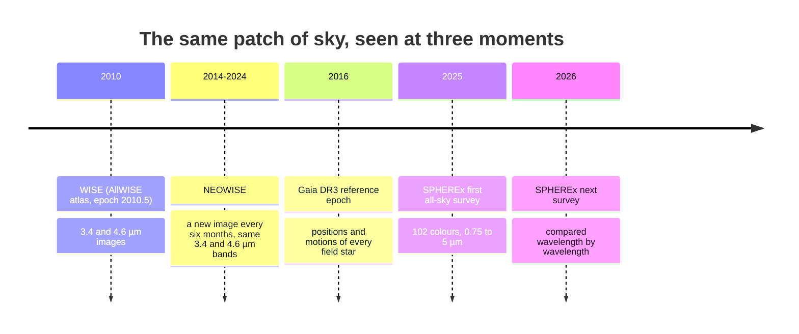
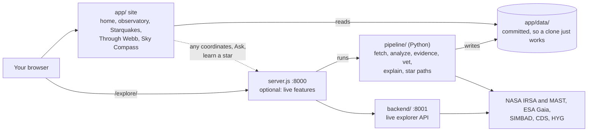
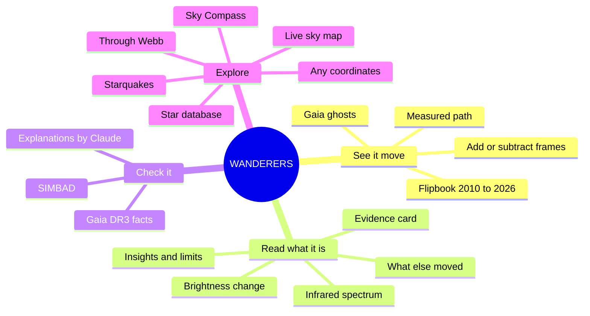
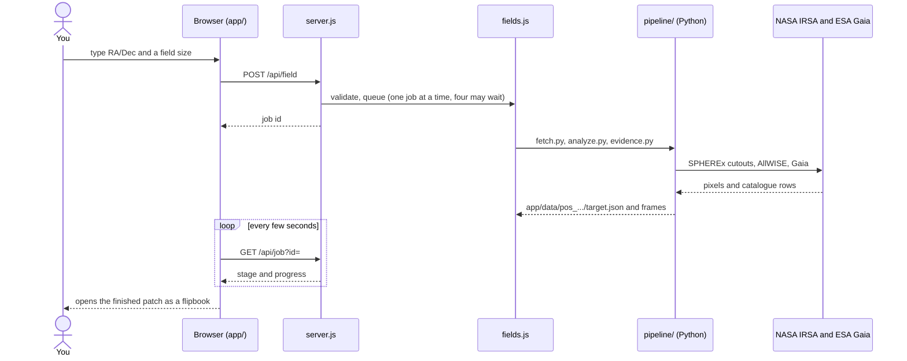

# WANDERERS

> Catch what moves in the infrared sky, then read what it is made of.

**NASA Space Apps 2026 · Challenge: Planet X and SPHEREx · Team Hello Universe (Seattle)**

**Live:** https://rajryadav4.github.io/wanderers/ · **Sky Compass (phone):** https://rajryadav4.github.io/wanderers/compass.html

<p align="center">
  
  
  
</p>
<p align="center">
  
  
  
  
  
  
  
  
  
  
  
  
  
</p>


<p align="center">
  <br>
  <sub><b>Scan to open WANDERERS on your phone</b> (the live site above)</sub>
</p>

Pluto was found by flipping between two photos of the sky and spotting the dot that moved. WANDERERS does
that with real infrared data spanning 2010 to 2026, then goes one step further: it uses SPHEREx's
102-colour spectrum to show *what* the moving or changing object is likely to be, with every piece of
evidence on screen. Unmatched objects are called **candidates, never discoveries**.

## The challenge requirements, one by one

Each row says what WANDERERS does, where to see it on the live site, and where the code and tests are.

| # | Requirement | What WANDERERS does | See it live | Code |
|---|---|---|---|---|
| 1 | **Automatic SPHEREx data updates**, showing the current release and the last sync | `pipeline/spherex_releases.py` asks NASA IRSA which SPHEREx releases exist and records how recent our prepared targets are. Every page shows one line, e.g. *SPHEREx Quick Release 3 · data through Sep 2026 · last synced 15 Nov 2026 · checked …*, and says when a newer release has data our targets lack. A weekly GitHub Action re-runs the pipeline when a release appears and opens a pull request with the refreshed data. | [Home](https://rajryadav4.github.io/wanderers/) and [explorer](https://rajryadav4.github.io/wanderers/observatory.html?target=wise0855): the "SPHEREx data" line | `pipeline/spherex_releases.py`, `.github/workflows/spherex-sync.yml`, `app/release.js`, `app/data/spherex_release.json` · [details](#keeping-the-spherex-data-current) |
| 2 | **Combine the six SPHEREx detectors**, with a switch between individual and combined | A combined channel, *All 6 detectors combined (0.75–5.0 µm)*: each detector's co-add is divided by its own noise, then summed, so no detector dominates and faint objects gain signal-to-noise. The explorer switches between **Individual detectors** (D1–D6) and **Combined (all 6)**; the choice is kept in the link. | [WISE 0855, combined](https://rajryadav4.github.io/wanderers/observatory.html?target=wise0855&ch=all) | `pipeline/analyze.py`, `app/app.js`, `app/frameinfo.js` · [details](#frame-details-and-data-flags) |
| 3 | **Contamination and observation metadata**, clearly visible | Every frame shows mission, instrument, detectors and wavelength range, the wavelength at the target, observing dates, images stacked, flags at the target and in the aperture, saturation, bad pixels and SPHEREx's own quality flag. It ends with a verdict, **good / caution / poor**, and the reason. Flag meanings come from the FITS headers. Survey candidates carry tile-edge, crowded, saturated and artefact flags. | [Explorer](https://rajryadav4.github.io/wanderers/observatory.html?target=barnard): "Data quality" panel under the flipbook | `pipeline/analyze.py`, `app/frameinfo.js` · [details](#frame-details-and-data-flags) |
| 4 | **Citizen-science classification**, aggregated across users | Every target and every survey candidate can be marked **Moving / Variable / Stationary / Artifact / Unsure**. A vote counts on the page at once. **Send my vote** files it through a GitHub issue form. A GitHub Action counts everyone's votes (one per person per object, newest wins) and shows a consensus once at least 3 people agree by 60%. | [Explorer](https://rajryadav4.github.io/wanderers/observatory.html?target=wise0855): "Classify this object"; [survey](https://rajryadav4.github.io/wanderers/survey.html): any candidate | `app/classify.js`, `.github/ISSUE_TEMPLATE/classification.yml`, `pipeline/aggregate_votes.py`, `.github/workflows/classifications.yml` · [details](#community-classifications-citizen-science) |
| 5 | **Large-scale candidate discovery and ranking** | The Sky Survey checks each mover against Gaia DR3 and ranks it with a transparent score. It also offers filters, a high-confidence preset, CSV/JSON export, links to other archives at the right epoch, and `promote.py` to send a candidate through the full WANDERERS pipeline. | [Sky Survey](https://rajryadav4.github.io/wanderers/survey.html) | `pipeline/survey/` · [details](#sky-survey-from-the-ranked-list-to-a-person-investigating) |
| 6 | **Automated search of a billion-plus objects**: data in, movers out, ranked for people | The sky is cut into 12,288 HEALPix tiles. For each tile the pipeline reads every NEOWISE single-exposure detection from 2014 to 2024 straight from NASA's AWS copy (about 15 million per tile). It then links the detections into ten-year tracks, fits their motion, rejects artefacts, checks Gaia, and ranks what is left for people to inspect. It runs unattended and resumes after interruptions. Before trusting it we checked it: hidden fake movers, empty skies, and real fast stars it was not told about. The [live page](https://rajryadav4.github.io/wanderers/survey.html) shows how much of the sky is done; more than 10 billion detections had been processed when this was written. | [Sky Survey](https://rajryadav4.github.io/wanderers/survey.html): counts, sky map, validation, ranked list | `pipeline/survey/` (`tiles.py`, `link.py`, `rank.py`, `run.py`, `validate.py`) · [contract](docs/survey-contract.md) |

### Sixteen years in one picture



## Quick start

| I want to… | Do this |
|---|---|
| **Look around** | Open the live site (top of this page). Nothing to install. |
| **Run everything** (any coordinates, live explorer) | `node start.js`, or double-click `start.cmd` / `start.command`. It sets up Python and the web build for you. |
| **Rebuild the data** | See [Run it](#run-it). `app/data/` is committed, so you only need this to change the data. |
| **Run the tests** | `for f in test/*.test.js; do node --test "$f"; done` and `python3 -m unittest discover -s tests -p "test_*.py"` |

## How it fits together



Dashed line: needs `server.js`. A plain static host shows everything that only reads `app/data/`. The full picture
(every route, the data flow step by step, where files live) is in [docs/architecture.md](docs/architecture.md).

## What it does



1. **Flipbook across 16 years.** WISE (2010), NEOWISE (one image every six months, 2014–2024) and SPHEREx
   (2025, 2026) images of the same patch, matched by wavelength (4.6 µm and 3.4 µm channels), so you compare
   like with like.
2. **Gaia "ghosts".** Circles show where every star Gaia knows about *should* be in each frame. Anything that
   moves without a ghost is unexplained.
3. **Measured path.** The target's position is measured in every frame and compared with the catalogue motion.
   What this does and does not show: the centroid is taken inside a small aperture (3–4 display pixels) placed at
   the position Gaia predicts for that date, and only where the signal is at least 5σ there. So it answers "is the
   object where the catalogue says, and how far has it moved?" — a real check of the catalogue, and what the five
   missions rest on. It is **not** a blind search and cannot find an object no catalogue knows about. That is the
   job of the mover search and of `pipeline/survey/`.
4. **Infrared fingerprint.** Aperture photometry at the target in every SPHEREx image (up to 150 per target), each
   placed at the wavelength that image recorded there, gives a 0.75–5 µm spectrum. Water, methane and CO/CO₂
   band positions are marked.
   **A usable spectrum exists for 5 of the 11 shipped targets**, because bright stars saturate SPHEREx and those
   points are dropped: WISE 0855 (117 of 158 points usable), Epsilon Indi B (111 of 180), Luhman 16 (75 of 150),
   RW Aurigae (10 of 150) and Wolf 359 (1 of 60). Barnard's Star, R Draconis, Lalande 21185, Proxima Centauri,
   61 Cygni and Kapteyn's Star have none. Those panels say so instead of drawing a line through noise.
5. **Brightness change.** The two SPHEREx sky surveys are compared wavelength by wavelength.
6. **Evidence card.** Simple, stated rules turn the measurements into a classification and a confidence. No
   machine-learnt score: the rules are the twenty lines of `pipeline/evidence.py` printed below.
   One wrinkle to read correctly. The headline count ("3 of 3 checks support it") counts the **key checks for the
   class the card chose**, which is not the same as the longer list printed underneath. A card can read "3 of 3"
   while the list below shows five checks, two of them failing, because those two are not key checks for that
   class. Two key checks are counter-intuitive and worth stating plainly: for a cold brown dwarf, *absence* from
   Gaia counts as support (Gaia is a visible-light survey, so a very cold object should be missing from it), and
   for a variable star, *not* moving counts as support. Read the printed list, not the headline.

How the card decides (`pipeline/evidence.py`, most specific rule first). The same rules, every time:

```mermaid
flowchart TD
  start(["Measurements for one target"]) --> a{"Cold and red AND moved?"}
  a -->|yes| c1["Cold brown dwarf"]
  a -->|no| b{"Brightness varies?"}
  b -->|yes| c2["Variable star"]
  b -->|no| c{"Moved AND in Gaia?"}
  c -->|yes| c3["Nearby star, fast proper motion"]
  c -->|no| d{"Moved AND matches a published motion?"}
  d -->|yes| c4["Nearby object, published motion"]
  d -->|no| e{"Moved?"}
  e -->|yes| c5["Unexplained mover"]
  e -->|no| f{"Listed as variable?"}
  f -->|yes| c6["Known variable, quiet in these snapshots"]
  f -->|no| c7["Steady star"]
  c1 & c2 & c3 & c4 & c5 & c6 & c7 --> conf["Confidence = how many checks agree<br/>3 or more: high, 2: medium, 0 or 1: low<br/>one step down if most SPHEREx data is saturated"]
  conf --> st{"In Gaia, or in a published catalogue?"}
  st -->|yes| known["status: known"]
  st -->|no| cand["status: candidate, never a discovery"]
```

7. **Explanations by Claude.** Written from the measurements only, with rules against over-claiming.
8. **Independent checks from Gaia DR3.** Distance (parallax), temperature estimate and Gaia's own
   variable-star classification from ~3 years of its photometry (e.g. Gaia also calls R Draconis a
   long-period variable, agreeing with our SPHEREx measurement).
9. **Live sky map for any coordinates.** Aladin Lite on IRSA's SPHEREx DR1 all-sky cube with a slider
   through all 102 SPHEREx wavelengths (cold brown dwarfs appear only at the long end), plus AllWISE colour.
   Runs entirely in the browser, so it works on the public site for any RA/Dec.
10. **What else moved in this field?** An automatic search pairs dots seen only in WISE 2010 with dots seen only
    in SPHEREx, checks each pair against the target's path, Gaia DR3 and SIMBAD (`pipeline/vet.py`), and lists what
    is left. An unconfirmed pair is not a discovery.
11. **Insights and limits.** Each evidence card adds plain-language facts (for example, "about 510 light-years
    away") and a "What this view cannot show" box, with links to check the result yourself.

The five challenge test targets are the five "missions": Barnard's Star, R Draconis, RW Aurigae,
Epsilon Indi B and WISE 0855. URLs are shareable and embeddable: `observatory.html?target=wise0855&ch=w2` (older links to `/?target=…` redirect there). Brand, logo files and the Day/Night palette: [BRAND.md](BRAND.md).

**Any coordinates.** Type an RA/Dec (degrees or `08h55m10.83s` / `-07d14m42.5s`). On the demo server
(`node server.js`) WANDERERS prepares that patch (up to 150 SPHEREx cutouts plus WISE, NEOWISE and Gaia),
measures it and plays it as a flipbook; this takes about 12–15 minutes while IRSA is busy. The public static site cannot do this by
itself because IRSA does not allow direct browser requests (no CORS), so it shows the prepared patches.

**Sky Compass** (`app/compass.html`, an extra for phones). The intro uses only real imagery: the NASA Blue Marble /
Black Marble Earth with the real day/night line swings in to your location, then NASA GIBS imagery of your region
with your city, time zone and sidereal time. Calibration takes ~10 s: lay the phone flat, hold, and give it three
quarter turns. The gyroscope measures the turns, so if the compass disagrees the app reports magnetic interference
(magnetic cases, laptops, metal), and averaging four directions cancels the phone's own bias. A sight check on a
landmark (drawn in the camera view), the Sun, the Moon or a star sets north exactly and stops using the compass.

**Star Fix** (`app/starfix.html`, needs `start.cmd` or `node start.js`, which install the plate solver; plain `node server.js` works only after that). Upload original iPhone night-sky photos and
WANDERERS finds where on Earth they were taken, from the stars only: it recognises the stars (cedar-solve plate solve),
reads which way was down (the phone's gravity sensor, in the Apple MakerNote) and the exact time, and turns the point
overhead into a latitude and longitude (astropy). The answer is a sentence ("about 130 km south-east of Geelong"), a
map with an honest circle, and the distance to the GPS position the phone stored. One photo is right to about 50 to
150 km; the median of a night's photos is better. `POST /api/star-fix` takes the raw photo bytes and runs
`pipeline/star_fix.py` with the photo on stdin: nothing is written to disk or stored. The page opens with a built-in
example and, on a static host, says how to start the local server. Checks:
`.venv/bin/python -m unittest discover -s tests -p "test_star_fix.py"` (Windows: `.venv\Scripts\python.exe`) and
`node --test test/starfixcore.test.js test/starfix-server.test.js`. Spec: `docs/specs/star-fix-build.md`.

**The real sky behind the Sky Compass** (`app/realsky.js`), so clouds and city lights do not matter. A switch under the
buttons picks **Off · Eye · Deep**. **Eye** draws the stars a person can see (HYG via the star database, with a City /
Suburb / Dark choice), constellation lines (d3-celestial) and the planets (JPL elements); it is drawn, not
photographed, and works with no connection. **Deep** shows survey photographs under the AR view, in the camera's own
projection: Digitized Sky Survey (STScI/NASA) or, with **Infrared**, 2MASS (UMass and IPAC/Caltech), both tiled by CDS
and served by NASA/IPAC IRSA. They are decades old, not a live view. Tap a planet for a card, or a star to open its
star sheet. Pinch with two fingers (or use the mouse wheel) to zoom in, up to 8 times. "Drag the sky" in the Sight check sheet moves the sky onto something you can see. The page opens with no
signal after one visit (`sw.js`); recent sky pictures stay on the phone for 7 days, and "Save the sky for a place" in
the ⓘ sheet keeps them for a latitude before a trip (each saved place has its own Remove). Once a day the
page asks the archive whether a survey was reissued, and fetches its pictures again when it was. Checks: `node --test test/sky.test.js test/hips.test.js
test/skyview.test.js` and `node test/browser/realsky.mjs` (headless Edge or Chrome, needs the network; `SHARP=1` also
saves and removes the 34 MB Sharp level). GitHub Actions (`.github/workflows/checks.yml`) runs the Node, Python and
`web/` tests on every pull request, plus this browser check, which is allowed to fail when an archive is down.
Spec: `docs/specs/sky-compass-real-sky.md`.

**No more 2010 → 2025 jump.** Between WISE 2010 and SPHEREx 2025 the time-lapse now shows one NEOWISE image per sky
visit (about every 6 months, Dec 2013 to 2024, same 3.4 and 4.6 µm bands), so you watch a fast star walk year by
year. `pipeline/neowise.py` finds the exposures covering a target in the NEOWISE single-exposure source table
(Parquet on NASA IRSA's AWS bucket, 5 columns of one sky partition), reads only the strip of each Level-1b image
around the target with HTTP byte ranges, and median-stacks up to 10 exposures per visit. `fetch.py` runs it for
new fields too. For any searched star the sky map has a **Play its path** year slider (1900 → 2100) that moves a
marker along its predicted path; it is labelled as a prediction, because there are no images for every star.

**Path taken and path ahead** (console and Sky Compass). Every result (a prepared target, a star found by name,
a star picked on the phone) shows where it has been and where it is going: 1900 to 2100 from the scikit-learn path
model (`pipeline/star_ml.py`, learnt from every catalogue position since about 1950, with its 68% band) when the
star has been learnt, else its catalogue motion; and thousands of years either way with `app/starcore.js` (straight
line through 3D space, closest approach to the Sun). In the Sky Compass the selected star's path is drawn across
the sky, blue behind it and green ahead. `pipeline/link_paths.py` joins the motion data to the name search
(9,165 of 9,265 stars) and maps each target to its model (10 of 11 learnt; Luhman 16 uses its published motion).

**Through Webb** (console tab and Sky Compass). WANDERERS matches any coordinates against the outlines of every
public JWST imaging frame in NASA's MAST archive (22,049 frames merged into ~5,500 pointings, `pipeline/make_webb.py`)
and shows the real Webb pixels there, with the frame outline on top: a MAST preview placed with its own WCS for our
targets and every catalogue star inside a Webb frame (`pipeline/make_webb_previews.py`), otherwise ESA ESASky's live
JWST maps where their coverage map says they have data, otherwise the outline alone with links to the full image and
the STScI programme page. In the Sky Compass, Webb pointings near where you aim appear as gold squares, and a chip
offers "Webb looked here" when one is inside the crosshair. Picking a star tells you whether Webb has imaged it
(WISE 0855, Fomalhaut, Vega, the Trapezium and 60+ others) or how far its nearest Webb frame is. For what Webb is
observing right now, the app links to Space Telescope Live (STScI), which has no public API.

Motion uses sensor fusion (`app/orient.js`): the gyroscope drives every movement and the compass only sets north,
averaged while the phone lies flat and corrected slowly after. `node tests/orient.sim.js` replays realistic sensor
streams (gyro drift, compass noise, tilt bias, declination, indoor magnetic distortion, Android spikes) through the
old and new engines, including the iPhone heading flip seen in a real test recording (the compass switches from the
phone's top to its camera at 45° tilt, so pointing above 45° flipped the old version by 180°). The new engine holds
0.1-0.5° error with 0.1° wobble; with a 12° magnetic case, four-direction calibration gives 0.1-0.8° (one direction:
5-9°) and flags the interference. A uniform bias from a steel building cannot be seen by any calibration on a table;
one sight check removes it.

## Run it

```bash
# one-time setup
python3 -m venv .venv && .venv/bin/pip install -r pipeline/requirements.txt

# 1. download and cache data (resumable; IRSA is busy during the hackathon, the script retries)
.venv/bin/python pipeline/fetch.py all
# 2. measure: frames, motion, spectrum, brightness change
.venv/bin/python pipeline/analyze.py all
# 3. independent Gaia facts, then evidence cards + target list
.venv/bin/python pipeline/gaia_facts.py
.venv/bin/python pipeline/evidence.py
# 3b. check the automatic mover search against SIMBAD ("What else moved in this field?")
.venv/bin/python pipeline/vet.py
# 4. plain-language explanations (Claude Code CLI, headless; no API key)
.venv/bin/python pipeline/explain.py
# 5. predicted star paths (proper motion + parallax; offline, seconds)
.venv/bin/python pipeline/star_trajectory.py
# 6. star names and Webb frames for the name search and "Through Webb"
.venv/bin/python pipeline/make_stars.py hygdata_v40.csv.gz
.venv/bin/python pipeline/make_webb.py
.venv/bin/python pipeline/make_webb_previews.py
.venv/bin/python pipeline/link_paths.py

# view it
node server.js        # http://localhost:8000 (home), /observatory.html (workspace), live "Ask WANDERERS" via claude -p
# or any static server on app/, e.g.  python3 -m http.server -d app 8000
```

`app/` is a static site, so it can be deployed as-is (GitHub Pages, Netlify). The live question box only
appears when `server.js` is running.

**Automatic deploy:** `.github/workflows/pages.yml` publishes `app/` to GitHub Pages
(`https://kneha07.github.io/WANDERERS/`) on every push to `main`, after each vote count, and by hand from the Actions
tab. A repository admin turns it on once: Settings → Pages → Build and deployment → Source: **GitHub Actions**. The
fork copy (`rajryadav4.github.io/wanderers`) still updates only when it is synced by hand.

### Add or subtract frames

Under the sky viewer, **Show** can subtract any two frames (later minus earlier, green = now, pink = before) or add
several together (average, to lower noise). It works in the browser on the displayed images, so it is for spotting
motion, not for measuring: the images are stretched, so the earlier frame's brightness is matched to the later one
first, with a light smoothing option and a threshold slider to hide speckle. Faint targets such as WISE 0855 look
noisy; the pipeline's raw-flux SPHEREx difference and the evidence card remain the measurements.

Links keep the choice: `?target=wise0855&mix=sub&a=0&b=3` (subtract), `?target=rw_aur&mix=add&set=1,2` (add),
with optional `th=0.6` and `sm=0`. Frame numbers count from 0 in the order of the frame slider.

```bash
node --test test/framemath.test.js   # includes checks on the real WISE 0855 and Barnard's Star frames
```

### Sky Survey: from the ranked list to a person investigating

The Sky Survey page (`app/survey.html`) ranks the movers found in the NEOWISE archive. To work through them:

- **Filter and sort** the table: unexplained only, minimum motion, minimum visits, minimum motion S/N, red only
  (W1−W2 ≥ 0.5 or no W1: a cold brown dwarf's colour, a hint and not proof), and hide rows flagged at a tile edge,
  crowded, saturated or classed as likely artefacts. **High-confidence** sets ≥ 12 visits, S/N ≥ 10 and hides all four.
  The address keeps every filter and the sort, so a shared link shows the same list (`?preset=high` works in a link too).
- **Download** the filtered, sorted list (every page) as CSV or JSON: id, position and epoch, motion and its error,
  W1/W2, visits, class, Gaia result, score, flags and merged duplicates.
- **Open a candidate** for links to other archives at the right date: IRSA Finder Chart, Aladin Lite and the Legacy
  Surveys viewer where it should be today, SIMBAD and VizieR at its J2000 position, Gaia DR3 at 2016.0, plus where
  it is in 2000, 2016, today and 2030.
- **Promote it** to a full WANDERERS target with the WISE → NEOWISE → SPHEREx time-lapse in the explorer:

```bash
.venv/bin/python pipeline/survey/promote.py --id 10226-0001          # prints the commands (dry run)
.venv/bin/python pipeline/survey/promote.py --top 5 --unexplained    # the five best unexplained candidates
.venv/bin/python pipeline/survey/promote.py --id 10226-0001 --run    # runs fetch.py, analyze.py, evidence.py
```

It moves the candidate to 2018.5 with its own motion (midway between AllWISE and SPHEREx), picks a field wide enough
for its 2010–2026 path, and runs the same `fetch.py --ra --dec`, `analyze.py` and `evidence.py` steps as typed
coordinates; then open `observatory.html?target=<id it prints>`. `--run` needs the network and a few minutes.

A source sitting on a tile boundary can be found in both tiles. Publishing merges such pairs (same position and
motion near the edge; the longer track is kept, the other id is listed under "Also found") and counts them once.
`python pipeline/survey/dedupe.py app/data/survey/tiles` reports how many the tile files hold.

### Any coordinates, on demand (needs `server.js`)

With `server.js` running, typing coordinates that are not cached starts `fetch.py`, `analyze.py` and
`evidence.py` for that patch, shows progress in the coordinate box, and opens it when ready (first time:
several minutes). One field is prepared at a time, up to four can wait, and errors never show server paths.
It uses `WANDERERS_PYTHON` if set, else the project's `.venv` (`.venv/bin/python`, or `.venv\Scripts\python.exe` on Windows),
else `python3` (`python` on Windows). The static site does not have this; it
still shows the message that a teammate can add the field.



**Field of view.** The coordinate box has a size choice: 2′ (close-up), 5′ (standard, what the five test targets
use) or 10′ (wide). Larger fields can follow faster-moving objects but need more data and take longer. The size
is stored with the target (`fov_arcsec`, any whole number from 60 to 900 works from the command line), and each
size is cached separately: the standard size keeps the id `pos_<ra>_<dec>`, other sizes add `_f<arcsec>`.
Typed coordinates match a cached target only if the sizes agree; without the server, the nearest cached field is
shown with a note that the other size needs the local server. Links can carry it: `?ra=269.4479&dec=4.7461&fov=600`.

```bash
.venv/bin/python pipeline/fetch.py --ra 133.795 --dec -7.245 --fov 600   # by hand, 10' field
node --test test/fields.test.js     # job handling, validation and HTTP checks (fake pipeline, no network)
python3 test/test_fov.py            # field-of-view helpers; no packages needed
```

### Predicted star path

Tick **Predicted path** under the sky viewer to see where the selected star should be. A green line shows the
predicted path over the years the frames cover, and a crosshair marks where the star should be in the frame you are
viewing. A dotted line continues the path to 2030, marked "2030?". The note under the toggles gives the motion rate
and the size of the parallax loop. It also says how closely the prediction matches the positions measured in the
frames and where the star should be in 2030.

This is the standard astrometric model, not a fitted or learned one. The catalogue position (Gaia DR3, or Luhman &
Esplin 2016 for WISE 0855) is moved along its proper motion. Then the yearly parallax shift is added: as Earth goes
around the Sun, a nearby star traces a small loop on the sky. Earth's position comes from astropy's built-in
ephemeris. WISE and SPHEREx orbit close to Earth, so Earth's centre stands in for them. Aberration and light bending
move every star in a small field by the same amount, so they are left out. The parallax formula matches astropy's
full coordinate transform to within 0.5 mas.

What the measurements show: the prediction matches the measured 4.6 µm positions to within one SPHEREx pixel (6.15″)
for every target. Barnard's Star matches to 0.9″ rms, Epsilon Indi B to 0.4″. The parallax loops (±0.55″ for
Barnard's Star, ±0.46″ for WISE 0855) are smaller than the noise of a position measured on 2″ display pixels. So
these frames show the proper motion clearly but cannot show the parallax itself. The output says so, and it gives
no error bars because the cached reference has no catalogue uncertainties.

```bash
.venv/bin/python pipeline/star_trajectory.py barnard --forecast 2027 2030   # writes app/data/barnard/trajectory.json
.venv/bin/python -m unittest tests/test_star_trajectory.py                 # model vs astropy, grid vs analyze.py
node --test test/starpath.test.js                                         # page helpers + every committed trajectory
```

### Star database and learnt trajectories

The **Star database** tab searches about 12,000 stars by proper name, Bayer/Flamsteed (`Alpha Lyrae`, `Alp Lyr`),
HIP, HD, HR or Gliese number (`Gl 699`). Pick a star to see its details and its path on the sky from 1900 to 2100: the
past as a solid line, the predicted future dashed, with a 68% uncertainty band, a table of positions and every
measured position used. Links open straight to a star: `?star=hip87937`.

**Data.** The search list comes from the HYG Database v4.1 (astronexus, CC BY-SA 4.0): every star with a name,
Bayer/Flamsteed or Gliese designation, or brighter than V = 6.5, plus the WANDERERS targets HYG lacks.
`pipeline/stardb.py` downloads it once to `data/cache/stars/` and writes `app/data/stars/index.json`.

**Model.** `pipeline/star_ml.py` learns each star's path from its measured positions, using a classical machine-learning
model: scikit-learn's `HuberRegressor`, a robust linear regression. The positions come from up to 13 catalogues with
their own observing dates, about 1950 to 2016: photographic plates (GSC 2.3), Hipparcos-2, Tycho-2, UCAC4, PPMXL,
2MASS, AllWISE, Pan-STARRS1, URAT1, CatWISE2020 and Gaia DR1/DR2/DR3. All are queried from the ESA Gaia archive. The
WANDERERS targets also use our own SPHEREx centroids. The model is fitted to each star separately; no weights were
trained beforehand. Four feature sets are compared by BIC: linear motion, plus parallax, plus acceleration, and both.
A parallax or acceleration term is only kept if it is a 3σ detection and physically possible. Uncertainty comes from a
parametric bootstrap, plus any acceleration too small to detect.

**Validation** is written into every result and shown on the page:
- **Gaia hold-out:** the model is retrained with no Gaia data and predicts where Gaia DR3 saw the star in 2016.0.
  Every shipped star carries its own number in `app/data/stars/pred/`. Across the **14 stars that have a
  hold-out, the median miss is 210 mas and the full range is 21 to 2,021 mas**:

  | Miss | Star | | Miss | Star |
  |---|---|---|---|---|
  | 21 mas | R Draconis | | 230 mas | Lalande 21185 |
  | 36 mas | Groombridge 1830 | | 232 mas | Tau Ceti |
  | 103 mas | Wolf 359 | | 257 mas | 61 Cygni |
  | 108 mas | Groombridge 34 | | 766 mas | Lacaille 9352 |
  | 116 mas | Luyten's Star | | 1,274 mas | Kapteyn's Star |
  | 176 mas | Barnard's Star | | 1,304 mas | RW Aurigae |
  | 190 mas | Epsilon Indi B | | 2,021 mas | Proxima Centauri |

  The good cases are nearby stars with long, clean catalogue histories. The bad cases have a reason: RW Aurigae is
  a blended binary in nebulosity (below), and Proxima and Kapteyn's Star have the largest parallaxes in the set, so
  a model fitted to sparse ground-based positions has the most room to go wrong. A few shipped stars (Sirius,
  Rigil Kentaurus) are fitted to only 4–6 catalogue rows and carry no hold-out at all; treat those paths as
  illustrative.
- **Learnt values vs Gaia DR3:** the learnt motion and parallax are compared with Gaia DR3's own. Proper motions agree
  to within a few mas/yr; Proxima's learnt parallax is 761 ± 103 mas against Gaia's 768.
- **Barnard's Star** gets an acceleration term of +1.33 mas/yr² in Dec. That is its known perspective acceleration.
- **WISE 0855:** the learnt motion is −8099, +712 mas/yr against Luhman & Esplin's −8123, +673. It uses mid-infrared
  data only, because the object is too faint for any optical catalogue.

**Known limit:** RW Aurigae is a binary inside nebulosity. Ground-based catalogues measure the blended light of both
stars, so its learnt motion differs from Gaia's.

```bash
.venv/bin/python pipeline/stardb.py                      # build the search list (downloads HYG once, 34 MB)
.venv/bin/python pipeline/star_ml.py --showcase          # the 18 stars shipped with the page
.venv/bin/python pipeline/star_ml.py "Tau Ceti" hip1475  # any other star, by name or key
.venv/bin/python -m unittest tests/test_star_ml.py       # synthetic stars: recovers motion, parallax, acceleration
node --test test/stardb.test.js                          # search, formatting, chart, every shipped prediction
```

**Over thousands of years.** Below the details, one year slider (±1,000 to ±50,000 years, with Play) drives three linked
views:
- **Sky:** a globe of the celestial sphere with a curved RA/Dec grid and real background stars. Switch to an
  RA/Dec atlas chart to see the curved track star atlases show.
- **3D map:** the Sun and Earth at the centre, the star's path through space, its closest approach and the nearest
  stars. Drag to rotate, scroll to zoom.
- **Distance through time,** with apparent brightness.

The learnt present-day state (position, motion, parallax when resolved) plus Gaia DR3's radial velocity is carried
through 3D space at constant velocity (`app/starcore.js`). That is the model behind astropy's `apply_space_motion`.
`test/starcore.test.js` checks it against astropy out to 30,000 CE; the fixture is in `test/fixtures/`.

Barnard's Star comes closest in 11,735 CE at 3.77 light-years. A cloud of 300 runs shows how the starting
uncertainties grow. The Galaxy's gravity and orbits around companions are not included. Links:
`?star=hip24186&span=50000&sky=radec&year=20000`.

With `node server.js` running, any star without a stored prediction can be learnt from the page (about a minute):
`POST /api/star-predict {"key": "hip1475"}`, then poll `GET /api/star-job/<n>`. One star is learnt at a time.

### Starquakes: hear a star ring

Stars like the Sun ring with sound waves driven by their boiling outer layers. **Starquakes** plays them sped
up **42,000×**, the same factor Stanford's Sonification of Solar Harmonics (SoSH) project used for the Sun. At
that speed the Sun's 3 mHz (five-minute) oscillations become a hum near 126 Hz, with slow beats about 5.7 Hz
apart (its modes are 135 µHz apart). Every star uses the same factor, so pitch compares fairly: small, dense stars
sound higher and big ones lower.

The widget appears under every star in the Star database and in the spectrum panel for the five targets. Each
sound is labelled with how we know it:

- **Measured.** Real Kepler short-cadence light curves (58.85 s), processed by `pipeline/starquake.py` the way
  SoSH treated the Sun's Doppler data: clean, interpolate short gaps (long gaps stay silent), band-pass around
  ν<sub>max</sub>, speed up and write a WAV. ν<sub>max</sub> and Δν are measured from the data with the collapsed
  autocorrelation method (Mosser & Appourchaux 2009). For four Kepler LEGACY stars, Δν matches the published values
  (Lund et al. 2017) to 0.2–1.4%:

  | Star | Δν measured / published (µHz) | Pitch | Beats |
  |---|---|---|---|
  | KIC 8006161 | 149.2 / 149.4 | 142 Hz | 6.3 Hz |
  | KIC 6106415 | 104.4 / 104.1 | 94 Hz | 4.4 Hz |
  | KIC 12258514 | 75.1 / 74.8 | 64 Hz | 3.2 Hz |
  | KIC 3632418 | 61.6 / 60.7 | 49 Hz | 2.6 Hz |

- **Published.** The Sun, α Centauri A and B, and Procyon: astronomers' measured ν<sub>max</sub> and Δν, with
  the mode pattern from theory. Each value is listed with its reference in `app/data/starquake_stars.json`.
- **Predicted.** Any other star with known temperature, brightness and distance. Its size and mass are estimated
  from the catalogue, then put through the scaling relations: ν<sub>max</sub> ∝ g/√T<sub>eff</sub> and
  Δν ∝ √(mean density), calibrated on the Sun. Red dwarfs and brown dwarfs (Barnard's Star, ε Indi B, WISE 0855)
  are predicted to oscillate, but it has never been detected, and the page says so.
- **No starquakes.** Stars hotter than about 7,000 K, such as Vega and Sirius, have no deep convection zone to
  drive solar-like oscillations, so there is no button and the page says why.

The model sound (`app/starquake.js`) treats each mode as a Lorentzian line about 1 µHz wide for the Sun. The modes
are filled with random amplitudes (stochastic excitation by convection) and turned into sound with an inverse
FFT. A 1 µHz line lives about 3.7 days, which becomes about 7.6 s of sound, so each tone swells and fades the way
real modes do. Red giants oscillate too slowly to hear at 42,000× (1–10 Hz). They get one extra speed-up factor,
and the page states it.

```bash
.venv/bin/python pipeline/starquake.py               # real Kepler stars -> app/data/starquake/*.wav, *.json
node scripts/starquake_samples.js                    # artifacts/starquakes/sun.wav, small_to_large.wav
node --test test/starquake.test.js                   # Sun calibration, 126 Hz, tonal (energy only at modes), labels
.venv/bin/python -m unittest tests/test_starquake.py # band-pass removes a 0.1 mHz trend, gaps, nu_max/dnu recovery
```

Not done yet: playing the Sun's own measured Doppler data (SOHO/MDI, SDO/HMI or BiSON). JSOC data exports need a
registered account, so the Sun currently uses its measured ν<sub>max</sub> and Δν with the model pattern.

### Star profile: compared with the Sun, what it is made of, its real light

Under every star in the Star database, a **Star profile** shows:

- **Size next to the Sun, to scale.** The colours are true blackbody colours computed from each surface
  temperature (Planck spectrum through the CIE 1931 colour-matching functions to sRGB). For giants such as Polaris,
  Earth's orbit is drawn in.
- **The star on the Hertzsprung–Russell diagram,** among every star in the database.
- **Facts:** weight in kg, diameter in km, surface temperature, power output, distance and light-travel time, the
  habitable zone, age, and metal content.
- **"Compared with the Sun" bars** on a log scale (0.01× to 100×) for mass, diameter, power, temperature, density,
  gravity and age.
- **What it is made of:**
  - hydrogen, helium and metals by mass, plus what the metals are (Asplund et al. 2009 solar mix);
  - a periodic table coloured by each measured element relative to the Sun, the view the Hypatia Catalog uses
    (blue = less than the Sun, orange = more).
- **Its real light spread into a rainbow:** the Gaia DR3 XP spectrum, 380–1000 nm, with the broad hydrogen,
  calcium, sodium, magnesium and titanium-oxide features labelled.
- **Known planets** with the habitable zone.

Each value comes from the best available source, and the page names it:

1. literature values;
2. Gaia DR3 FLAME and GSP-Phot (`gaiadr3.astrophysical_parameters`);
3. the Hypatia Catalog (Hinkel et al. 2014): element abundances and planets for about 14,000 nearby stars;
4. estimates from the catalogue, labelled as such.

`pipeline/star_profile.py` builds the profiles. The default stars ship ready-made. For any other star, the page
shows catalogue estimates at once and, with `node server.js` running, fetches Gaia and Hypatia data in about 20 s
(`POST /api/star-profile`).

**Every star has a profile and both paths.** `pipeline/star_profiles_bulk.py` gathers measured basics for all
12,244 stars in about 160 bulk calls instead of one query per star:
- Hypatia properties, planets and element abundances: about 120 batched `star` calls and 29 whole-element `data` calls;
- Gaia DR3 physical parameters and astrometry: 1,000 stars per TAP query, through Gaia's Hipparcos cross-match.

The results go into `app/data/stars/profile_bulk/`, 101 shards keyed by HIP number mod 100, so the page loads about
85 KB for the star it opens.

| Data | Stars |
|---|---|
| Gaia and/or Hypatia measurements | 9,056 |
| Gaia astrometry | 8,281 |
| Element abundances | 3,136 |
| Known planets | 329 |
| Catalogue estimates only (the rest) | about 3,190 |

Stars without a learnt path get a 1900–2100 path calculated from their measured motion (`app/physicspath.js`; Gaia
DR3, else Hipparcos via HYG). It is labelled "calculated", not "learnt", and the button to learn it with the ML model
stays. For Barnard's Star the calculated and learnt paths agree to within 1.5″.

The top of the Star database tab lists the stars that are already fully done (full profile with real spectrum,
learnt path and pre-made sound), and search results carry "full profile" and "learnt path" badges.

**Starquake sounds** are pre-made for every default star (`node scripts/starquake_defaults.js` writes
`app/data/starquake/model/`). Any other star's sound is generated in the browser the moment it is opened (about
50 ms), with its waveform shown. The model uses the star's measured radius and temperature from its profile when
there is no literature value.

Tested in the iOS Simulator (iPhone 17 Pro, iPhone 16e, iPad Pro 13) as well as desktop browsers. Links can jump to
a section once it has been drawn: `?star=hip8102#starProfile`, `#starQuake`, `#starLong`.

```bash
.venv/bin/python pipeline/star_profile.py --defaults     # profiles for the default stars
node scripts/starquake_defaults.js                       # their starquake sounds
node --test test/starprofile.test.js                     # colours, Sun ratios = 1, composition, shipped profiles
```

### Frame details and data flags

**Six detectors, one at a time or combined.** SPHEREx sees 0.75–5.0 µm with six detectors (D1–D6), each covering
one slice of the spectrum. Under the 3.4 / 4.6 µm channel buttons, the **SPHEREx detectors** switch picks
**Individual detectors** (choose D1–D6) or **Combined (all 6)**. The combined image stacks the six detectors' co-adds
of each survey visit: each is background-subtracted and divided by its own robust noise (median and MAD), then they
are summed and divided by √(number of detectors with data). The picture is in units of the noise, no detector
dominates, and a source seen by several detectors gains signal-to-noise. Motion is still measured at matched
wavelengths (3.4 and 4.6 µm), because the combined image mixes wavelengths. The choice is in the link
(`?ch=d1` … `?ch=d6`, `?ch=all`).

**Data quality of every frame.** A panel under the flipbook follows the frame being shown:
- **What:** mission and instrument, detectors and wavelength range, the wavelength at the target, first and last
  observation (UTC), and the number of images stacked.
- **Contamination:** SPHEREx flags at the target pixel and inside the 3-pixel photometry aperture, saturation
  (OVERFLOW at the target), the number of bad or flagged pixels near the target, and SPHEREx's own L2 quality flag.
- **Verdict:** **good / caution / poor**, with the reason. A combined frame is judged from its six detector co-adds.
  WISE and NEOWISE frames have no flag planes, so only blank pixels and a saturated core are checked, and the panel
  says so.

The image table shows readable flag chips (hover for the meaning, taken from the FITS header's flag descriptions) and
a legend.

Under the sky viewer, **Frame details and data flags** lists each frame of the chosen wavelength (year, source,
how many SPHEREx images were stacked, whether the object was seen and how strongly), how many SPHEREx spectrum
measurements were left out because of flagged pixels, and the SPHEREx visits at that position. It shows only what
the pipeline recorded: a flagged / not-flagged count. A second panel lists every SPHEREx image with the flags set
at the target, counted per flag type.

```bash
node --test test/frameinfo.test.js   # includes checks on every committed target
```

## Explore any patch (live mode)

Open <http://localhost:8000/explore/>, type any star name or sky position, and see its SPHEREx images as a blink
video, fetched live from IRSA. The Data tab starts with "About this star": three sentences from the catalogs (CDS
Sesame, SIMBAD), our own SPHEREx measurement and one quoted Wikipedia sentence. The coordinate box links to the
explorer for positions outside the five missions. For typed coordinates, a note names a fast-moving star whose
path passed nearby (old coordinates can miss it). A brightness change counts only when the brightest survey shows a
source; else the panel says "No source at this position — the brightness numbers are sky noise."

```
backend/   FastAPI live API (port 8001): spherex.py (frames), about.py (About this star), app.py (routes)
web/       React + TypeScript explorer, built to web/dist, served by server.js under /explore/
start.js   one-click start: backend/.venv, root .venv (on-demand fields), web build, both servers
docs/blink/   README.md (setup, limits) · api.md (the API contract)
```

Start everything with `node start.js`, or double-click `start.cmd` (Windows) or `start.command` (macOS). By hand:

| Step | macOS / Linux | Windows |
|---|---|---|
| Python packages (once) | `python3 -m venv backend/.venv` then `backend/.venv/bin/python -m pip install -r backend/requirements.txt` | `py -3 -m venv backend\.venv` then `backend\.venv\Scripts\python -m pip install -r backend\requirements.txt` |
| Live API | `backend/.venv/bin/python -m uvicorn backend.app:app --port 8001` | `backend\.venv\Scripts\python -m uvicorn backend.app:app --port 8001` |
| Web app | `cd web && npm ci && npm run build`, then `node server.js` | the same |

Tests of the live mode (from the repo root unless noted):

```bash
backend/.venv/bin/python -m pytest backend -q     # Windows: backend\.venv\Scripts\python -m pytest backend -q
node --test test/*.test.js                         # server.js routes, the live proxy, the teammates' modules
cd web && npm test && npm run build                # the explorer's pure functions, then a type check and build
node web/scripts/verify-ui.mjs http://localhost:5173/explore/   # browser checks (needs npm run dev in web/)
```

Setup, options and known limits: [docs/blink/README.md](docs/blink/README.md). API: [docs/blink/api.md](docs/blink/api.md).

## Data (all public)

| Source | Used for |
|---|---|
| NASA SPHEREx spectral images, DR1 and QR3 (IRSA; releases tracked in `app/data/spherex_release.json`) | 2025 and 2026 images, spectrum, brightness change |
| NASA WISE / AllWISE atlas (IRSA) | 2010 images at 3.4 and 4.6 µm |
| ESA Gaia DR3 | positions and motions of the targets and of every field star (ghosts) |
| Luhman & Esplin 2016, AJ 152, 78 | motion of WISE 0855, which is too cold for Gaia |
| astropy built-in solar-system ephemeris | Earth's position, for the parallax term of the predicted star paths |
| HYG Database v4.1 (astronexus, CC BY-SA 4.0) | the searchable star list |
| NASA Kepler short-cadence light curves (MAST) | real starquakes of four Kepler LEGACY stars |
| ESA Gaia archive TAP (Gaia DR1-3, Hipparcos-2, Tycho-2, 2MASS, AllWISE, Pan-STARRS1, URAT1, UCAC4, PPMXL, GSC 2.3, CatWISE2020) | measured positions that train each star's trajectory model |
| IRSA HiPS: SPHEREx DR1 all-sky cube, AllWISE colour | live sky map in the browser (Aladin Lite 3.8.2, CDS) |
| NEOWISE-R single exposures and source table (NASA IRSA on AWS) | yearly frames 2014–2024 between WISE 2010 and SPHEREx |
| HYG database v4.0 (astronexus; Hipparcos, Yale Bright Star, Gliese), CC BY-SA 4.0 | the 9,265-star name search (`app/data/stars.json`, same licence) |
| MAST (STScI), JWST public level-3 images | Webb frame outlines (`s_region`) and previews for "Through Webb" |
| ESA ESASky JWST NIRCam / MIRI / NIRISS HiPS | live Webb pixels where covered |
| IRSA HiPS mirrors of 2MASS and DSS colour | sky underneath the Webb view |
| NOAA/BGS World Magnetic Model 2025 | magnetic to true north in the Sky Compass |
| GitHub issues labelled `classification` in kneha07/WANDERERS (public votes) | community classifications (`app/data/classifications.json`, below) |

Methods follow the IRSA SPHEREx tutorials: wavelength per pixel from the `WCS-WAVE` lookup table with SIP
turned off, the conservative bad-pixel flag set from the SPHEREx Explanatory Supplement, 3-pixel aperture
photometry with local background, and per-pixel solid angle from each image's WCS.

### Keeping the SPHEREx data current

SPHEREx data reaches the public in releases at NASA IRSA (today Data Release 1 and Quick Release 3, which gets new
images every week). Which releases exist, and how recent our prepared targets are, is kept in
`app/data/spherex_release.json`, written by `pipeline/spherex_releases.py`:

```bash
.venv/bin/python pipeline/spherex_releases.py           # ask IRSA, update app/data/spherex_release.json
.venv/bin/python pipeline/spherex_releases.py show      # what the file says
.venv/bin/python pipeline/spherex_releases.py synced    # after rebuilding targets with fetch.py + analyze.py
```

- **Releases** come from IRSA's SIA collection list (astroquery `Irsa.list_collections(servicetype="SIA",
  filter="spherex")`, then IRSA TAP if that fails), oldest data first: data releases, then quick releases.
  `pipeline/fetch.py` searches them in that order and keeps the first copy of an exposure that two releases share.
  If the file is missing or broken, `fetch.py` uses its built-in list (`spherex_dr1`, `spherex_qr3`).
- **data through** is the newest SPHEREx image date in `app/data/<target>/target.json` (nothing is downloaded for
  it); **last synced** is when the targets were last rebuilt; **checked** is when IRSA last answered.
- **New data**: a release newer than the one a target was built from (the file records, per target, which releases
  `fetch.py` searched, from the IRSA answers it cached).
- **IRSA down** (it often answers 502): the last known file is kept, only `last_attempt` and `error` change, and the
  script exits normally. With no file yet it writes one from what is known locally and says the online check failed.

The explorer and the home page show this as one line, for example *SPHEREx Quick Release 3 · data through Sep 2026 ·
last synced 15 Nov 2026 · checked 15 Nov 2026*, with a short note when new data is available (`app/release.js`; the
line stays hidden if the file cannot be read).

**Automatic updates.** [`.github/workflows/spherex-sync.yml`](.github/workflows/spherex-sync.yml) runs every Monday
and can be started by hand (Actions > spherex-sync > Run workflow; tick **rebuild** to rebuild even without a new
release; a rebuild needs IRSA to answer). When a new release appears, or on a rebuild request, it re-runs `fetch.py`, `analyze.py`, `gaia_facts.py`,
`evidence.py` and `vet.py` for every prepared target and opens a pull request from the `spherex-sync` branch with the
refreshed `app/data` (it never pushes to `main`; `explain.json` and `trajectory.json` are not regenerated). When only
the status file changed it opens a pull request with that file alone; when nothing changed, or IRSA is down, it does
nothing. While its pull request is open, scheduled runs do not rebuild again. One repository setting is needed:
Settings > Actions > General > "Allow GitHub Actions to create and approve pull requests". Pull requests opened by
the workflow do not start the `checks` workflow by themselves: close and reopen the pull request to run them.

### Community classifications (citizen science)

Every target in the explorer and every Sky Survey candidate has a "Classify" card: Moving, Variable, Stationary,
Artifact or Unsure (`app/classify.js`, `app/classify.css`). The site is static, so votes travel through GitHub:

1. Your vote is saved in your browser and counted on the page at once, marked "incl. yours".
2. **Send my vote** opens the issue form `.github/ISSUE_TEMPLATE/classification.yml` in `kneha07/WANDERERS`, already
   filled in (object id, kind, class, title `[classify] <id>: <class>`). It needs a free GitHub account and creates a
   **public** issue with your vote and your GitHub name. The form labels it `classification`.
3. `pipeline/aggregate_votes.py` counts those issues into `app/data/classifications.json`: per object the counts, the
   number of voters, a consensus (at least 3 voters and 60% agreeing) and each voter's latest vote. One vote per GitHub
   user per object; the newest wins. Unknown ids, unknown classes, pull requests and broken issues are skipped and counted
   by reason. The output has no clock in it, so the same issues always give the same file.
4. `.github/workflows/classifications.yml` runs it on issue events with that label, every six hours and by hand
   (`workflow_dispatch`), and commits `app/data/classifications.json` to `main` only when a count changed.
5. On the hosted site the page also asks GitHub's public search API (no key) for votes newer than the snapshot,
   skips issue numbers the snapshot already counted, and says nothing if GitHub refuses (it allows 10 searches a minute
   per visitor). Local copies (`localhost`) never call it; add `?votes=live` to try it, or `?votes=snapshot` to turn it off.

```bash
gh issue list --repo kneha07/WANDERERS --label classification --state all --limit 5000 \
  --json number,title,body,author,createdAt,labels > issues.json
python pipeline/aggregate_votes.py issues.json          # writes app/data/classifications.json
```

**GitHub Pages fork:** `https://rajryadav4.github.io/wanderers/` is served from a fork, which does not receive the
workflow's commits by itself. Sync the fork with `kneha07/WANDERERS` `main` and redeploy Pages to publish a new snapshot;
until then the page adds newer votes live, as above.

**One-time setup in `kneha07/WANDERERS`:** create the `classification` label (issue forms apply only labels that
exist), allow GitHub Actions to write (Settings → Actions → General → Workflow permissions → Read and write, or let the
workflow's `github-actions[bot]` push past any branch protection on `main`), and merge the form and workflow to `main`
(GitHub uses issue forms and issue-event workflows from the default branch only). To remove a spam vote, label the
issue `invalid` or `spam`; the next run drops it. Candidate ids come from the current `leaderboard.json`, so a vote for
a candidate that a later survey run renumbers or drops is no longer counted.

## Honest limits

- Bright stars (Barnard's Star) saturate SPHEREx at many wavelengths; those points are dropped and the card says so.
- AllWISE is a 2010–2011 coadd; we treat it as epoch 2010.5.
- Aperture photometry, not PSF fitting: good for the shape of a spectrum, not for precise absolute fluxes.
- Only the cached targets run in the browser; new coordinates need `pipeline/fetch.py` (or `node server.js`).
  On the public site any other position shows the live sky map, which is one combined image, not a time-lapse.
- A usable SPHEREx spectrum exists for 5 of the 11 targets (WISE 0855, Epsilon Indi B, Luhman 16, and RW Aurigae
  and Wolf 359 with a handful of points). Very bright stars (Barnard's Star, R Draconis and others) saturate
  SPHEREx and their points are dropped on purpose; the panel says so rather than drawing a line through noise.
- The per-field "what else moved" search re-finds the known mover in 8 of the 9 fields whose target moves, after
  the known-path pairing fix. An empty list means "this search found nothing", not "nothing is there", and an
  unconfirmed pair is never a discovery.
- The measured path is a centroid inside a small aperture placed at the catalogue-predicted position, so
  "measured motion agrees with the catalogue" is a consistency check, not an independent detection.
- Distances on the cards are 1/parallax with no error bar. For nearby stars that is fine; for R Draconis
  (parallax 1.25 mas, a Mira whose photocentre moves) the figure is indicative only and the digits past the
  first two are not meaningful.
- In single NEOWISE exposures the brightest stars saturate: their frames are marked "saturated" and give no
  position (61 Cygni, R Draconis).
- The public static site shows only the prepared targets. With `node server.js` (or `node start.js`), new coordinates are prepared on demand, and `/explore/` shows any patch live.
- Through Webb: ESASky's Webb maps hold a subset of the data (to mid-2024), and MAST full previews are too large for
  phones, so many frames show the outline only, with a link to the full image. Frames are matched with the
  catalogue (J2000) position; a fast-moving star can sit a few arcseconds from where Webb saw it.
- Kapteyn's Star and Luhman 16 were first added with hand-typed coordinates that were 17-30″ off; they now use the
  Gaia DR3 position (Luhman 16: Gaia position with the published motion from Bedin et al. 2017).

## Use of AI

Much of the code, tests and documentation in this repository was written with AI assistance (Claude Code,
by Anthropic), directed, reviewed and tested on real phones by the team. On the site, the plain-language
explanations and the "Ask WANDERERS" answers are generated by Claude from the measured numbers and are labelled
"AI · Claude". Every measurement (motion, brightness, spectrum, evidence checks, paths) comes from the
pipeline code and public data, not from AI.

WANDERERS is a NASA Space Apps Challenge project. It is not affiliated with or endorsed by NASA, ESA or any of
the data providers.

## References

- **Data:** see "Data (all public)" above. Star names: HYG database (astronexus), CC BY-SA 4.0.
- **Python:** Astropy, astroquery, PyVO, reproject, astropy-healpix, NumPy, SciPy, Matplotlib, scikit-learn,
  PyArrow, pygeomag.
- **Browser:** Aladin Lite (CDS, Strasbourg), three.js; the live explorer uses React, Vite and FastAPI.
- **Inspiration:** WiseView (the Backyard Worlds blink tool) and the Backyard Worlds: Planet 9 project, which the
  page links to for reporting candidates; the IRSA SPHEREx tutorial notebooks for the methods.

## Repo layout

```
pipeline/   fetch.py · analyze.py · evidence.py · vet.py · explain.py · targets.py · fov.py · gaia_facts.py
            star_trajectory.py · stardb.py · star_ml.py · starquake.py · link_paths.py · star_fix.py
            make_stars.py · make_sky_stars.py · make_webb.py · make_webb_previews.py · make_declination.py · describe_extras.py
            aggregate_votes.py (community classifications)
app/        index.html (home) · observatory.html (console) · compass.html (phone) · starfix.html (Star Fix)
            brand.css · theme.js · home.css · home.js · style.css · app.js · search.js · telescope.js
            starfix.js · starfixcore.js · starfix.css · data/starfix-sample.json
            starpath.js · pathview.js · stardb.js · stars.js · starcore.js · longrange.js
            classify.js · classify.css (community classifications)
            starquake.js · starquake-ui.js · compass.js · orient.js · sky.js · intro.js · realsky.js · skyview.js · hips.js · sw.js
            data/<target>/ · data/stars/ · data/starquake/ · stars.json · skystars.json · constellations.json · webb.json · declination.json
server.js   local demo server (live answers, any coordinates, learning a star, Star Fix, /explore/)
fields.js   the any-coordinates job service used by server.js
star-fix-solver.js   the Star Fix solver process (time limit, kill tree, answers) used by server.js
start.js    one-click start for everything (also start.cmd, start.command)
backend/    FastAPI live explorer API (port 8001)     web/   React live explorer, served at /explore/
test/ tests/   Node and Python tests              artifacts/   review records, merge records, screenshots
docs/       architecture.md · demo-script.md · blink/ · research/ · HANDOFF.md · product-gaps.md · field-shift/ (earlier plan)
```

More: [docs/architecture.md](docs/architecture.md) (diagrams and routes) · [BRAND.md](BRAND.md) · [docs/demo-script.md](docs/demo-script.md).
