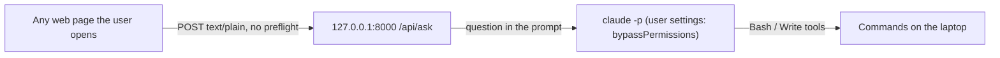

# Security review, 2026-11-15

Scope: the public repo kneha07/WANDERERS at `main` adc4eb8, all 546 commits of history, the GitHub Actions workflows,
the local servers (`server.js`, `fields.js`, `backend/`), the static site in `app/` and `web/`, and the live site
https://wanderer.johnyc.com. Branch: `fix/security-2026-11-15`.

## Summary

| # | Severity | Finding | Status |
|---|----------|---------|--------|
| 1 | Critical | Any website can make `server.js` run `claude -p` with its own text. With `bypassPermissions` in the user's Claude settings, that is code execution on the laptop. | Fixed |
| 2 | High (privacy) | The 14 iPhone photos in `star_image/` hold the exact GPS spot where each was taken. | Fixed at HEAD; history still holds them |
| 3 | Medium | `main` has no branch protection and no ruleset. | Owner step |
| 4 | Low | GitHub Actions use moving tags (`@v4`), not commit SHAs. | Fixed |
| 5 | Low | The live site sends no security headers (no nosniff, no frame-ancestors, no HSTS). | Fixed, needs a redeploy |
| 6 | Low | `realsky.js` accepts `?survey=toString` (prototype key); `app.js` star card puts data in `innerHTML` unescaped. | Fixed |
| 7 | Info | Community votes are GitHub issues: one person with many accounts can stuff votes. | Accepted (moderation label exists) |
| 8 | Info | Aladin Lite loads from jsDelivr with no SRI (`import()` cannot carry `integrity`). The version is pinned to 3.8.2. | Accepted |

No secrets found: a pattern scan of every commit (AWS, GitHub, Anthropic, OpenAI, Google, Slack keys, private keys,
bearer tokens, password literals) and of every file name ever committed (`.env`, `.pem`, browser profiles, cookies)
found nothing. `npm audit` for `web/`: 0 vulnerabilities. Python packages are pinned. A sweep of the 146 HTML sinks
in `app/` and `web/src/` found no DOM XSS: URL values reach HTML only after a match against repo data or a fixed list.

## 1. Cross-site request to `claude -p` (critical)

- `server.js` binds to 127.0.0.1, but a browser on the same laptop can still reach it. A `text/plain` POST needs no
  CORS preflight, and the server parsed the body as JSON whatever its type. It did not check `Origin` or `Host`, so
  DNS rebinding also worked.
- Proof (before the fix): a POST with `Origin: https://evil.example` and `Content-Type: text/plain` got a normal
  answer from the running server. `claude -p` with the old arguments, given an injected instruction, wrote a file
  in the test folder.
- Fix in `server.js`:
  - `trusted(req)`: the `Host` name must be `localhost`, `127.0.0.1` or `[::1]` (stops DNS rebinding). A POST that
    sends `Origin` must send this server's own origin (stops cross-site POSTs). Else 403.
  - `claude -p` now runs with `--tools "" --strict-mcp-config --permission-mode dontAsk`: no tools and no MCP servers.
    Proof: the same injection gives text only and writes no file.
- Tests: `test/server.test.js` adds a cross-site POST (403), a foreign Host (403) and a same-origin POST (allowed).

Action: restart every running `server.js` (for example the one on port 8020) after the merge. Until then it runs the
old code.

## 2. GPS in the sample photos (privacy)

- Before: each HEIC held the phone's GPS to about 1 m. The tests already said "never write a sample photo's own GPS
  here", but the photos themselves held it.
- Fix: the GPS latitude and longitude in each photo are rounded to 0.1 degree (about 11 km). Only the EXIF GPS bytes
  change; the decoded image data is byte-identical (MD5 checked), so the plate solve gives the same result.
  `tests/test_star_fix.py` still passes (the solve is within 150 km of the rounded GPS).
- New test `SamplePrivacy.test_sample_gps_is_coarse` fails when a photo in `star_image/` has GPS finer than 0.1 degree.
- Open: the old photos stay in git history and in the fork rajryadav4/wanderers. Removing them needs a history
  rewrite (`git filter-repo`), a force push by a repo admin, and a GitHub Support request to drop cached views.
  The fork keeps its copy. The photo owner decides if this is worth it.

## 3. No branch protection on `main`

`gh api repos/kneha07/WANDERERS/branches/main/protection` gives 404, and there are no rulesets. Tracked in kneha07/WANDERERS#105. Anyone with write
access (6 collaborators) can push or force-push `main`. Our account has WRITE, not admin, so the owner (kneha07) must
add a ruleset: require a pull request, block force pushes and deletion. Allow the `github-actions[bot]` push from
`classifications.yml`, or change that workflow to open a pull request.

## 4. Actions pinned to SHAs

`checks.yml`, `classifications.yml` and `spherex-sync.yml` now use full commit SHAs, with the tag as a comment.
`tests/test_spherex_releases.py::test_workflow_actions_are_pinned` now requires a 40-character SHA.

## 5. Live site headers

New file `app/_headers` (Cloudflare Workers static assets read it and do not serve it): `X-Content-Type-Options`,
`X-Frame-Options: SAMEORIGIN`, `Content-Security-Policy: frame-ancestors 'self'; object-src 'none'; base-uri 'self'`,
`Referrer-Policy` and `Strict-Transport-Security`. It has no `script-src`, because the sky map loads Aladin Lite and its
WASM from jsDelivr. A redeploy of the Worker (`wanderers`) applies it. GitHub Pages ignores the file.

## 6. Small client fixes

- `app/realsky.js`: `?limit=` and `?survey=` use `Object.hasOwn`, so `toString` or `constructor` cannot pass.
- `app/app.js`: the star search card escapes the name, other names and facts with `esc()`.

## Not changed

- The FastAPI backend (port 8001) has no Host check. It serves public sky data only, so DNS rebinding there leaks
  nothing private.
- `artifacts/` holds a few logs with the local path `C:\Users\user`. That user name is generic.
- Windows test failures that also fail on `main`: 4 survey test files import `resource` (Unix only), and 2 tests read
  files with the Windows default encoding.

## Checks run

- `node --test test/*.test.js`: 665 tests, 663 pass, 2 skipped. `node --check` on all app and server files: clean.
- `python -m pytest tests`: 1103 pass on this branch. The only failures are the Windows-only ones above.
- `python test/test_fov.py`: OK.
