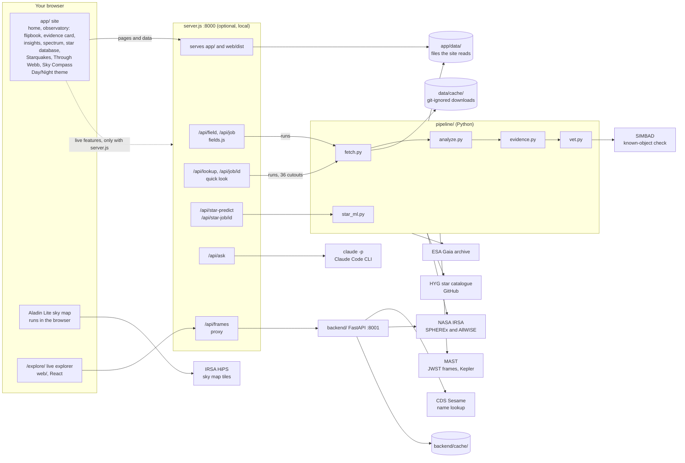
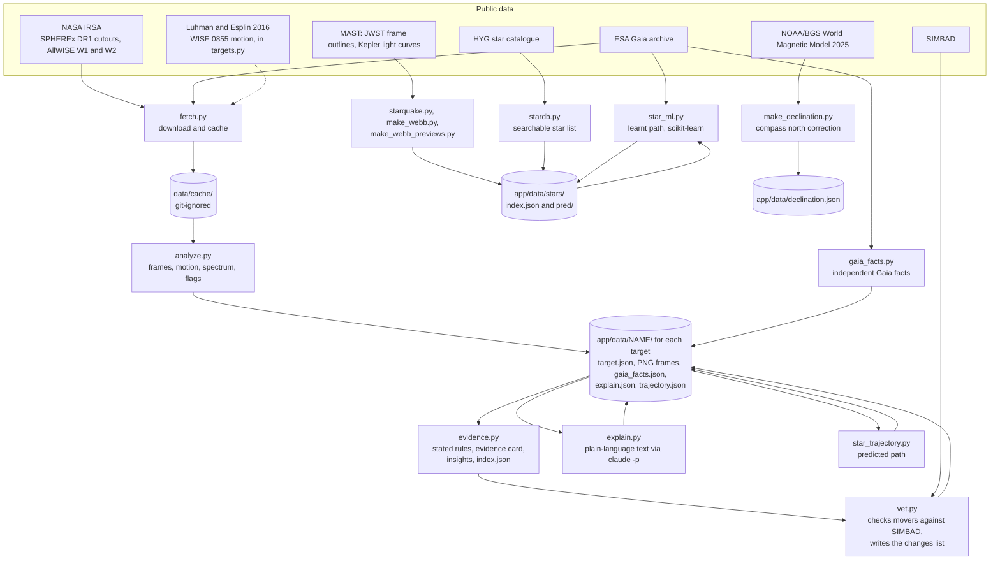

# Architecture

How WANDERERS is put together, from the files in this repository. If this page and the code disagree, the code is right: fix this page.

Written against `main` at `3c896ba` (2026-11-14, after the redesign, Starquakes, Through Webb, Sky Compass and the insights PRs). The diagrams are [Mermaid](https://mermaid.js.org/), which GitHub draws for you.

## 1. The whole system

Dashed line: the live features need `server.js`. A plain static host (for example GitHub Pages) shows everything that
only reads `app/data/` plus the Aladin sky map, but cannot prepare new fields, answer questions or learn a new star.

## 2. What runs where

| You run | You get |
|---|---|
| Nothing, any static host serving `app/` | The five missions, evidence cards, spectrum, star database (precomputed paths), Aladin sky map for any RA/Dec, Sky Compass, add/subtract frames. All of it runs in the browser. |
| `node server.js` (port 8000) | Plus: any coordinates on demand, "Ask WANDERERS" (needs the `claude` command signed in), and learning the path of any star in the database. |
| `node start.js`, or double-click `start.cmd` / `start.command` | Plus: the `/explore/` live explorer. It sets up `backend/.venv` and `web/`, then starts the FastAPI server (port 8001) and `server.js` together. |

## 3. Where the data goes (the pipeline)

Run order for the five missions is in the README's "Run it" section: `fetch`, `analyze`, `gaia_facts`, `evidence`, `explain`,
`star_trajectory`. Each target's folder collects the files the steps write: `analyze.py` writes `target.json` and the frames,
`gaia_facts.py` writes `gaia_facts.json`, `evidence.py` adds the evidence card to `target.json` and writes `app/data/index.json`,
`explain.py` writes `explain.json`, and `star_trajectory.py` writes `trajectory.json`. `app/data/` is committed, so the site
works straight from a clone without running anything.

## 4. The servers and their routes

| Where | Route | What it does |
|---|---|---|
| `server.js` :8000 | `GET /`, any file in `app/` | The static site and its data |
| | `GET /explore/…` | The live explorer, built to `web/dist` (unknown paths fall back to its `index.html`) |
| | `GET /api/health` | `ok` |
| | `POST /api/ask` | Answers a question about one target with `claude -p`, using only that target's measurements |
| | `POST /api/field`, `GET /api/job?id=` | **`fields.js`.** Prepares any position and field size (60 to 900 arcsec) by running `fetch.py`, `analyze.py` and `evidence.py`. One job runs at a time, up to four wait. Shows no server paths in errors. |
| | `POST /api/lookup`, `GET /api/job/<id>` | The **older quick look** (`server.js`). The same three steps, but `fetch.py --max 36`, so fewer cutouts and a faster result. One job at a time, replies 409 when busy. No field-of-view choice. |
| | `POST /api/star-predict`, `GET /api/star-job/<id>` | Learns one star's path with `star_ml.py`. The key must be one of the stars in the database. |
| | `GET /api/frames`, `GET /api/live-health` | Proxied to the FastAPI server on port 8001. When it is down the proxy answers 502 and says how to start it. |
| `backend/` :8001 | `GET /api/frames?q=&fov=&per_group=&det=` | Finds a star by name (CDS Sesame) or position, asks IRSA which SPHEREx images cover it, reads only the needed pixels from the public S3 copy, aligns and stacks them by survey epoch, and returns frames as PNG with measurements. Details: [blink/README.md](blink/README.md) and [blink/api.md](blink/api.md). |
| | `GET /api/health` | `{"ok": true}` |

### Two on-demand routes (issue #9)

Both exist on `main`. They differ in how much they download, so how long they take:

| | `/api/lookup` (quick look) | `/api/field` (`fields.js`) |
|---|---|---|
| SPHEREx cutouts | at most 36 | up to 150 (`fetch.py` default) |
| Field of view | fixed | 2′, 5′, 10′ or any 60 to 900 arcsec |
| Waiting jobs | none, 409 when busy | up to four |
| Measured on a real 2′ field | not measured | about 12 minutes of downloading |

Issue #9 records that the page calls only `/api/field` today. Which one stays, or whether both stay as "quick" and "full",
is a team decision. This table is a description, not a recommendation.

## 5. Where files live

| Path | What | In git? |
|---|---|---|
| `app/` | The static site | yes |
| `app/data/<target>/`, `app/data/stars/`, `app/data/declination.json` | What the pipeline produces and the site reads | yes (so a clone works with no setup) |
| `app/data/spherex_release.json` | SPHEREx releases at IRSA and how recent the prepared targets are (`pipeline/spherex_releases.py`, kept current by `.github/workflows/spherex-sync.yml`; read by `fetch.py` and `app/release.js`) | yes |
| `app/data/classifications.json` | Community votes (Moving / Variable / Stationary / Artifact / Unsure), counted from GitHub issues by `pipeline/aggregate_votes.py` and `.github/workflows/classifications.yml`; `app/classify.js` shows them and adds newer votes live on the hosted site | yes |
| `data/cache/` | Raw downloads (SPHEREx cutouts, AllWISE, Gaia answers, the HYG file) | no |
| `backend/cache/` | The live explorer's results | no |
| `artifacts/` | Review records, merge records, demo screenshots | yes |
| `docs/` | This page, the demo script, the live explorer notes, research | yes |
| `background/` | The challenge pages | yes |
