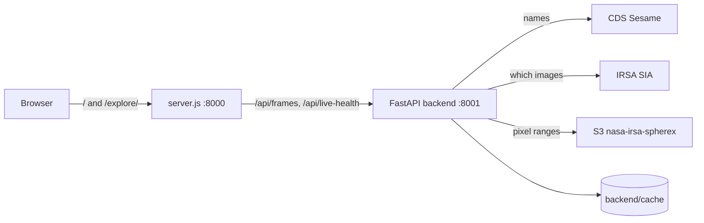

# Explore any patch (live mode)

## Run it in one click

- **Windows:** double-click `start.cmd`.
- **macOS:** double-click `start.command`.
- **Any system:** run `node start.js` in the repo folder. Add `--precompute` to cache the five challenge targets first.

You need Node.js and Python 3.11 or newer. The first run creates `backend/.venv`, installs the web packages and builds
`web/dist`. Then it starts the live API (port 8001) and `server.js` (port 8000), waits for both, and opens
<http://localhost:8000>. If our servers already run, it uses them. If another program holds port 8000 or 8001, it
stops with a message. Press Ctrl+C (or close the window) to stop both servers.

## What this mode is

SPHEREx Blink is the "Explore any patch" mode of WANDERERS. Type a star name or a sky position. The tool gets
the SPHEREx images of that patch from IRSA and shows them as a short blink video. Moving and changing objects
stand out.

- A **mover** changes its position between surveys, for example a nearby star or a brown dwarf.
- A **blinker** changes its brightness, for example a variable star.

## What it does

1. Finds the position. A name goes to CDS Sesame, which also gives the proper motion. RA/Dec text is read directly.
2. Moves a known proper-motion target to its 2026.0 position and centers the view there.
3. Asks IRSA SIA (`spherex_dr1` and `spherex_qr3`) for the Level-2 images that cover the position.
4. Groups the images into survey epochs (a gap of more than 20 days starts a new epoch; a pass longer than 45 days
   is cut into 30-day bins; at most 12 epochs).
5. Chooses up to 12 images per epoch. The detectors take turns, and the picks spread in time.
6. Reads only the pixels under the view from the public S3 copy (HTTP range reads), not the 66 MB files.
7. Drops bad pixels with the FLAGS plane (cosmic rays, hot pixels, persistence, saturation).
8. Aligns each cutout onto one north-up, east-left grid (SIP WCS) and removes a plane background.
9. Stacks each epoch, makes a difference image (last minus first), and marks where the target should be.

## Run it locally

Three parts work together:

| Part | Command | Address |
|---|---|---|
| WANDERERS site and proxy | `node server.js` | <http://localhost:8000> |
| Live SPHEREx API (FastAPI) | `backend/.venv/bin/python -m uvicorn backend.app:app --port 8001` | port 8001 |
| Explorer app (React) | `cd web && npm run build` | <http://localhost:8000/explore/> |

First-time setup (on Windows, use `backend\.venv\Scripts\python` instead of `backend/.venv/bin/python`):

```bash
python3 -m venv backend/.venv
backend/.venv/bin/python -m pip install -r backend/requirements.txt
cd web && npm ci && npm run build && cd ..
```

Then start the two servers and open <http://localhost:8000/explore/>:

```bash
backend/.venv/bin/python -m uvicorn backend.app:app --port 8001
node server.js
```

For frontend work, run `npm run dev` in `web/` and open <http://localhost:5173/explore/>. Vite sends `/api` to port 8001.

Fill the cache for the challenge targets, so that the demo loads them at once:

```bash
backend/.venv/bin/python -m backend.precompute
```

Run the checks:

```bash
backend/.venv/bin/python -m pytest backend -q
cd web && npm run build
```

## How the parts connect



`server.js` serves `web/dist` under `/explore/` and proxies two routes to port 8001. When port 8001 is down,
the proxy answers HTTP 502 with a message that tells you how to start it. The WANDERERS coordinate box shows an
"Explore this patch live" link for positions outside the five missions, but only when the live API answers.

## API

`GET /api/frames?q=<name or RA/Dec>&fov=5&per_group=12&det=`

| Parameter | Meaning |
|---|---|
| `q` | Name (`Barnard's Star`), decimal degrees (`269.45 4.69`) or sexagesimal (`17h57m48.5s +04d41m36s`) |
| `fov` | Field of view in arcmin, 2 to 15 |
| `per_group` | Images per epoch, 1 to 30 |
| `det` | Empty for all detectors, or `D1` to `D6` for one detector (`D6` suits cold brown dwarfs such as WISE 0855) |

The answer holds the center, the proper motion, one frame per epoch (PNG, false-colour PNG, date range, image count,
ring position, saturated flag, measured centroid, photometry, wavelengths), per-detector frames, a difference image,
Gaia DR3 stars moved to each epoch, notes and counts of images used and failed. The full contract is
[api.md](api.md). Errors come back as
HTTP 400 (bad input), 404 (no images) or 502 (IRSA failed) with `{"detail": "..."}`. `GET /api/health` answers
`{"ok": true}`. Results are cached in `backend/cache/` (delete the files to rebuild).

## Data sources

| Source | Use |
|---|---|
| NASA SPHEREx Level-2 spectral images, DR1 and QR3 (IRSA SIA, S3 `nasa-irsa-spherex`) | Frames |
| CDS Sesame (SIMBAD, NED, VizieR) | Names, J2000 positions, proper motions |

Research notes: [docs/research/spherex-data-access.md](../research/spherex-data-access.md).

## Known limits

- **Small motion.** A SPHEREx pixel is 6.15". The fastest targets move 1 to 2 pixels over the baseline.
- **Background.** Each cutout gets a fitted plane (sky level plus gradient), not a model. The ZODI plane does not
  hold the D1 and D2 airglow, so it is not used.
- **Saturated cores.** Very bright stars (R Dra, Barnard's Star) have no data in the core. The core shows white,
  the frame is flagged, and the difference image leaves those pixels gray.
- **Mixed wavelengths.** A stack mixes detectors, so a star changes brightness a little from epoch to epoch.
- **Undersampled PSF.** Bright fixed stars can leave small dark and bright pairs in the difference image.
- **IRSA is busy.** SIA answers HTTP 502 at times. The API tries 3 times, then reports the failure. A cold load
  takes 10 to 90 seconds; a cached load takes less than 1 second.
- **WISE 0855** is faint even in the D6 stack. It sits in the ring, but its 1.3 px motion over one year is hard to
  see by eye.

## Next steps

- Pipeline gate at 22:00: Barnard's Star must show its motion in the blink and in the difference.
- Spectrum per pixel from the `WCS-WAVE` table, a flags overlay, and a Gaia DR3 overlay.
- Cloud hosting later (it needs a small server for SIA; the S3 reads work from anywhere).
