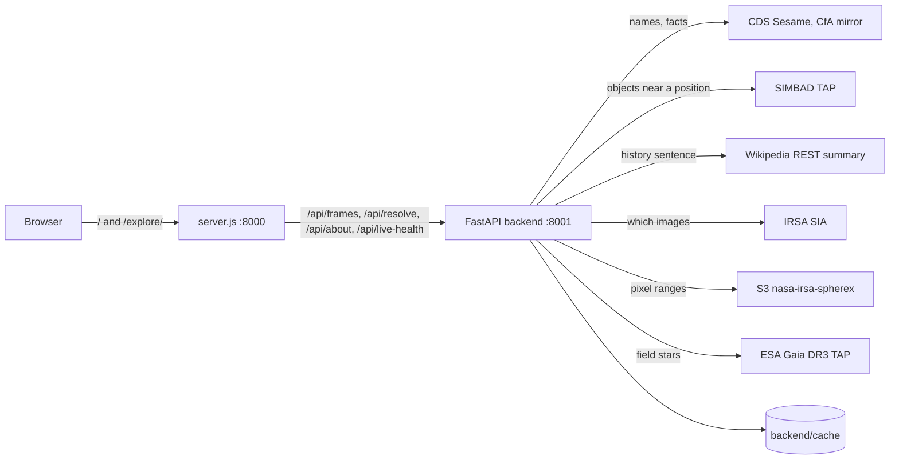

# Explore any patch (live mode)

## Run it in one click

- **Windows:** double-click `start.cmd`.
- **macOS:** double-click `start.command`.
- **Any system:** run `node start.js` in the repo folder. Add `--precompute` to cache the five challenge targets first.

You need Node.js and Python 3.11 or newer. The first run creates `backend/.venv`, installs the web packages and builds
`web/dist`. Then it starts the live API (port 8001) and `server.js` (port 8000), waits for both, and opens
<http://localhost:8000>. If our servers already run, it uses them. If another program holds port 8000 or 8001, it
stops with a message. Press Ctrl+C (or close the window) to stop both servers.

The first run also creates the root `.venv` with `pipeline/requirements.txt`. The missions page needs it for a field
at new coordinates (`fields.js` runs `pipeline/fetch.py`; without it the job fails with `No module named 'pyvo'`).
`start.js` checks it at each start (`import pyvo`) and repairs it when it is broken. On Windows it tells `server.js`
where that Python is (`WANDERERS_PYTHON`), because `fields.js` looks only for `.venv/bin/python`. If
`pipeline/requirements.txt` is missing, the step is skipped with a note. A failed install does not stop the live
explorer.

Options: `--precompute` (cache the challenge targets), `--no-open` (do not open the browser). `PORT` and `LIVE_PORT`
(default 8000 and 8001) run a second copy next to the first one, for example `PORT=8041 LIVE_PORT=8042 node start.js`.

## What this mode is

SPHEREx Blink is the "Explore any patch" mode of WANDERERS. Type a star name or a sky position. The tool gets
the SPHEREx images of that patch from IRSA and shows them as a short blink video. Moving and changing objects
stand out.

- A **mover** changes its position between surveys, for example a nearby star or a brown dwarf.
- A **blinker** changes its brightness, for example a variable star.

## What it does

1. Finds the position. A name goes to CDS Sesame, which also gives the proper motion. RA/Dec text is read directly.
2. Moves a known proper-motion target to its 2026.0 position and centers the view there.
3. Asks IRSA SIA (`spherex_dr1` and `spherex_qr3`) for the Level-2 images that cover the position.
4. Groups the images into survey epochs (a gap of more than 20 days starts a new epoch; a pass longer than 45 days
   is cut into 30-day bins; at most 12 epochs).
5. Chooses up to 12 images per epoch. The detectors take turns, and the picks spread in time.
6. Reads only the pixels under the view from the public S3 copy (HTTP range reads), not the 66 MB files.
7. Drops bad pixels with the FLAGS plane (cosmic rays, hot pixels, persistence, saturation).
8. Aligns each cutout onto one north-up, east-left grid (SIP WCS) and removes a plane background.
9. Stacks each epoch from the detectors that every epoch has, makes a difference image (last minus first, from the
   detectors of those two epochs), and marks where the target should be.
10. "About this star" (Data tab, and "About" on each candidate): three sentences. (1) Catalog facts from CDS Sesame,
   or for a clicked position the SIMBAD object within 5″ (else the nearest Gaia DR3 star of the answer). (2) Our own
   SPHEREx measurement: motion per year and direction, or the brightness change, or "too bright to measure". (3) One
   sentence quoted from the Wikipedia summary (CC BY-SA 4.0), else the number of SIMBAD papers. No language model
   writes these facts.

## Run it locally

Three parts work together:

| Part | Command | Address |
|---|---|---|
| WANDERERS site and proxy | `node server.js` | <http://localhost:8000> |
| Live SPHEREx API (FastAPI) | `backend/.venv/bin/python -m uvicorn backend.app:app --port 8001` | port 8001 |
| Explorer app (React) | `cd web && npm run build` | <http://localhost:8000/explore/> |

First-time setup (on Windows, use `backend\.venv\Scripts\python` instead of `backend/.venv/bin/python`):

```bash
python3 -m venv backend/.venv
backend/.venv/bin/python -m pip install -r backend/requirements.txt
cd web && npm ci && npm run build && cd ..
```

Then start the two servers and open <http://localhost:8000/explore/>:

```bash
backend/.venv/bin/python -m uvicorn backend.app:app --port 8001
node server.js
```

For frontend work, run `npm run dev` in `web/` and open <http://localhost:5173/explore/>. Vite sends `/api` to port 8001.
To use another live API (for example a second checkout on port 8031), set `VITE_API_TARGET`:

```bash
VITE_API_TARGET=http://127.0.0.1:8031 npm run dev -- --port 5193 --strictPort     # PowerShell: $env:VITE_API_TARGET=...
```

`server.js` has the same switch for its proxy: `WANDERERS_LIVE=http://127.0.0.1:8031 node server.js`.

Fill the cache for the challenge targets, so that the demo loads them at once:

```bash
backend/.venv/bin/python -m backend.precompute
```

Run the checks:

```bash
backend/.venv/bin/python -m pytest backend -q   # pipeline math, cache, Gaia, Sesame, About, HTTP errors; no network
node --test test/*.test.js                       # server.js routes and the live proxy (a fake upstream)
cd web && npm test && npm run build              # pure functions (vitest), then the type check and build
node scripts/verify-ui.mjs http://localhost:5173/explore/   # in web/: browser checks against a running dev server
```

## How the parts connect



`server.js` serves `web/dist` under `/explore/` and proxies four routes to port 8001. If the live API stops in the
middle of an answer, the proxy ends the browser's response at once (the browser does not wait 3 minutes). When port 8001 is down,
the proxy answers HTTP 502 with a message that tells you how to start it. The WANDERERS coordinate box shows an
"Explore this patch live" link for positions outside the five missions, but only when the live API answers.

## API

`GET /api/frames?q=<name or RA/Dec>&fov=5&per_group=12&det=`

| Parameter | Meaning |
|---|---|
| `q` | Name (`Barnard's Star`), decimal degrees (`269.45 4.69`) or sexagesimal (`17h57m48.5s +04d41m36s`) |
| `fov` | Field of view in arcmin, 2 to 15 |
| `per_group` | Images per epoch, 1 to 30 |
| `det` | Empty for all detectors, or `D1` to `D6` for one detector (`D6` suits cold brown dwarfs such as WISE 0855) |

The answer holds the center, the proper motion, one frame per epoch (PNG, false-colour PNG, date range, image count,
ring position, saturated flag, measured centroid, photometry, wavelengths), per-detector frames, a difference image,
Gaia DR3 stars moved to each epoch, notes and counts of images used and failed. The full contract is
[api.md](api.md). Errors come back as
HTTP 400 (bad input), 404 (no images), 500 (a bug) or 502 (IRSA failed) with `{"detail": "..."}`. `GET /api/health`
answers `{"ok": true}`.

Two more routes:

- `GET /api/resolve?q=` gives the position of a name in a few seconds. The web app calls it first, so a wrong name
  fails fast ("No object called '…' found") and the wait text names the real step.
- `GET /api/about?q=<name>` or `GET /api/about?ra=<deg>&dec=<deg>` gives "About this star" (see [api.md](api.md)).

Cache (`backend/cache/`): a frames answer is kept 7 days (QR3 adds new surveys every week), 1 hour when images failed
or an epoch was dropped. When IRSA is down at rebuild time, the old answer is served with a note. An About answer is
kept 30 days, but not when a source failed. A failed Gaia query switches the overlay off for 10 minutes, and a
failed Sesame mirror is skipped for 10 minutes. Delete the files to rebuild at once.

## Data sources

| Source | Use |
|---|---|
| NASA SPHEREx Level-2 spectral images, DR1 and QR3 (IRSA SIA, S3 `nasa-irsa-spherex`) | Frames |
| CDS Sesame (SIMBAD, NED, VizieR), CDS and the CfA mirror | Names, J2000 positions, proper motions; About: type, spectral type, parallax, aliases, papers |
| SIMBAD TAP (CDS, CfA mirror) | About for a clicked position: the object within 5″ |
| ESA Gaia DR3 (archive TAP) | Field stars moved to each frame, G magnitude, parallax |
| Wikipedia REST summary (CC BY-SA 4.0) | About: one quoted history sentence, with a link |

Research notes: [docs/research/spherex-data-access.md](../research/spherex-data-access.md).

## Known limits

- **Small motion.** A SPHEREx pixel is 6.15". The fastest targets move 1 to 2 pixels over the baseline.
- **Background.** Each cutout gets a fitted plane (sky level plus gradient), not a model. The ZODI plane does not
  hold the D1 and D2 airglow, so it is not used.
- **Saturated cores.** Very bright stars (R Dra, Barnard's Star) have no data in the core. The core shows white,
  the frame is flagged, and the difference image leaves those pixels gray.
- **Mixed wavelengths.** The gray frames stack only the detectors that every frame has. When no detector is in every
  frame (Barnard's Star, R Dra), each frame stacks all its detectors and a note says so. Inside one detector band,
  each survey also sees a star at another wavelength (SPHEREx filters change across the detector), so an object
  with strong spectral bands can change brightness without being variable.
- **Scattered light.** A brightness change that is largest in D1 or D2 is labelled "may be scattered light"
  (issue #5), not "larger than the noise".
- **Typed coordinates** have no proper motion: no ring, and frames without a source at the typed position say "no
  proper motion known: no predicted position". The WISE 0855 challenge coordinates are from 2010; its chip uses the
  2026 position. When a fast mover (over 1″/yr) passed near the typed position, the note under the image names it
  ("A fast-moving star … is 127″ from here … search it by name"), from SIMBAD, else from Gaia.
- **No source, no change.** A brightness change counts only when the brightest survey shows a source (a centroid in
  that frame, or a flux of 5σ or more). Else the panel says "No source at this position — the brightness numbers
  are sky noise." It is judged at the brightest survey, because a weak fit in one faint survey (WISE 0855's 2010
  coordinates) let a false "10.8× … larger than the noise" through when any survey could count.
- **About this star** depends on CDS and Wikipedia. On 2026-11-14 SIMBAD at CDS was down and the CfA mirror answered. Many
  Wikipedia summaries have no dated history sentence (Barnard's Star); then the card counts the SIMBAD papers.
- **Undersampled PSF.** Bright fixed stars can leave small dark and bright pairs in the difference image.
- **IRSA is busy.** SIA answers HTTP 502 at times. The API tries 3 times, then reports the failure. A cold load
  takes 10 to 90 seconds; a cached load takes less than 1 second.
- **WISE 0855** is faint even in the D6 stack. It sits in the ring, but its 1.3 px motion over one year is hard to
  see by eye.

## Next steps

Done: the 22:00 gate (Barnard's Star moves in the blink and in the difference) and the Gaia DR3 overlay.

- Spectrum per pixel from the `WCS-WAVE` table, and a flags overlay.
- Brightness compared at matched wavelengths inside a detector band (the WANDERERS deep dive does this).
- Public hosting: issue #24 (it needs a small server for SIA; the S3 reads work from anywhere). Until then, share
  links open only on the computer that runs the tool.
