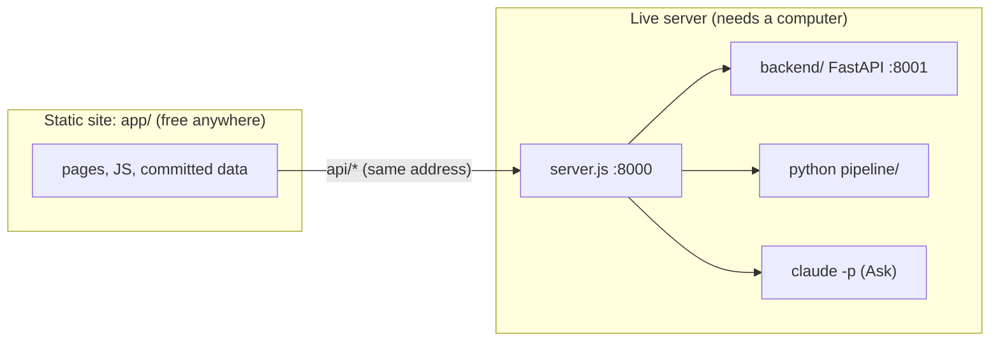

# Deploy WANDERERS

WANDERERS has two parts. Each part deploys in a different way.



The pages call the server with relative paths (`fetch("api/...")`). So the live features work only when the pages
and the server come from the same address. On a static host, `api/health` gives 404, and the page hides Ask,
Lookup, Star Fix, new fields and the live Explore.

## Pick a way

| Way | What works | Cost | Address | Updates |
|---|---|---|---|---|
| **A. GitHub Pages** | Static site | Free | `https://kneha07.github.io/WANDERERS/` | By itself on each merge to `main` |
| **B. Cloudflare Worker** | Static site | Free | `https://wanderer.johnyc.com` and `https://wanderers.<account>.workers.dev` | When you run the script |
| **C. Your computer + tunnel** | Everything | Free | Random `*.trycloudflare.com`, or your own hostname | Live; up only while the computer runs |

Use A or B for the permanent link. Use C only for a demo of the live features.

Do not host the server on Vercel or a normal Worker. The server starts Python jobs, keeps jobs in memory and
writes into `app/data/`. Serverless hosts cannot do this. Cloudflare Containers can run it, but they need the paid
Workers plan. Get the owner's approval before you use a paid plan.

## Before every deploy

1. Deploy from `main` only. `main` holds reviewed work.
2. Get the latest `main`:
   ```bash
   git switch main && git pull
   ```
3. Check the site files:
   ```bash
   node scripts/deploy.js check
   ```
   The script checks the same entry pages as `.github/workflows/pages.yml`.

## A. GitHub Pages (automatic)

`.github/workflows/pages.yml` publishes `app/` on each push to `main`. It also publishes after each vote count,
and when you start it by hand (Actions → pages → Run workflow).

One-time setup by a repository admin: Settings → Pages → Build and deployment → Source: **GitHub Actions**.
Until then, the deploy step fails with "Pages site not found".

The fork copy `rajryadav4.github.io/wanderers` does not update by itself. Its owner must sync the fork.

## B. Cloudflare Worker (static)

`wrangler.jsonc` makes a Worker named `wanderers` that serves `app/` as static assets.

1. Deploy:
   ```bash
   node scripts/deploy.js static
   ```
   The first time, wrangler opens a browser to log in to Cloudflare.
2. Check the address that wrangler prints (`https://wanderers.<account>.workers.dev`).
3. Optional, one time: attach your own hostname. In the Cloudflare dashboard, open Workers → `wanderers` →
   Settings → Domains & Routes → Add → Custom domain. The zone must be on Cloudflare. Delete any old DNS record
   on that hostname first. The custom domain stays across deploys.

Notes:
- A link that ends in `.html` redirects to the clean path, for example `/compass.html` → `/compass`.
- Each file must be 25 MiB or less. The free plan allows 20,000 files.
- To undo a bad deploy, run `npx wrangler@4 rollback`.

## C. Your computer + Cloudflare tunnel (full app)

Use this for a demo of Ask, Lookup, Star Fix and Explore, for example from a phone.

1. Install `cloudflared` once:
   ```bash
   winget install Cloudflare.cloudflared
   ```
   On macOS, use `brew install cloudflared`.
2. Start the app and keep its window open:
   ```bash
   node start.js
   ```
3. In a second window, start the tunnel:
   ```bash
   node scripts/deploy.js tunnel
   ```
4. Open the `https://….trycloudflare.com` address that it prints, on any device.

The address is HTTPS, so the phone compass and motion sensors work. The address changes each time.

### A fixed hostname (named tunnel)

1. In the Cloudflare dashboard, open Zero Trust → Networks → Tunnels → Create a tunnel (type Cloudflared).
2. Add a public hostname, for example `wanderer.example.com`, with service `http://localhost:8000`.
3. Copy the tunnel token into a file outside the repo, for example `~/.cloudflared/wanderers.token`.
   Never commit the token.
4. Run the tunnel with the token file:
   ```bash
   TUNNEL_TOKEN_FILE=~/.cloudflared/wanderers.token node scripts/deploy.js tunnel
   ```

A hostname can point at a tunnel or at a Worker, not at both. To change from way B to way C, remove the Worker's
custom domain first. To change back, delete the tunnel's DNS record first.

### Know before you share the address

- The site is up only while the computer is awake, online, and both windows run. A closed lid stops it.
- Anyone with the address can use the Ask box. Each question uses the Claude login on that computer.
- Anyone with the address can start Python jobs on that computer. Jobs run one at a time, so others get `409`.
  See issue #81.
- To stop, press Ctrl+C in both windows. For a named tunnel you do not need again, delete it in the dashboard.

## Problems

| What you see | Cause | Fix |
|---|---|---|
| Star Fix says "Could not read this photo." for a good photo | The server started before a merge, so `/api/star-fix` gives 404 (issue #84). | Stop `start.js` and start it again after each pull. |
| Star Fix fails with `No module named 'pillow_heif'` or `'tetra3'` | The root `.venv` setup stopped half way. | Run `node start.js` again. It repairs the `.venv`. |
| The live features do not show | The page cannot reach `api/health`. | On way A or B this is normal. On way C, check that `start.js` runs. |
| New pages do not show on the phone | The browser has the old page. | Reload the page. The service worker gets pages from the network first. |
| `cloudflared` is not found in an open window | A new install is not yet on the PATH. | Open a new window. The script also looks in `C:/Program Files (x86)/cloudflared/`. |
