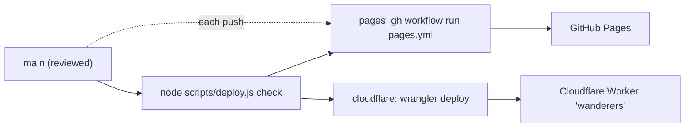

# Deploy WANDERERS

The site in `app/` is plain static files with committed data. It has no build step. Deploy it in one of two ways:

| | 1. GitHub Pages | 2. Cloudflare Worker |
|---|---|---|
| Command | `node scripts/deploy.js pages` | `node scripts/deploy.js cloudflare` |
| Updates | By itself on each merge to `main` | When you run the command |
| Address | `https://kneha07.github.io/WANDERERS/` | `https://wanderers.<account>.workers.dev`, and your own hostname (for example `https://wanderer.johnyc.com`) |
| Config | `.github/workflows/pages.yml` | `wrangler.jsonc` |
| Needs | `gh`, logged in; Pages turned on once by a repo admin | A Cloudflare login (wrangler asks for it the first time) |
| Cost | Free | Free (static asset requests are not billed) |



Both methods publish `app/` only. They do not publish the pipeline, the backend, tests or secrets.

## What a static site does not do

The pages call the live server with relative paths (`fetch("api/...")`). On a static host, `api/health` gives
404, so the page hides these features: Ask, Lookup of new coordinates, Star Fix upload, new fields, and the live
Explore. All committed targets, stars, stories and the Sky Compass work. To use the live features, run
`node start.js` on your computer and open `http://localhost:8000`.

## Before every deploy

1. Deploy from `main` only. `main` holds reviewed work.
2. Get the latest `main`:
   ```bash
   git switch main && git pull
   ```
3. Check the site files:
   ```bash
   node scripts/deploy.js check
   ```
   This checks the entry pages that `.github/workflows/pages.yml` also checks. Both deploy commands run it first.

## 1. GitHub Pages

`.github/workflows/pages.yml` publishes `app/` by itself:
- on each push to `main` (each merged pull request);
- after each vote count (the `classifications` workflow);
- on a pull request that changes `app/`, it only builds and checks the bundle, with no publish.

### One-time setup (repository admin)

Settings → Pages → Build and deployment → Source: **GitHub Actions**.
Until then, the publish step fails with "Pages site not found", and `node scripts/deploy.js pages` stops with
the same instruction.

### Deploy now

1. Start the workflow for `main`:
   ```bash
   node scripts/deploy.js pages
   ```
2. Follow the run until it ends:
   ```bash
   gh run watch
   ```
3. Open the address in Settings → Pages.

You can also start it in the browser: Actions → pages → Run workflow.

The fork copy `rajryadav4.github.io/wanderers` is a different site. Its owner must sync the fork to update it.

## 2. Cloudflare Worker

`wrangler.jsonc` makes a Worker named `wanderers` that serves `app/` as static assets, with no server code.

### Deploy

1. Publish `app/`:
   ```bash
   node scripts/deploy.js cloudflare
   ```
   The first time, wrangler opens a browser to log in to Cloudflare.
2. Open the address that wrangler prints, for example `https://wanderers.<account>.workers.dev`.

### Own hostname (one time)

1. Make sure the domain's zone is on Cloudflare.
2. Delete any old DNS record on the hostname.
3. In the Cloudflare dashboard, open Workers → `wanderers` → Settings → Domains & Routes → Add → Custom domain.
4. Type the hostname, for example `wanderer.johnyc.com`.

The custom domain stays across deploys.

### Undo a bad deploy

```bash
npx wrangler@4 rollback
```

### Notes

- A link that ends in `.html` redirects to the clean path, for example `/compass.html` → `/compass`.
- Each file must be 25 MiB or less. The free plan allows 20,000 files.

## Check a deploy

| Check | Expected |
|---|---|
| `/` | 200, title "WANDERERS · The sky is never still" |
| `/compass.html` (Pages) or `/compass` (Cloudflare) | 200 |
| `/api/health` | 404 (static site, live features hidden) |

New pages show on phones at once. The service worker gets pages from the network first. If a phone shows an old
page, reload it.
