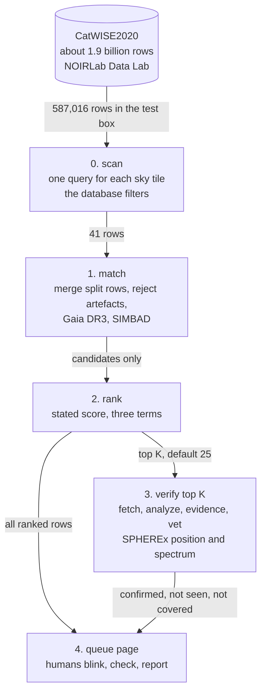

# Catalogue survey: from "pick a field" to a ranked candidate queue

Date: 2026-11-15. Base: `origin/main` at `ca220c7`. Status: design, not built. Tracking: issue #60 (build decision), issue #59 (step 0).

## 1. The gap, evaluated

The statement: WANDERERS analyses a field that a user selects. The full problem is a search of more than one billion objects that gives humans a ranked list.

| Part of the statement | Verdict | Evidence |
|---|---|---|
| The product starts from a user-selected field | True | `fetch.py add_position`, `/api/field`, eleven fixed targets in `app/data/` |
| No automatic search of the sky exists | True | `find_movers` runs only inside one prepared field |
| It is the biggest gap | True for the challenge ambition. Not true for today's demo. | See the two notes below |
| "1B+ objects" is the challenge's wording | Not verified | The challenge page did not load (certificate error). The saved PDF has no text layer. |

Two notes change the solution:

1. **The billion objects are catalogue rows, not SPHEREx pixels.** CatWISE2020 holds about 1.9 billion sources, each with a motion measured from 2010 to 2018. A database can filter them. Nobody must download images to do it.
2. **The committed mover data is older than the mover code.** On `origin/main` the data gives `target_recovered: false` for WISE 0855 and Barnard's Star. The record for issue #41 (`artifacts/movers/pr-body.md`) says `true`. The cause is known: merge `ce65492` kept the pairing fix in `analyze.py` but kept main's older data for the five targets, because main's files had NEOWISE frames. Its message says: "The five targets need one rebuild with the merged code". Nobody did that rebuild. Commit `1d67484` holds the last data with `true`. Step 0 below does the rebuild, because stage 3 uses the same search.

## 2. What we measured (2026-11-15)

One query to the CatWISE2020 table at NOIRLab Astro Data Lab (`https://datalab.noirlab.edu/tap/sync`, table `catwise2020.main`, no account):

| Item | Result |
|---|---|
| Box | RA 132° to 136°, Dec −9° to −5° (16 square degrees, holds WISE 0855) |
| Rows in the box | 587,016 |
| Rows after the filter | 41 |
| Time for each query | about 20 s |
| WISE 0855 in the 41 rows | Yes: `J085508.34-071439.2`, W1 − W2 = 4.1 mag, motion −7.97, +0.81 ″/yr |
| Output | `artifacts/survey/catwise-box-ra132-136-dec-9--5.csv` |

The filter: W2 brighter than 15.5 mag, motion above 0.3 ″/yr, motion above 6 times its error.

The test also shows two faults that the design must handle:

- CatWISE splits a fast mover into many rows. WISE 0855 appears four times in 25″.
- A saturated star gives a false motion. `J085417.52-052602.9` (W2 = 5.5 mag) shows −14.4 ″/yr.

Other hosts on the same day: IRSA TAP gave no answer in 90 s. CDS VizieR gave no answer in 45 s. The IRSA cloud bucket `nasa-irsa-wise` holds AllWISE (747,634,026 rows, 340 GB) but not CatWISE.

## 3. Design



One new file does stages 0 to 2: `pipeline/survey.py`. Stage 3 is a loop over code that exists. Stage 4 is one static page.

| Stage | What it does | Reuse | New code |
|---|---|---|---|
| 0. scan | Sends the filter query for each tile. Saves the rows to `data/cache/survey/tiles/<tile>.csv`. Skips a tile that has a file, so a stopped run continues. | `fetch.get` (retries) | Tile list, query text |
| 1. match | Merges rows closer than 30″. Rejects W2 brighter than 8 mag and flagged rows. Marks a row `known` when a Gaia DR3 star or a SIMBAD object explains the motion. | `fetch.gaia`, `vet.simbad_cone`, the grade words of `vet.py` (`known`, `rejected`, `candidate`) | Position match at epoch 2015.4 |
| 2. rank | Sorts the candidates by a score. Each term shows on the card. | none | About ten lines |
| 3. verify | Prepares a 2′ field at the position that the motion predicts for the SPHEREx date. Looks for the dot there and reads its spectrum. | `fetch.add_position`, `analyze.find_movers(paths=...)`, `evidence.py`, `vet.py` | `add_position` accepts a motion, so `analyze.py` gets the path |
| 4. queue page | Shows the ranked table with the grade, the SPHEREx result and links. | Observatory page, "Check it yourself" links | `app/queue.html`, one script |

### The score

```
score = min(motion / error, 30) / 30          how sure the motion is
      + clip(W1 - W2, 0, 4) / 4               how cold the object is
      + 1 if the shift from 2010 to SPHEREx is 2 pixels or more   can SPHEREx confirm it
```

No learnt model. No labelled examples exist yet. Add a model when the queue holds about 100 graded rows.

### The data contract

`app/data/survey/index.json`, written by `survey.py`, read by the page:

```json
{
  "catalogue": "CatWISE2020",
  "run_date": "2026-11-15",
  "rows_screened": 587016,
  "sky_fraction": 0.0004,
  "filter": {"w2_max": 15.5, "w2_min": 8, "pm_min": 0.3, "snr_min": 6},
  "items": [
    {"rank": 1, "name": "J085508.34-071439.2", "ra": 133.78476, "dec": -7.24425,
     "pm": 8.0, "pm_snr": 30, "w1_w2": 4.1, "score": 2.9,
     "grade": "known", "reason": "SIMBAD: WISE J085510.83-071442.5",
     "spherex": "confirmed", "target": "wise0855"}
  ]
}
```

`rows_screened` and `sky_fraction` are sums over the finished tiles. The page prints them, so the site never claims more sky than the run covered.

### The human step

Each row has four links: the Observatory page (verified rows only), WiseView at the position, SIMBAD, and **Report**. **Report** opens a new GitHub issue with the name, position and score in the text, label `candidate-report`. No server, no database, no cost.

## 4. Build order

| Step | Work | Done when |
|---|---|---|
| 0 | Rebuild the five targets with the merged code: `fetch.py`, `neowise.py`, `analyze.py`, `evidence.py`, `vet.py` (issue #59). | `target_recovered` is `true` for WISE 0855, Barnard's Star and Epsilon Indi B on main. `tests/test_movers.py` passes. If a value stays `false`, the fault is in the code and gets its own fix. |
| 1 | `survey.py scan` and `match` on the test box | `tests/test_survey.py` passes on the saved CSV: the four WISE 0855 rows merge into one, the W2 = 5.5 row is `rejected`, WISE 0855 is in the top 3 |
| 2 | `rank`, `index.json`, `app/queue.html` | The page shows the test box with its true `sky_fraction` |
| 3 | `add_position` with a motion; verify the top 25 | WISE 0855 from the queue reads `spherex: confirmed` with no hand-made target entry |
| 4 | Scan more sky, in tiles | The page states the screened rows and the sky fraction. A full run is not necessary for the demo. |

Control check for each larger run: ten known brown dwarfs that Gaia does not hold (taken from SIMBAD at build time) must appear in the queue. The page prints "found N of 10".

## 5. Cost and run time

- All services are free and need no account: Data Lab TAP, Gaia TAP, SIMBAD, IRSA.
- The scan runs on a laptop. Nothing is deployed. The queue is static files on GitHub Pages.
- Estimate for the full sky: about 2,600 tiles of 16 square degrees, about 20 s each, so about 14 hours for one stream. One tile is measured. Tiles in the Milky Way plane hold more rows and are slower.
- Stage 3: architecture.md records about 12 minutes of download for a 2′ field. 25 fields are a night's run. `fetch.py --max 36` is faster.
- Repository size: each prepared target is about 3.6 MB (40 MB for 11). Keep K at 25 or less.

## 6. Limits to print beside the queue

- CatWISE2020 is public since 2020. Backyard Worlds and survey teams searched it. A new object is not probable. The new parts are the SPHEREx position 15 years after WISE, the SPHEREx spectrum, and an open ranked list.
- The catalogue filter finds objects that WISE detected. A body too faint for WISE is not in the queue. This includes a distant planet.
- Motion below 0.78 ″/yr is less than 2 SPHEREx pixels since 2010. Such a row can get a spectrum but not a motion confirmation.
- A `candidate` is not a discovery. Asteroids are not checked.

## 7. Options not taken

| Option | Why not |
|---|---|
| Search all SPHEREx images pixel by pixel | Each file is about 66 MB. The full set is far above laptop size (not measured). SPHEREx alone sees only motion above 12 to 26 ″/yr (`docs/product-gaps.md`), so it finds asteroids, not nearby cold objects. |
| Download the AllWISE Parquet copy | 340 GB, 747 million rows, and its motions come from 2010 only |
| IRSA TAP or CDS VizieR for CatWISE | No answer on the test day. Keep them as second hosts. |
| A learnt ranker | No labels yet |
| A vote server | Needs a host and an owner. The GitHub issue link does the job. |

## 8. Not verified

- The challenge text on object count and automation.
- Data Lab limits for many queries in a row, and the time for plane tiles.
- The names of the CatWISE flag columns at Data Lab (`ab_flags`, `cc_flags`).
- That SPHEREx detects sources as faint as W2 = 15.5 mag in the bands that `analyze.py` uses. WISE 0855 (W2 = 13.8) is detected.
- The number of candidates for the full sky. The test box suggests an order of 100,000 rows before the Gaia match.
- That the rebuild in step 0 gives `true` with NEOWISE frames in the field. The last `true` data (`1d67484`) had no NEOWISE frames.
