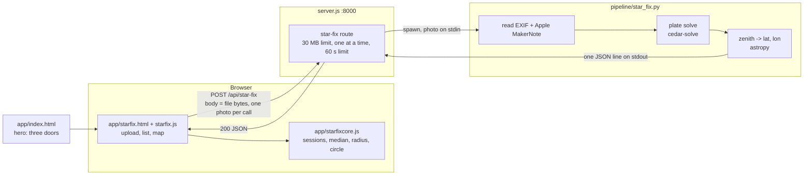
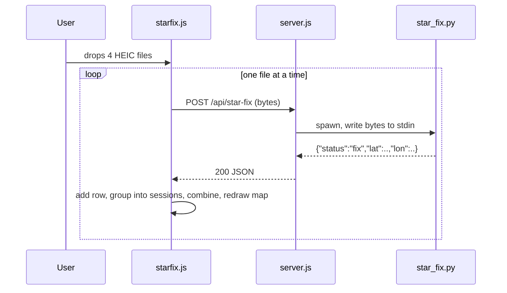
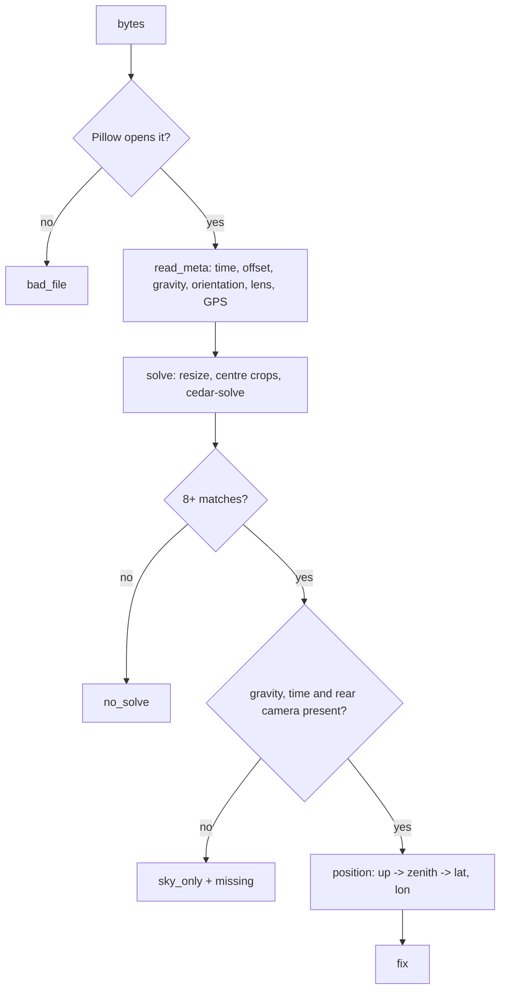

# Star Fix: build design

Status: ready to build, 2026-11-14. Tracking: [kneha07/WANDERERS#39](https://github.com/kneha07/WANDERERS/issues/39).
Evidence and history: [`star-fix.md`](star-fix.md) (read section 2f; sections 3 to 6 there are superseded by this file).
Reader: the agent that builds the feature on Windows. This file is the full brief. Where it and `star-fix.md` disagree, this file wins.

## 1. Goal

A person uploads original iPhone night-sky photos. The app finds where on Earth the photos were taken, from the stars only.
It shows the place on a map with an honest error circle, and compares it with the GPS position that the phone stored.

Measured on Windows with the 14 sample photos (`artifacts/star-fix/win/probe.py`): one photo is 34 to 155 km off, and the
median of a session is 3, 61 and 10 km off. Say "about 50 to 150 km, the accuracy of a navigator before GPS" in the UI.

## 2. Brief for the builder

- Repo: `C:\Users\user\Desktop\github\hackathon\nasa-space-apps-2026`. Work in the worktree `.worktrees\star-fix`.
- That worktree is on `docs/star-fix-design`, which already contains `origin/main`. Start with `git switch -c feature/star-fix`.
- Never commit on `main`. Never run `git push`. The owner pushes after review.
- The worktree has a ready `.venv` (Python 3.13) with every package this design needs. `fields.js` `pickPython` finds it.
- Port the maths from `artifacts/star-fix/win/probe.py`. It is verified on this machine. Do not re-derive it.
- Git on this machine converts line ends. Do not commit a file whose diff is only line ends.
- Build in the order of section 12. Stop and report if an acceptance check in section 11 cannot pass.
- You do not review your own work. End with the report in section 13; a separate reviewer checks it.

## 3. Scope

| In (build this) | Out (do not build) |
|---|---|
| New page `app/starfix.html`: upload, per-photo result, session fix, map | Taking the photo in the browser (owner decision, `star-fix.md` 2a) |
| `POST /api/star-fix` in `server.js`: one photo in, one JSON result out | Sky-glow "up", compass heading, hand-drawn horizon (measured: unusable) |
| `pipeline/star_fix.py`: metadata, plate solve, position | Sun, Moon, planet sights; skyline matching; building edges |
| Combine several photos into one fix per session, in the browser | Android "up" (those files carry no gravity vector): they give `sky_only` |
| Home page hero becomes the chooser: three doors | Lens distortion calibration, a wide-field solver database |
| `start.js` installs the solver; `server.js` uses `pickPython` (closes #27) | A photo preview with marked stars; saving results; accounts |
| Tests in section 11 | Use on a static host (the page says that it needs the local server) |

## 4. How it fits





The photo never touches the disk and never leaves the machine. Nothing is stored or logged on the server.

## 5. Files

| File | Change |
|---|---|
| `pipeline/star_fix.py` | New. Section 7. |
| `pipeline/requirements.txt` | Add `pillow==13.0.0` and `pillow-heif==1.8.1`. Do **not** add `cedar-solve` here (section 9). |
| `server.js` | New route (section 6). Replace the old `PY` lookup by `process.env.WANDERERS_PY \|\| pickPython(__dirname)` from `./fields`. |
| `start.js` | Install and check the solver packages (section 9). |
| `app/starfixcore.js` | New. Pure maths, no DOM, same export pattern as `app/starcore.js`. Section 8. |
| `app/starfix.html`, `app/starfix.js`, `app/starfix.css` | New page. Section 10. Use `brand.css` and `theme.js` like `compass.html`. |
| `app/index.html`, `app/home.css` | Hero doors (section 10.1). Footer link to `starfix.html`. |
| `test/compass-cta.test.js` | Update the expected hero link list (section 10.1). |
| `tests/test_star_fix.py`, `test/starfixcore.test.js`, `test/starfix-server.test.js` | New. Section 11. |
| `docs/architecture.md`, `README.md` | Add the route, the page and the test commands. Short. |

Do not add `starfix.*` to the `SHELL` list in `app/sw.js`. That list is for the Sky Compass page only.

## 6. API contract: `POST /api/star-fix`

Request: the body is the raw bytes of one photo file. No JSON, no multipart. `content-type` is ignored.

| Case | Answer |
|---|---|
| Python gave a result | `200` and the JSON below |
| Empty body | `400 {"error":"no photo"}` |
| Body larger than 30 MB | `413 {"error":"photo too large"}`. Stop reading; do not keep the bytes. |
| Another solve is running | `409 {"error":"busy"}` |
| No answer after 60 s | Kill the process tree, then `504 {"error":"timed out"}` |
| Python missing, crash, or no JSON line | `500 {"error":"Star Fix could not run. Start the app with start.cmd."}`. Never send paths or stack traces. |

Result JSON (Python prints exactly one line; the server relays the last stdout line that starts with `{`):

```json
{
  "status": "fix",
  "lat": -38.21, "lon": 145.52,
  "utc": "2026-06-14T08:20:51Z",
  "sky": { "ra": 139.1, "dec": -72.2, "matches": 53, "constellation": "Carina" },
  "camera_alt": 52.0,
  "model": "iPhone 17 Pro",
  "gps": { "lat": -38.5, "lon": 145.2 },
  "warnings": []
}
```

| `status` | Meaning | Fields |
|---|---|---|
| `fix` | Position found | all |
| `sky_only` | Stars solved, but an input is missing | `sky`, `model`, `utc` if known, `missing`: list of `"gravity"`, `"time"`, `"rear_camera"` |
| `no_solve` | Fewer than 8 matched stars | `stars`: number of star-like spots found |
| `bad_file` | Not a readable image | none |

- `gps` is the position in the file's own EXIF, rounded to 0.01 degree, or `null`. It is for the comparison only. It never feeds the estimate.
- `warnings`: `"zone_mismatch"` when `abs(lon - 15 * offset_hours) > 45` degrees (the photo time or the file is suspect);
  `"untested_lens"` when `FocalLengthIn35mmFilm` is not between 20 and 30 (only the main camera is tested).
- Round `lat`, `lon` to 0.01 and the angles to 0.1.

Server notes:

- Add a `bodyBytes(req, limit)` helper next to `body()`. `body()` returns a string and has a 20 kB limit.
- Spawn `PY` with `["pipeline/star_fix.py"]`, `cwd: __dirname`, no shell. Write the buffer with `p.stdin.end(buf)` and add an empty `error` handler on `p.stdin`.
- Ignore stderr (the solver logs there).
- Timeout kill: on `win32` run `taskkill /pid <pid> /T /F`, as `start.js` does. The venv `python.exe` is a launcher with a child process, so `p.kill()` alone leaves the child alive.
- Use one `starFixBusy` flag. Clear it on `close` and on `error`.

## 7. `pipeline/star_fix.py`

Entry points: `python pipeline/star_fix.py` reads the photo from stdin (`sys.stdin.buffer.read()`); `python pipeline/star_fix.py <file>` reads a file.
Both print one JSON line and exit 0 for every status in section 6. Keep the functions separate so that the tests can call them:
`read_meta(im)`, `solve(im)`, `position(R, g, orient, utc)`, `star_fix(data: bytes) -> dict`.



### 7.1 Metadata (Pillow only, no `exifread`)

Verified on the sample files with `im.getexif()`:

| Value | Where |
|---|---|
| Local time | Exif IFD (`ex.get_ifd(0x8769)`) tag `36867` `DateTimeOriginal`, `"2026:06:14 18:20:51"` |
| UTC offset | Exif IFD tag `36881` `OffsetTimeOriginal`, `"+10:00"`. UTC = local time minus offset. |
| Gravity `g` | Exif IFD tag `37500` MakerNote (bytes, starts with `b"Apple iOS\x00"`). Parse the Apple IFD as `apple_makernote()` in `probe.py` does; tag `8`, three signed rationals. Offsets count from the MakerNote start. |
| Orientation | `im.info.get("original_orientation") or ex.get(274) or 1`. Read it **before** `ImageOps.exif_transpose(im)`. |
| Lens | Exif IFD tag `42036` `LensModel`; if it contains `"front"`, report `missing: ["rear_camera"]`. Tag `41989` is the 35 mm focal length. |
| Model | IFD0 tag `272` |
| GPS | `ex.get_ifd(0x8825)`: tags 1 to 4 (lat ref, lat, lon ref, lon) |

Missing time or offset gives `missing: ["time"]`. Missing MakerNote tag 8 gives `missing: ["gravity"]`.

**Orientation rule (new finding, guards a 7500 km error).** `pillow-heif` turns a HEIC upright and resets EXIF tag 274 to 1.
It keeps the real value in `im.info["original_orientation"]` (6 for portrait, absent for landscape).
Do not guess the orientation from the picture shape or the sign of gravity. Photo `20231125_204326416` was held past the zenith:
the guess gives 7535 km error, the stored value gives 55 km. For a JPEG, read tag 274, then call `ImageOps.exif_transpose`.
Orientation values 2, 4, 5 and 7 (mirrored) are not supported: report `missing: ["rear_camera"]`.

Gravity `g` is in device axes: x to the right of the screen, y to the top of the phone, z out of the screen. The rear camera looks along -z.
Camera frame of the upright picture: X right, Y down, Z forward.

| Orientation | Phone | Picture right (X) | Picture down (Y) |
|---|---|---|---|
| 6 | portrait | `gx` | `-gy` |
| 1 | landscape, left side down | `-gy` | `-gx` |
| 3 | landscape, right side down | `gy` | `gx` |
| 8 | portrait, upside down | `-gx` | `gy` |

`up = -normalize([X, Y, -gz])`.

### 7.2 Plate solve (keep these numbers; they are measured)

1. `import math, numpy as np; np.math = math` before `import tetra3` (cedar-solve still calls `np.math`).
2. Grey picture, resized so that the long side is 2048 px (`LANCZOS`).
3. Try centre crops `0.5`, `0.35`, `1.0`; for each, `sigma` 3 then 2:
   `tetra3.get_centroids_from_image(crop, sigma=sigma, max_area=300, min_area=2)`; skip when there are fewer than 6 spots;
   `t3.solve_from_centroids(cents[:60], (ch, cw), solve_timeout=5000, return_matches=True)`. Stop at the first solve.
4. Accept only `Matches >= 8`. Else `no_solve`.
5. Fit a `TAN` sky map to the matched stars in full-picture pixels (add the crop offset) with `fit_wcs_from_points`.
   Then refit 3 times with `proj_point = wcs.pixel_to_world(W/2, H/2)`. The tangent point must be the picture centre (the lens axis);
   a tangent point at the centre of the stars put "up" 10 to 13 degrees wrong.
6. Camera-to-sky rotation `R`: sample a 9 x 9 pixel grid, build camera rays with the focal length from the sky map, and solve by SVD (`cam_to_sky()` in `probe.py`).
   The focal length comes from the star solve. Do not use the EXIF focal length.
7. `sky.constellation` = `astropy.coordinates.get_constellation` of the picture centre (works offline).

### 7.3 Position

```python
from astropy.utils import iers
iers.conf.auto_download = False            # never wait for the network (firewall, offline demo)
iers.conf.iers_degraded_accuracy = "ignore"   # UT1-UTC error stays below 0.9 s = 0.4 km

z = R @ up                                 # zenith, ICRS unit vector
zz = SkyCoord(ra, dec of z).transform_to(TETE(obstime=utc))
lat = zz.dec
lon = (zz.ra - utc.sidereal_time("apparent", "greenwich")).wrap_at(180 deg)
camera_alt = 90 - angle(R @ [0, 0, 1], z)
```

## 8. `app/starfixcore.js` (browser and Node, pure)

Input: the `fix` results of the page. Functions:

| Function | Rule |
|---|---|
| `distKm(a, b)` | Great-circle distance, Earth radius 6371 km |
| `sessions(fixes)` | Sort by `utc`. A gap of more than 60 minutes starts a new session. |
| `combine(fixes)` | Unit vectors of the fixes; the median of each component; normalise. Returns `{lat, lon, radiusKm, outliers}`. |
| `radiusKm` | 1 photo: `150`. 2 or more: `max(50, median distance of the photos from the combined fix)`. |
| `outliers` | Only with 3 or more photos: a photo more than 300 km from the combined fix. Shown grey. The median already ignores it. |
| `circle(lat, lon, km, n = 64)` | Points of the error circle, by the destination-point formula, for the map |

The radius rule covers the truth in all three sample sessions (radius 53, 65 and 107 km; truth at 3, 61 and 10 km).
Three sessions are a sanity check, not a calibration. Label the circle "typical error", not "guaranteed".

## 9. Windows rules (all verified on this machine)

| Fact | Rule |
|---|---|
| `pip install cedar-solve` fails: its Pillow pin forces a source build | `start.js`: after `pip install -r pipeline/requirements.txt`, run `pip install --no-deps cedar-solve==0.5.1` |
| `start.js` checks the root `.venv` only with `import pyvo` | Check `import pyvo, pillow_heif, tetra3` (this import works without the `np.math` line). A venv from before this feature then repairs itself. |
| `python3` on Windows is the Store stub (exit 9009, #27) | `server.js` uses `pickPython` from `fields.js` |
| Photo to Python | stdin pipe, 1.1 MB file arrives intact (`artifacts/star-fix/win/pipe.js`). No temp file, no path quoting. |
| Python stdout on Windows is cp1252 | Print with `json.dumps` defaults (ASCII only) |
| Time per photo | Process start + imports 1.5 s warm (9.5 s the first time). Solve 0.3 to 5 s. No-solve up to 12 s. So one request stays far below the 60 s limit. |
| Chrome and Edge cannot show HEIC | The page shows the file name, not a thumbnail |
| `node --test test/*.test.js` in `cmd` | Name the test files; `cmd` does not expand `*` |

## 10. Page design

### 10.1 Entry: the home hero is the chooser (decision D1)

Star Fix is a separate page, not a tab of the Observatory: it has its own task, its own input (a file) and it needs the local server.
The entry is the existing home page. There is no extra "choose a page" screen in front of it.
Reason: a gate adds one tap to every visit, hides the project pitch from a first-time visitor, and the hero already is that screen.

Change the hero buttons (`<div class="cta">` in `app/index.html`) into three equal doors plus the "How It Works" link:

| Door | Line 1 | Line 2 | Link |
|---|---|---|---|
| 1 | Explore the Sky | Observatory · 16 years of infrared images | `observatory.html` |
| 2 | See it in the sky | Sky Compass · point your phone up | `compass.html` (keep class `compass-cta` and its text) |
| 3 | Find where you are | Star Fix · upload a star photo | `starfix.html` |

All three use the two-line button style that the Sky Compass button has now (`cc-icon`, `cc-text`). Door 1 keeps `btn-primary`.
Update the expected list in `test/compass-cta.test.js` to `["observatory.html", "compass.html", "starfix.html", "#how"]`.
On a phone the doors stack. Each door is at least 44 px high.

### 10.2 `starfix.html`

One column, top to bottom:

1. Header: logo link to home, theme toggle (copy from `compass.html`), title "Star Fix", one line: "Find where a photo was taken, from its stars."
2. Upload box: a `<label>` around `<input type="file" multiple accept=".heic,.heif,.jpg,.jpeg,image/heic,image/jpeg">`, also a drop target.
   Under it, the tip: "Use the original file from an iPhone (AirDrop, cable or iCloud). Chat apps remove the data that this needs."
3. Photo list, one row per file: name, status, and for a fix the constellation, the position and the distance from the session fix.
   States: waiting, solving (with elapsed seconds), fix, sky only (say what is missing), no solve ("too few stars: twilight or cloud"), error.
4. One card per session: the date and time, "You were about here: 38.2 S, 145.5 E", the nearest city from `data/earth/cities.json`
   (same rule as `nearestCity` in `compass.js`), "Typical error: about 60 km (4 photos)", and when the files hold GPS:
   "Your phone's GPS says 61 km from here."
5. Map: a `<canvas>` that draws a 40 x 20 degree window of `data/earth/day.jpg` (2048 x 1024, plate carree) centred on the fix.
   Draw the error circle from `circle()`, a dot per photo (grey for outliers), a cross for the GPS position.
   Under it a link "Open in OpenStreetMap" (`https://www.openstreetmap.org/?mlat=..&mlon=..#map=7/../..`, `rel="noopener noreferrer"`).
   Mark the code: `// ponytail: 20 km per pixel and no wrap at 180 degrees; use map tiles if a sharper map is needed`.
6. Footer line: "The stars give the place to about 50 to 150 km. GPS is 10 000 times better. This is how navigators worked before GPS."

Behaviour:

- Send the files one at a time, in order. A file above 30 MB is refused in the page before upload.
- On load, `fetch("/api/health")`. When it fails, show "Star Fix needs the local server. Start it with start.cmd." and disable the upload.
- The status row is an `aria-live="polite"` region. Everything works with the keyboard.
- Privacy line near the upload box: "Your photos stay on this computer."

## 11. Tests and acceptance criteria

Commands (Windows, from the worktree root):

```bat
.venv\Scripts\python.exe -m unittest discover -s tests -p "test_star_fix.py"
node --test test/starfixcore.test.js test/starfix-server.test.js test/compass-cta.test.js test/home.test.js test/server.test.js test/fields.test.js
```

The photo tests read `star_image/`. Skip them (do not fail) when a file or the solver package is absent.
Do not write a GPS coordinate of a sample photo into the repo. Only Phillip Island (38.5 S, 145.2 E) is public.

| # | Criterion | Measured now |
|---|---|---|
| A1 | Maths round trip, no photo: for a known place and time, build the zenith, a random camera rotation and `g` for each orientation 1, 3, 6, 8. `position()` returns the place within 2 km. | not yet built |
| A2 | `star_image/20260614_082051102_iOS.heic`: `status` is `fix`, within 100 km of (-38.5, 145.2), `sky.constellation` is `Carina` | 34 km |
| A3 | `star_image/20231125_204326416_iOS.heic` (held past the zenith): `fix`, less than 150 km from the file's own `gps` | 55 km |
| A4 | `star_image/20231125_211246181_iOS.heic` (twilight): `no_solve` | 11 spots |
| A5 | Random bytes: `bad_file`. A sample photo saved again as JPEG without EXIF: `sky_only`, `missing` holds `gravity` and `time`. | not yet built |
| A6 | The four `20260614_*` results through `sessions()` and `combine()`: one session, fix within 120 km of (-38.5, 145.2), radius between 50 and 150 km | 61 km, radius 65 km |
| A7 | `combine()` unit tests: one far photo among four does not move the fix by more than 50 km and is in `outliers`; 1 photo gives radius 150; photos 2 h apart give two sessions; every `circle()` point is `km` from the centre within 1 % | not yet built |
| A8 | Server: empty body gives 400; a 31 MB body gives 413 or a closed connection, and `/api/health` answers after it; random bytes give 200 `bad_file` (skip when the packages are absent); no response text holds a file path | not yet built |
| A9 | `server.js` holds no `python3` literal; `/api/star-predict` uses the same lookup as `fields.js` | #27 open |
| A10 | Every test file that passed before still passes | run the full list |
| A11 | In a browser at `http://localhost:8000/starfix.html`: upload the four `20260614_*` files; the page shows one session, a map with a circle, and a GPS distance. Save a screenshot to `artifacts/star-fix/page.png`. | not yet built |
| A12 | The home hero shows three doors and each opens its page | not yet built |

## 12. Build order

1. `pipeline/star_fix.py` + `tests/test_star_fix.py` (A1 to A5). Port from `probe.py`.
2. `app/starfixcore.js` + `test/starfixcore.test.js` (A6, A7).
3. `server.js` route, `pickPython`, `test/starfix-server.test.js` (A8, A9).
4. `start.js` and `pipeline/requirements.txt` (section 9).
5. `app/starfix.*` page (A11).
6. Home hero doors, footer link, `test/compass-cta.test.js` (A12).
7. `docs/architecture.md`, `README.md`. Full test run (A10).

Commit after each step.

## 13. Report format (end of the build)

At most 15 lines. Line 1: `DONE` or `BLOCKED`. Then one line per criterion A1 to A12: `PASS` or `FAIL` with the command and its exit code,
or the measured km. Then the commit list. Put anything longer in `artifacts/star-fix/build-report.md` and name the path.
Report a failure as a failure.

## 14. Decisions and open points for the owner

| # | Decision in this design | Other option |
|---|---|---|
| D1 | The home hero is the chooser (three doors). No gate screen. | A full-screen chooser before the home page. One more tap on every visit; the pitch moves behind it. |
| D2 | The page shows the phone's GPS next to the star fix. It is the proof that the method works. | Hide GPS fully. Then the user cannot see the error. |
| D3 | Only original iPhone files give a fix. Other files give "sky only" with the reason. | A typed time and a hand-drawn horizon: measured 150 to 400 km at best, and more UI. |
| D4 | The map is the Blue Marble picture that the app already ships. No map library, no tile server. | Leaflet + OpenStreetMap tiles: sharper, but a new dependency and tile requests that show the area to a third party. |

Open point (privacy, not part of the build): commit `72ba60f` put the 14 original photos in `star_image/` on the public `main`.
Each file holds the exact GPS position. The tests in section 11 use these files. If the owner removes the files or strips their GPS,
A2, A4 and A6 still work with local copies, and A3 needs the GPS of its file.

## 15. Known limits (say so in the report if one is hit)

- A JPEG from an iPhone ("Most Compatible" setting) follows the same code path but no real file was tested.
- An edited or re-saved photo can carry a wrong orientation value. The result is then wrong by thousands of km; `zone_mismatch` catches only some of these.
- The ultra-wide and telephoto cameras are not tested (`untested_lens`).
- One bad gravity reading (phone moved during night mode) gives 600 km for that photo. Only a session of 3 or more photos removes it.
- Twilight photos with fewer than about 10 stars do not solve.
