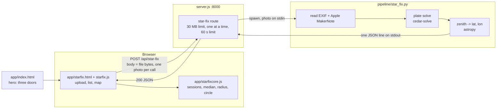
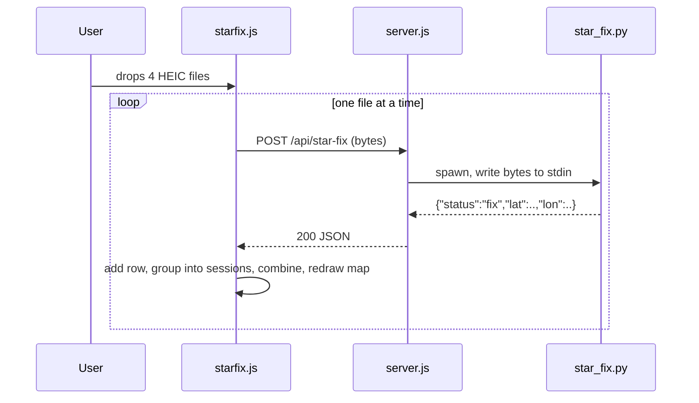
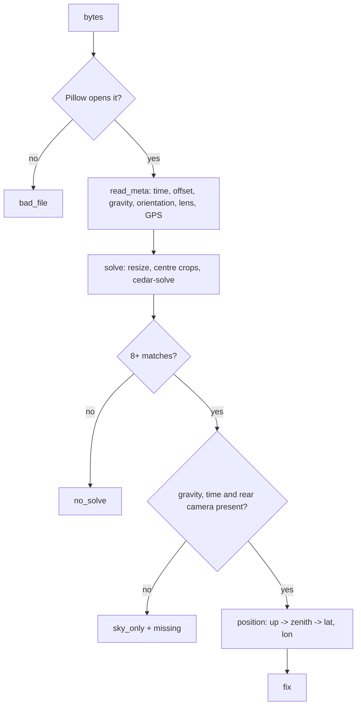

# Star Fix: build design

Status: ready to build, 2026-11-14. Tracking: [kneha07/WANDERERS#39](https://github.com/kneha07/WANDERERS/issues/39).
Evidence and history: [`star-fix.md`](star-fix.md) (read section 2f; sections 3 to 6 there are superseded by this file).
Reader: the agent that builds the feature on Windows. This file is the full brief. Where it and `star-fix.md` disagree, this file wins.

## 1. Goal

A person uploads original iPhone night-sky photos. The app finds where on Earth the photos were taken, from the stars only.
It shows the place on a map with an honest error circle, and compares it with the GPS position that the phone stored.

Measured on Windows with the 14 sample photos (`artifacts/star-fix/win/probe.py`): one photo is 34 to 155 km off, and the
median of a session is 3, 61 and 10 km off. Say "about 50 to 150 km, the accuracy of a navigator before GPS" in the UI.

## 2. Brief for the builder

- Repo: `C:\Users\user\Desktop\github\hackathon\nasa-space-apps-2026`. Work in the worktree `.worktrees\star-fix`.
- That worktree is on `docs/star-fix-design`, which already contains `origin/main`. Start with `git switch -c feature/star-fix`.
- Never commit on `main`. Never run `git push`. The owner pushes after review.
- The worktree has a ready `.venv` (Python 3.13) with every package this design needs. `fields.js` `pickPython` finds it.
- Port the maths from `artifacts/star-fix/win/probe.py`. It is verified on this machine. Do not re-derive it.
- Git on this machine converts line ends. Do not commit a file whose diff is only line ends.
- Build in the order of section 12. Stop and report if an acceptance check in section 11 cannot pass.
- You do not review your own work. End with the report in section 13; a separate reviewer checks it.

## 3. Scope

| In (build this) | Out (do not build) |
|---|---|
| New page `app/starfix.html`: upload, one-sentence answer, map, a built-in example | Taking the photo in the browser (owner decision, `star-fix.md` 2a) |
| `POST /api/star-fix` in `server.js`: one photo in, one JSON result out | Sky-glow "up", compass heading, hand-drawn horizon (measured: unusable) |
| `pipeline/star_fix.py`: metadata, plate solve, position | Sun, Moon, planet sights; skyline matching; building edges |
| Combine several photos into one fix per session, in the browser | Android "up" (those files carry no gravity vector): they give `sky_only` |
| Home page hero becomes the chooser: three doors | Lens distortion calibration, a wide-field solver database |
| `start.js` installs the solver; `server.js` uses `pickPython` (closes #27) | A photo preview with marked stars; saving results; accounts |
| Tests in section 11 | Use on a static host (the page says that it needs the local server) |

## 4. How it fits





The photo never touches the disk and never leaves the machine. Nothing is stored or logged on the server.

## 5. Files

| File | Change |
|---|---|
| `pipeline/star_fix.py` | New. Section 7. |
| `pipeline/requirements.txt` | Add `pillow==13.0.0` and `pillow-heif==1.8.1`. Do **not** add `cedar-solve` here (section 9). |
| `server.js` | New route (section 6). Replace the old `PY` lookup by `process.env.WANDERERS_PY \|\| pickPython(__dirname)` from `./fields`. |
| `star-fix-solver.js` | New (architecture pass). `solvePhoto(buf, {python, script, cwd, timeoutMs})` -> `{code, body, gone}`: the process rules of section 6. |
| `start.js` | Install and check the solver packages (section 9). |
| `app/starfixcore.js` | New. Pure maths, no DOM, same export pattern as `app/starcore.js`. Section 8. |
| `app/starfix.html`, `app/starfix.js`, `app/starfix.css` | New page. Section 10. Use `brand.css` and `theme.js` like `compass.html`. |
| `app/data/starfix-sample.json` | New. The example that the page shows first (section 10.2). No photo is shipped. |
| `app/index.html`, `app/home.css` | Hero: three doors (section 10.1). Footer link to `starfix.html`. |
| `test/compass-cta.test.js` | Update the expected hero link list (section 10.1). |
| `tests/test_star_fix.py`, `test/starfixcore.test.js`, `test/starfix-server.test.js` | New. Section 11. |
| `docs/architecture.md`, `README.md` | Add the route, the page and the test commands. Short. |

Do not add `starfix.*` to the `SHELL` list in `app/sw.js`. That list is for the Sky Compass page only.

## 6. API contract: `POST /api/star-fix`

Request: the body is the raw bytes of one photo file. No JSON, no multipart. `content-type` is ignored.

| Case | Answer |
|---|---|
| Python gave a result | `200` and the JSON below |
| Empty body | `400 {"error":"no photo"}` |
| Body larger than 30 MB | `413 {"error":"photo too large"}`. Stop reading; do not keep the bytes. |
| Another solve is running | `409 {"error":"busy"}` |
| No answer after 60 s | Kill the process tree, then `504 {"error":"timed out"}` |
| Python missing (spawn error, or "No module named" on stderr) | `500 {"error":"Star Fix could not run. Start the app with start.cmd."}`. Never send paths or stack traces. |
| Python started, then crashed or printed no JSON line | `500 {"error":"Could not read this photo."}` (fix round 1, review TL L3) |

Result JSON (Python prints exactly one line; the server relays the last stdout line that starts with `{`):

```json
{
  "status": "fix",
  "lat": -38.21, "lon": 145.52,
  "utc": "2026-06-14T08:20:51Z",
  "local": "2026-06-14T18:20:51+10:00",
  "sky": { "ra": 139.1, "dec": -72.2, "matches": 53, "constellation": "Carina" },
  "camera_alt": 52.0,
  "model": "iPhone 17 Pro",
  "gps": { "lat": -38.5, "lon": 145.2 },
  "warnings": []
}
```

| `status` | Meaning | Fields |
|---|---|---|
| `fix` | Position found | all |
| `sky_only` | Stars solved, but an input is missing | `sky`, `model`, `utc` if known, `missing`: list of `"gravity"`, `"time"`, `"rear_camera"` |
| `no_solve` | No solve passed the gate in 10.5 | `stars`: number of star-like spots found in the last try |
| `bad_file` | Not a readable image, or more than 60 MP (a decompression bomb is refused before decoding) | none |

- `gps` is the position in the file's own EXIF, rounded to 0.01 degree, or `null`. It is for the comparison only. It never feeds the estimate.
- `warnings` (in `fix`, `sky_only` and `no_solve`): `"zone_mismatch"` when the longitude differs from `15 * offset_hours` by more
  than 45 degrees, measured across 180 degrees (the photo time or the file is suspect); `"untested_lens"` when
  `FocalLengthIn35mmFilm` is not between 20 and 30 (only the main camera is tested); `"small_photo"` (10.5).
- `local` is the photo's own clock time with its offset. The page shows its date.
- Round `lat`, `lon` to 0.01 and the angles to 0.1.

Server notes:

- Add a `bodyBytes(req, limit)` helper next to `body()`. `body()` returns a string and has a 20 kB limit.
- Spawn `PY` with `["pipeline/star_fix.py"]`, `cwd: __dirname`, no shell. Write the buffer with `p.stdin.end(buf)` and add an empty `error` handler on `p.stdin`.
- Do not relay stderr (the solver logs there). Read it only to find "No module named", which separates the two 500 answers.
- Timeout kill: on `win32` run `taskkill /pid <pid> /T /F`, as `start.js` does. The venv `python.exe` is a launcher with a child process, so `p.kill()` alone leaves the child alive. On POSIX the solver runs in its own process group, and the group is killed.
- Use one `starFixBusy` flag. Clear it when the process has ended (on `close` and on `error`), also after a 504.
- Architecture pass: the process rules (spawn, stdin, time limit, kill tree, last JSON line, the two 500 answers) are in `star-fix-solver.js` (`solvePhoto`); the route is the HTTP adapter (busy flag, size limit, replies). A test drives `solvePhoto` with a fake solver that sleeps past a 1.5 s limit and checks that its process tree is gone.

## 7. `pipeline/star_fix.py`

Entry points: `python pipeline/star_fix.py` reads the photo from stdin (`sys.stdin.buffer.read()`); `python pipeline/star_fix.py <file>` reads a file.
Both print one JSON line and exit 0 for every status in section 6. Keep the functions separate so that the tests can call them:
`read_meta(im)`, `solve(im)`, `position(R, g, orient, utc)`, `star_fix(data: bytes) -> dict`.



### 7.1 Metadata (Pillow only, no `exifread`)

Verified on the sample files with `im.getexif()`:

| Value | Where |
|---|---|
| Local time | Exif IFD (`ex.get_ifd(0x8769)`) tag `36867` `DateTimeOriginal`, `"2026:06:14 18:20:51"` |
| UTC offset | Exif IFD tag `36881` `OffsetTimeOriginal`, `"+10:00"`. UTC = local time minus offset. |
| Gravity `g` | Exif IFD tag `37500` MakerNote (bytes, starts with `b"Apple iOS\x00"`). Parse the Apple IFD as `apple_makernote()` in `probe.py` does; tag `8`, three signed rationals. Offsets count from the MakerNote start. |
| Orientation | `im.info.get("original_orientation") or ex.get(274) or 1`. Read it **before** `ImageOps.exif_transpose(im)`. |
| Lens | Exif IFD tag `42036` `LensModel`; if it contains `"front"`, report `missing: ["rear_camera"]`. Tag `41989` is the 35 mm focal length. |
| Model | IFD0 tag `272` |
| GPS | `ex.get_ifd(0x8825)`: tags 1 to 4 (lat ref, lat, lon ref, lon) |

Missing time or offset gives `missing: ["time"]`. Missing MakerNote tag 8 gives `missing: ["gravity"]`.

**Orientation rule (new finding, guards a 7500 km error).** `pillow-heif` turns a HEIC upright and resets EXIF tag 274 to 1.
It keeps the real value in `im.info["original_orientation"]` (6 for portrait, absent for landscape).
Do not guess the orientation from the picture shape or the sign of gravity. Photo `20231125_204326416` was held past the zenith:
the guess gives 7535 km error, the stored value gives 55 km. For a JPEG, read tag 274, then call `ImageOps.exif_transpose`.
Orientation values 2, 4, 5 and 7 (mirrored) are not supported: report `missing: ["rear_camera"]`.

Gravity `g` is in device axes: x to the right of the screen, y to the top of the phone, z out of the screen. The rear camera looks along -z.
Camera frame of the upright picture: X right, Y down, Z forward.

| Orientation | Phone | Picture right (X) | Picture down (Y) |
|---|---|---|---|
| 6 | portrait | `gx` | `-gy` |
| 1 | landscape, left side down | `-gy` | `-gx` |
| 3 | landscape, right side down | `gy` | `gx` |
| 8 | portrait, upside down | `-gx` | `gy` |

`up = -normalize([X, Y, -gz])`.

### 7.2 Plate solve (keep these numbers; they are measured)

1. `import math, numpy as np; np.math = math` before `import tetra3` (cedar-solve still calls `np.math`).
2. Grey picture, resized so that the long side is 2048 px (`LANCZOS`).
3. Try centre crops `0.5`, `0.35`, `1.0`; for each, `sigma` 3 then 2:
   `tetra3.get_centroids_from_image(crop, sigma=sigma, max_area=300, min_area=2)`; skip when there are fewer than 6 spots;
   `t3.solve_from_centroids(cents[:60], (ch, cw), solve_timeout=5000, return_matches=True)`. Stop at the first solve.
4. Accept only `Matches >= 8`. Else `no_solve`.
5. Fit a `TAN` sky map to the matched stars in full-picture pixels (add the crop offset) with `fit_wcs_from_points`.
   Then refit 3 times with `proj_point = wcs.pixel_to_world(W/2, H/2)`. The tangent point must be the picture centre (the lens axis);
   a tangent point at the centre of the stars put "up" 10 to 13 degrees wrong.
6. Camera-to-sky rotation `R`: sample a 9 x 9 pixel grid, build camera rays with the focal length from the sky map, and solve by SVD (`cam_to_sky()` in `probe.py`).
   The focal length comes from the star solve. Do not use the EXIF focal length.
7. `sky.constellation` = `astropy.coordinates.get_constellation` of the picture centre (works offline).

### 7.3 Position

```python
from astropy.utils import iers
iers.conf.auto_download = False            # never wait for the network (firewall, offline demo)
iers.conf.iers_degraded_accuracy = "ignore"   # UT1-UTC error stays below 0.9 s = 0.4 km

z = R @ up                                 # zenith, ICRS unit vector
zz = SkyCoord(ra, dec of z).transform_to(TETE(obstime=utc))
lat = zz.dec
lon = (zz.ra - utc.sidereal_time("apparent", "greenwich")).wrap_at(180 deg)
camera_alt = 90 - angle(R @ [0, 0, 1], z)
```

## 8. `app/starfixcore.js` (browser and Node, pure)

Input: the `fix` results of the page. Functions:

| Function | Rule |
|---|---|
| `distKm(a, b)` | Great-circle distance, Earth radius 6371 km |
| `sessions(fixes)` | Sort by `utc`. A gap of more than 60 minutes starts a new session. |
| `combine(fixes)` | Unit vectors of the fixes; the median of each component; normalise. Returns `{lat, lon, radiusKm, outliers}`. |
| `radiusKm` | 1 photo: `150`. 2 or more: `max(50, median distance of the photos from the combined fix)`. |
| `outliers` | Only with 3 or more photos: a photo more than 300 km from the combined fix. Its row says "Not used". The median already ignores it. |
| `circle(lat, lon, km, n = 64)` | Points of the error circle, by the destination-point formula, for the map |
| `describe(result, isOutlier)` | The row text for one photo: the exact sentences of the table in section 10.2 |
| `headline(combined, city, gps, count, example, pending)` | The headline, the "Usually right to about N km" line and the check line, by the rules in section 10.2 |
| `night(rows, {cities, example})` | One night of page rows -> everything its answer block shows: `day`, `headline` (empty before the first answer), `position`, `radius`, `check`, `hint`, `map` (`{lat, lon, r, span}`, the window rule of 10.2) and `osm`, `rows` (`{row, used, mark, text, retry}`), `summary`, `open` (the list default), and the counts `used`, `total`, `pending` (refused files not counted, outliers not used). The page only writes it out (architecture pass). |
| `photoQueue(send, onChange)` | The photo list and its one-at-a-time queue (10.4); `add(files)` returns the names that were already in the list |

The radius rule covers the truth in all three sample sessions (radius 53, 65 and 107 km; truth at 3, 61 and 10 km).
Three sessions are a sanity check, not a calibration. So the page says "Usually right to about N km", never "within N km".

## 9. Windows rules (all verified on this machine)

| Fact | Rule |
|---|---|
| `pip install cedar-solve` fails: its Pillow pin forces a source build | `start.js`: after `pip install -r pipeline/requirements.txt`, run `pip install --no-deps cedar-solve==0.5.1` |
| `start.js` checks the root `.venv` only with `import pyvo` | Check `import pyvo, pillow_heif, tetra3` (this import works without the `np.math` line). A venv from before this feature then repairs itself. |
| `python3` on Windows is the Store stub (exit 9009, #27) | `server.js` uses `pickPython` from `fields.js` |
| Photo to Python | stdin pipe, 1.1 MB file arrives intact (`artifacts/star-fix/win/pipe.js`). No temp file, no path quoting. |
| Python stdout on Windows is cp1252 | Print with `json.dumps` defaults (ASCII only) |
| Time per photo | Process start + imports 1.5 s warm (9.5 s the first time). Solve 0.3 to 5 s. No-solve up to 12 s. So one request stays far below the 60 s limit. |
| Chrome and Edge cannot show HEIC | The page shows the file name, not a thumbnail |
| `node --test test/*.test.js` in `cmd` | Name the test files; `cmd` does not expand `*` |

## 10. Page design

### 10.0 UX rules (the complexity budget)

The feature must not make the app harder to understand. These rules decide every detail below.

1. **One question per screen.** Home asks "where do you start?". Star Fix asks "which photos?". Nothing else competes.
2. **Answer first.** The result is one sentence with a place name, then the map. Numbers and per-photo detail come after, closed by default.
3. **Show, do not explain.** The page opens with a finished example, so nobody has to read instructions to know what will happen.
4. **Help at the point of need.** A photo that cannot be used says why and what to do, in its own row. There is no up-front manual.
5. **No settings, no modes, no new words.** The user never sees: plate, solve, zenith, session, outlier, EXIF, MakerNote, gravity, or "fix" outside the name "Star Fix".
6. **Native controls.** `<input type="file">`, `<details>`, `<progress>`. No custom widgets, no library.
7. **Never a dead end.** Without the local server the page still shows the example and says in one line how to use your own photos.
8. **It looks like WANDERERS.** Only `brand.css` tokens and the brand typefaces. One strong element per screen; the rest stays quiet (section 10.3).

### 10.1 Entry: the home hero is the chooser (decision D1)

Star Fix is a separate page, not a tab of the Observatory: it has its own task, its own input (a file) and it needs the local server.
The entry is the existing home page. There is no extra "choose a page" screen in front of it.
Reason: a gate adds one tap to every visit, hides the project pitch from a first-time visitor, and the hero already is that screen.

Replace the hero buttons (`<div class="cta">` in `app/index.html`) by exactly three doors. Three equal choices, nothing else in the row.

```
┌───────────────────────┐ ┌───────────────────────┐ ┌───────────────────────┐
│ ◎ Explore the Sky     │ │ ◈ See it in the sky   │ │ ✦ Find where you were │
│ Observatory · watch   │ │ Sky Compass · point   │ │ Star Fix · upload a   │
│ 16 years of sky change│ │ your phone up         │ │ star photo            │
└───────────────────────┘ └───────────────────────┘ └───────────────────────┘
```

| Door | Line 1 (what you get) | Line 2 (name · what you need) | Link |
|---|---|---|---|
| 1 | Explore the Sky | Observatory · watch 16 years of sky change | `observatory.html` |
| 2 | See it in the sky | Sky Compass · point your phone up | `compass.html` (keep class `compass-cta` and its text) |
| 3 | Find where you were | Star Fix · upload a star photo | `starfix.html` |

- Line 1 is the result. Line 2 is the name and the one thing the person needs. A visitor can choose without a trial click.
- All three use the two-line button style that the Sky Compass button has now (`cc-icon`, `cc-text`), the same size. Door 1 keeps `btn-primary`: it is the default for a person who does not want to choose.
- Move "How It Works" out of this row. It stays in the top navigation, where it is already. Four mixed buttons become three like ones.
- No label above the row: three buttons that say what they do need no heading. Each door is at least 44 px high.
- Fix round 1 (reviews UA M1, PM F1): the row sits right under the lede, before the longer paragraph, so that all three doors are
  above the fold on a 1280 x 720 laptop (measured: bottom of door 3 at 671 px). One row, equal widths, from a 1024 px window
  (text column 470 px and up); the text gets smaller while the doors are narrow. Below that (phones) the doors stack.
- Update the expected list in `test/compass-cta.test.js` to `["observatory.html", "compass.html", "starfix.html"]`.

### 10.2 `starfix.html`: one column, three states

```
 1. First visit                      2. Working                         3. Done
┌──────────────────────────────┐   ┌──────────────────────────────┐   ┌──────────────────────────────┐
│ ◯ WANDERERS          [theme] │   │ ◯ WANDERERS          [theme] │   │ ◯ WANDERERS          [theme] │
│ Star Fix                     │   │ Star Fix                     │   │ Star Fix                     │
│ Find where you were, from the│   │ Find where you were, ...     │   │ Find where you were, ...     │
│ stars in your photo.         │   │                              │   │                              │
│ ┌ ─ ─ ─ ─ ─ ─ ─ ─ ─ ─ ─ ─ ┐  │   │ ┌ ─ ─ ─ ─ ─ ─ ─ ─ ─ ─ ─ ─ ┐  │   │ ┌ ─ ─ ─ ─ ─ ─ ─ ─ ─ ─ ─ ─ ┐  │
│ │  [ Choose star photos ] │  │   │ │  [ Add more photos ]    │  │   │ │  [ Add more photos ]    │  │
│ │  or drop them here      │  │   │ └ ─ ─ ─ ─ ─ ─ ─ ─ ─ ─ ─ ─ ┘  │   │ └ ─ ─ ─ ─ ─ ─ ─ ─ ─ ─ ─ ─ ┘  │
│ └ ─ ─ ─ ─ ─ ─ ─ ─ ─ ─ ─ ─ ┘  │   │ Reading photo 2 of 4         │   │ 14 June 2026                 │
│ Your photos stay on this     │   │ [=========>            ]     │   │ The stars place these photos │
│ computer.                    │   │                              │   │ 130 km south-east of Geelong.│
│ ▸ Which photos work?         │   │ 14 June 2026                 │   │ Usually right to about 65 km.│
│                              │   │ The stars place this photo   │   │ ✓ Your phone's GPS recorded  │
│ Example · 14 June 2026       │   │ 130 km south-east of Geelong.│   │   a spot 61 km from here.    │
│ The stars place these photos │   │ Usually right to about 150 km│   │ ┌──────────────────────────┐ │
│ 130 km south-east of Geelong.│   │ ┌──────────────────────────┐ │   │ │ map  ⌖ stars  ○ phone GPS│ │
│ Usually right to about 65 km.│   │ │ map                      │ │   │ └──────────────────────────┘ │
│ ✓ The phone's GPS recorded a │   │ └──────────────────────────┘ │   │ Open in OpenStreetMap        │
│   spot 61 km from here.      │   │ ▾ Photos                     │   │ ▸ 4 photos used              │
│ ┌──────────────────────────┐ │   │   IMG_1 ✓ Used · Carina      │   │                              │
│ │ map  ⌖ stars  ○ phone GPS│ │   │   IMG_2 … reading            │   │ ▸ How does this work?        │
│ └──────────────────────────┘ │   │   IMG_3   waiting            │   │ Remove my photos             │
│ ▸ 4 photos used              │   │   IMG_4   waiting            │   │                              │
│ ▸ How does this work?        │   │                              │   │                              │
└──────────────────────────────┘   └──────────────────────────────┘   └──────────────────────────────┘
```

The example values are real (Windows probe, the four `20260614_*` photos): combined answer 39.02 S, 145.43 E, radius 66 km (shown as 65),
61 km from the true place, nearest listed city Geelong at 134 km. The wireframe shortens the headline to fit.

Parts, top to bottom:

1. **Header.** Logo link to home and the theme toggle (copy from `compass.html`). Title "Star Fix". One line: "Find where you were, from the stars in your photo." The door on the home page uses the same words.
2. **Upload.** One control: a `<label>` styled as the primary button around
   `<input type="file" multiple accept=".heic,.heif,.jpg,.jpeg,image/heic,image/jpeg">`. The whole page is the drop target.
   "or drop them here" has its own line under the button, so a late web font cannot re-wrap it and move the page.
   Text under it: "Your photos stay on this computer." After the first photo the button text becomes "Add more photos".
   One closed `<details>` "Which photos work?": "Night-sky photos from an iPhone, with many stars. Use the original file (AirDrop, cable or iCloud). Chat apps remove the data that this needs."
3. **Progress**, only while photos are read: "Reading photo 2 of 4" and a native `<progress>`. It is an `aria-live="polite"` region.
4. **Answer block**, one per night (a "session" in the code; the user sees only the date). Newest first. Content in this order:
   - the date of the photos, from `local`;
   - the headline: "The stars place these photos about 130 km south-east of Geelong, Australia." (rule below);
   - "Usually right to about 65 km." (the radius, rounded to 5 km);
   - the check line, only when the files hold GPS (rule below);
   - the map; then the link "Open in OpenStreetMap";
   - a `<details>` "4 photos used" (or "3 of 4 photos used") with one row per photo. Until the person opens or closes it: open while photos are read or when one was not used (so the reason is visible without a click), closed when every photo was used. After the person opens or closes it, their choice stays. Refused files (not a photo, too large) have a row but are not counted; a photo that disagrees counts but is not used.
   - with 1 or 2 photos, one hint: "Add 2 or more photos from the same night for a better result."
   The block appears after the first photo and updates as more arrive.
5. **Example.** Before the user's first result, the page shows the answer block built from `app/data/starfix-sample.json`,
   with the word "Example" before the date and a dashed rule above it. It uses the same render code. It is removed when the first real result arrives.
6. **"How does this work?"**, one closed `<details>` at the bottom, three lines:
   "1. The app recognises the stars in your photo. 2. Your phone stored which way was down and the exact time. 3. Together they give the one place on Earth where those stars were overhead."
   Then: "Stars give the place to about 50 to 150 km. GPS is 10 000 times better. Navigators worked like this before GPS."
7. **"Remove my photos"**, a text button, only after a result. It removes the user's photos and shows the example again.

Words (all user text comes from `describe()` and `headline()` in `starfixcore.js`, so that one test can check it):

| Case | Row text |
|---|---|
| `fix`, used | "Used · stars of Carina" |
| `fix`, more than 300 km from the others | "Not used: it disagrees with the other photos" |
| `sky_only`, `gravity` missing | "Stars recognised (Carina), but the file has no tilt data. Use the original iPhone file." |
| `sky_only`, `time` missing | "Stars recognised (Carina), but the file has no time data. Use the original iPhone file." |
| `sky_only`, `rear_camera` missing | "Stars recognised (Carina), but this camera is not supported. Use the main rear camera." |
| `no_solve` | "Too few stars to recognise. Use a darker, clearer photo." |
| `bad_file`, or no `.heic`/`.heif`/`.jpg`/`.jpeg`/`.png` name (checked in the page) | "This file is not a photo. Choose a .heic or .jpg file." |
| above 30 MB (checked in the page) | "This file is too large (30 MB limit). Use the original photo." |
| 409, 500, 504 or network error | "Could not read this photo." and a text button "Try again" in the row |
| the same file again (name and size) | No new row. The status line says "Already added: {name}". |
| warning `zone_mismatch` (added to the row) | "The place does not match the photo's time zone. The file may be edited." |
| warning `untested_lens` (added to the row) | "Zoom or wide lens: the result may be less exact." |
| warning `small_photo` (added to the row) | "This photo is small. Use the original file for a better result." |

| Line | Rule |
|---|---|
| Headline | "The stars place these photos {where}." Nearest city from `data/earth/cities.json` (6204 large cities). City inside the radius: "near {city}, {country}". Else: "about {d} km {direction} of {city}, {country}", `d` rounded to 10 km, `direction` one of the 8 compass words (north, north-east, ...) from the city to the answer. One photo: "this photo"; more: "these photos". The count is the photos used for the place (no refused file, no photo that disagrees). |
| No place | "No place found from these photos." With "yet" before the full stop only while photos of that night are still waiting or being read. No sentence before the first answer of the night. |
| Exact position | Small text under the headline: "38.2° S, 145.5° E". |
| Check line, GPS inside the radius | "✓ Your phone's GPS recorded a spot {d} km from here." |
| Check line, GPS outside the radius | "Your phone's GPS recorded a spot {d} km from here. Add more photos from the same night." |
| GPS used for the check | The `gps` of the first photo of that night that has one. |
| Example block | Same lines, but "Your phone's GPS" reads "The phone's GPS". |

Map: a `<canvas>` that draws a window of `data/earth/day.jpg` (2048 x 1024, plate carree) centred on the answer. The window comes from the data
(fix round 1): half-height = 4 x the larger of the radius and the GPS distance, 2:1, from 16 to 40 degrees across (8 to 20 tall).
The 16 degree minimum keeps the coastline readable: a closer crop of the 2048 px image blurs it. At 65 km the circle radius is about
22 px on a 608 px map and 13 px on a phone, clearly bigger than the reticle, and the map glides as photos arrive.
Draw only two marks, in the language of the WANDERERS emblem (`BRAND.md`): the star answer is the solid point with the four-tick reticle
("the position measured now") inside the circle from `circle()`; the phone's GPS is a hollow ring ("recorded"). The legend is two words on the map: "stars", "phone GPS".
No dot per photo: it adds a third mark and no decision. Give the canvas an `aria-label` that repeats the headline.
The link under it: `https://www.openstreetmap.org/?mlat=..&mlon=..#map=7/../..`, `rel="noopener noreferrer"`.
Mark the code: `// ponytail: day.jpg has about 20 km per image pixel (blurry when zoomed in) and no wrap at 180 degrees; use map tiles if a sharper map is needed`.

Behaviour:

- Send the files one at a time, in order. Adding photos during a run appends them to the queue.
- On load, `fetch("/api/health")`. When it fails: keep the example, disable the upload button, and show next to it
  "To use your own photos, start WANDERERS on a computer (start.cmd)."
- Never show a status by colour alone: each row has a mark and words. Everything works with the keyboard. Both themes use the `brand.css` tokens.
- One motion only: when a new photo changes the answer, the circle moves and resizes to its new place in about 400 ms.
  The person sees the circle tighten as photos arrive. Skip it under `prefers-reduced-motion`. Build it last; leave it out if it needs more than about 20 lines.

### 10.3 Visual direction

The page is part of WANDERERS (`BRAND.md`): no new colour, typeface or component style.

| Part | Rule |
|---|---|
| The strong element | The answer: the headline sentence and the map. Everything else is quiet. |
| Headline | `--f-display` (Manrope), large (about `clamp(1.6rem, 4vw, 2.4rem)`), weight 700, sentence case. The place name has the same colour and weight as the rest of the sentence; do not accent one word. |
| Other text | `--f-ui` (Inter). The exact position and the km values in `--f-mono`, as the Observatory shows measured values. |
| Layout | One column, left aligned, `max-width: 38rem`, so that lines stay below about 70 characters. Not centred. |
| Map | Sits on `--viewer` in both themes (brand rule: imagery sits on the viewer colour and is never recoloured). Circle and reticle in the accent colour, 1.5 px line; GPS ring in `--viewer-ink`. Ratio 2:1, full column width. |
| Blocks | No card boxes and no shadows. A block starts with a `--line` rule and its date. The example has a dashed rule. Photo rows are a plain list with hairlines. |
| Labels | Sentence case everywhere. No all-caps labels, no label above a heading. |
| Buttons | The existing `btn btn-primary` for the upload; text buttons for the rest. One primary button per screen. |
| Focus and contrast | Visible keyboard focus on every control; text contrast as the rest of the site (the tokens already meet it). |

`app/data/starfix-sample.json`: the four `fix` results of the `20260614_*` photos, as `star_fix.py` returns them,
but with `gps` set to the public value `{"lat": -38.5, "lon": 145.2}` in every entry. No photo is shipped.

### 10.4 UX mechanics (added 2026-11-15, owner: "enforce the uiux robustness")

The page is one place. It uses no `pushState` and no hash routes. Back from Star Fix is one press to home. Reload shows the example again, because nothing is stored.

```
home --door--> starfix [example | no server] --choose/drop--> reading (queue) --> done
done --Add more--> reading ; done --Remove my photos--> example + inline Undo (8 s)
```

| # | Rule |
|---|---|
| U1 | Every chosen file shows as a row ("waiting") within 100 ms, before the first request. |
| U2 | One request at a time (`photoQueue` in `starfixcore.js`). Dedupe by name + size, also against waiting rows; the status line says "Already added: {name}". |
| U3 | Every request ends: abort at 75 s. A 409/500/504/network failure keeps the File and shows an in-row "Try again". |
| U4 | Keyed in-place updates. A `<details>` that the person opened or closed keeps its state, always: the automatic rule applies only until the person touches it. Focus never jumps. |
| U5 | No layout shift: the map has a fixed 2:1 box; the example renders only after its data and the city list load; the drop hint has its own line. CLS below 0.1 at 390 px on a first visit (measured 0.003 to 0.006, also with fonts 1.2 s late). |
| U6 | The "start WANDERERS" line shows only after `/api/health` fails, never while it is pending. |
| U7 | "Remove my photos" acts at once, moves focus to the upload control and offers "Undo" for 8 s. No `confirm()`. |
| U8 | Visible drop state ("Drop to add"). Non-image files and files above 30 MB are refused in the page without a request. |
| U9 | The circle motion can be interrupted and never queues; off under `prefers-reduced-motion`. |
| U10 | `aria-live` progress ("Reading photo N of M"), then the headline once. Status is a mark plus words, never colour alone. |

### 10.5 Server quality checks (added 2026-11-15)

Measured with `artifacts/star-fix/compress_test.py` (4 photos × 6 sizes × 4 JPEG qualities; issue #39):

- **Solve gate.** Accept a solve only when Matches ≥ 8, RMSE ≤ 300″ and Prob ≤ 1e-8. A JPEG copy of `20260614_081100956` gave a solve with 15 matches, Prob 2.3e-7 and RMSE 516″: the right sky with the wrong scale and roll, 2800 km off. Good solves have Prob ≤ 2.6e-9 and RMSE ≤ 165″. This is test A17.
- **`small_photo` warning** when the long side is below 1600 px: "This photo is small. Use the original file for a better result." From 1280 px down, the matches fall to 8–16.
- **No compression on the device.** From 2048 px up, a JPEG copy at any quality from 0.4 to 0.92 gives the same answer to about 1 to 2 km. But Chromium 156 on Windows cannot decode HEIC (`createImageBitmap` gives `InvalidStateError`), and iPhone HEIC files are 1 to 3 MB. So the 30 MB limit stays. For a hosted version later: resize on the device to 3072 px at quality 0.85, and copy the EXIF block with the original orientation.

## 11. Tests and acceptance criteria

Commands (Windows, from the worktree root):

```bat
.venv\Scripts\python.exe -m unittest discover -s tests -p "test_star_fix.py"
node --test test/starfixcore.test.js test/starfix-server.test.js test/compass-cta.test.js test/home.test.js test/server.test.js test/fields.test.js
```

The photo tests read `star_image/`. Skip them (do not fail) when a file or the solver package is absent.
Do not write a GPS coordinate of a sample photo into the repo. Only Phillip Island (38.5 S, 145.2 E) is public.

| # | Criterion | Measured now |
|---|---|---|
| A1 | Maths round trip, no photo: for a known place and time, build the zenith, a random camera rotation and `g` for each orientation 1, 3, 6, 8. `position()` returns the place within 2 km. | built: PASS (build-report.md) |
| A2 | `star_image/20260614_082051102_iOS.heic`: `status` is `fix`, within 100 km of (-38.5, 145.2), `sky.constellation` is `Carina` | 34 km |
| A3 | `star_image/20231125_204326416_iOS.heic` (held past the zenith): `fix`, less than 150 km from the file's own `gps` | 55 km |
| A4 | `star_image/20231125_211246181_iOS.heic` (twilight): `no_solve` | 11 spots |
| A5 | Random bytes: `bad_file`. A sample photo saved again as JPEG without EXIF: `sky_only`, `missing` holds `gravity` and `time`. | built: PASS (build-report.md) |
| A6 | The four `20260614_*` results through `sessions()` and `combine()`: one session, fix within 120 km of (-38.5, 145.2), radius between 50 and 150 km | 61 km, radius 65 km |
| A7 | `combine()` unit tests: one far photo among four does not move the fix by more than 50 km and is in `outliers`; 1 photo gives radius 150; photos 2 h apart give two sessions; every `circle()` point is `km` from the centre within 1 % | built: PASS (build-report.md) |
| A8 | Server: empty body gives 400; a 31 MB body gives 413 or a closed connection, and `/api/health` answers after it; random bytes give 200 `bad_file` (skip when the packages are absent); no response text holds a file path | built: PASS (build-report.md) |
| A9 | `server.js` holds no `python3` literal; `/api/star-predict` uses the same lookup as `fields.js` | #27 open |
| A10 | Every test file that passed before still passes | run the full list |
| A11 | In a browser at `http://localhost:8000/starfix.html`: upload the four `20260614_*` files. The page shows one answer block: headline with a place name, "Usually right to about N km", the GPS check line, the map with two marks. The answer is above the photo list and the list is closed. Save `artifacts/star-fix/page.png` (wide) and `page-phone.png` (390 px wide), in both themes. | built: PASS (build-report.md) |
| A12 | The home hero row holds exactly three links, in this order: `observatory.html`, `compass.html`, `starfix.html`. "How It Works" is still in the top navigation. Each door opens its page. | built: PASS (build-report.md) |
| A13 | First visit: the example block is visible and has the word "Example". After the first result it is gone; "Remove my photos" brings it back. With `/api/health` unreachable (open `app/starfix.html` from a static server): the example shows, the upload is disabled, and the one-line reason is visible. | built: PASS (build-report.md) |
| A14 | `describe()` returns the exact text of section 10.2 for every case. No text from `describe()`, `headline()` or `starfix.html` holds one of: plate, solve, zenith, session, outlier, EXIF, MakerNote, gravity, or "fix" outside "Star Fix" (case-insensitive test). | built: PASS (build-report.md) |
| A15 | `app/data/starfix-sample.json`: four entries, every `gps` is exactly `{"lat": -38.5, "lon": 145.2}`, and `combine()` of them is within 120 km of that point | built: PASS (build-report.md) |
| A16 | `starfix.html` before upload has one primary button; the page has no horizontal scroll at 390 px; every control is reachable by Tab and shows focus | built: PASS (build-report.md) |

## 12. Build order

1. `pipeline/star_fix.py` + `tests/test_star_fix.py` (A1 to A5). Port from `probe.py`.
2. `app/starfixcore.js` + `test/starfixcore.test.js` (A6, A7).
3. `server.js` route, `pickPython`, `test/starfix-server.test.js` (A8, A9).
4. `start.js` and `pipeline/requirements.txt` (section 9).
5. `app/starfix.*` page and `app/data/starfix-sample.json` (A11, A13 to A16). The circle motion comes last.
6. Home hero doors, footer link, `test/compass-cta.test.js` (A12).
7. `docs/architecture.md`, `README.md`. Full test run (A10).

Commit after each step.

## 13. Report format (end of the build)

At most 25 lines. Line 1: `DONE` or `BLOCKED`. Then one line per criterion A1 to A16: `PASS` or `FAIL` with the command and its exit code,
or the measured km. Then the commit list. Put anything longer in `artifacts/star-fix/build-report.md` and name the path.
Report a failure as a failure.

## 14. Decisions and open points for the owner

| # | Decision in this design | Other option |
|---|---|---|
| D1 | The home hero is the chooser (three doors). No gate screen. | A full-screen chooser before the home page. One more tap on every visit; the pitch moves behind it. |
| D2 | The page shows the phone's GPS next to the star fix. It is the proof that the method works. | Hide GPS fully. Then the user cannot see the error. |
| D3 | Only original iPhone files give a fix. Other files give "sky only" with the reason. | A typed time and a hand-drawn horizon: measured 150 to 400 km at best, and more UI. |
| D4 | The map is the Blue Marble picture that the app already ships. No map library, no tile server. | Leaflet + OpenStreetMap tiles: sharper, but a new dependency and tile requests that show the area to a third party. |
| D5 | The page opens with a finished example (Phillip Island) instead of instructions. It also keeps the page useful on the static site. | An empty page with a how-to text: more to read, and a dead end without the server. |
| D6 | The hero row holds only the three doors. "How It Works" stays in the top navigation. | Keep it as a fourth button: four unlike choices instead of three like ones. |
| D7 | The user sees a place in words first ("about 130 km south-east of Geelong, Australia"); coordinates and per-photo detail are secondary and closed. | Coordinates and a table first: exact, but the person must translate them. |

Open point (privacy, not part of the build): commit `72ba60f` put the 14 original photos in `star_image/` on the public `main`.
Each file holds the exact GPS position. The tests in section 11 use these files. If the owner removes the files or strips their GPS,
A2, A4 and A6 still work with local copies, and A3 needs the GPS of its file.

## 15. Known limits (say so in the report if one is hit)

- A JPEG from an iPhone ("Most Compatible" setting) follows the same code path but no real file was tested.
- An edited or re-saved photo can carry a wrong orientation value. The result is then wrong by thousands of km; `zone_mismatch` catches only some of these.
- The ultra-wide and telephoto cameras are not tested (`untested_lens`).
- One bad gravity reading (phone moved during night mode) gives 600 km for that photo. Only a session of 3 or more photos removes it.
- Twilight photos with fewer than about 10 stars do not solve.
