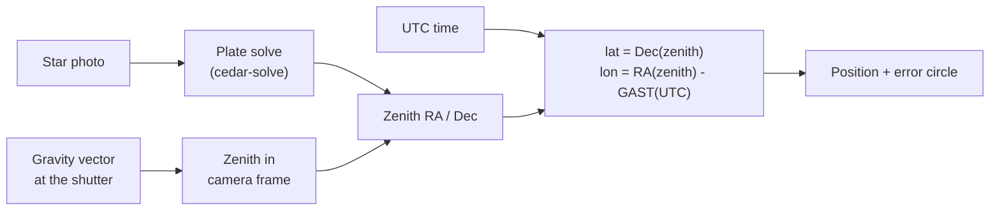
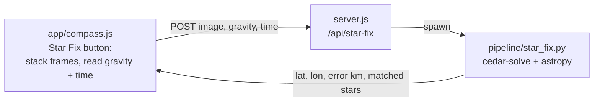

# Star Fix: find your position from a photo of the sky

Status: design evaluation, 2026-11-14. Nothing is built yet. **Build design: [`star-fix-build.md`](star-fix-build.md)** (it supersedes sections 3 to 6 here). Tracking: [kneha07/WANDERERS#39](https://github.com/kneha07/WANDERERS/issues/39). Related risk: #27 (the star-predict spawn uses the wrong Python lookup on Windows).

## 1. What a position fix needs

A sailor with a sextant needs three things. The app needs the same three things.

| Sailor had | App uses | Gives |
|---|---|---|
| Star almanac | Plate solver + Hipparcos catalogue | The sky direction (RA/Dec) of every pixel |
| Sextant (angle to the horizon) | Phone gravity sensor, or the horizon in the photo | Which direction is "up" (the zenith) |
| Chronometer | Phone clock (UTC) | How far the Earth turned |



If one of the three is missing, there is no fix.

## 2. Test on the four sample photos (`star_image/`)

I ran `cedar-solve` (an open-source fork of ESA tetra3) on the four photos. The default database covers a 10-30 deg field.
A phone frame is about 60-70 deg, so three photos solved only after a centre crop of 50 %.

| Photo | Input | Centre RA | Centre Dec | Field | Matched stars | False-match probability | Sky area |
|---|---|---|---|---|---|---|---|
| `1 (1).jpeg` | centre 50 % | 144.1 | -65.2 | 39 deg | 50 | 5e-75 | Carina |
| `1 (2).jpeg` | centre 50 % | 120.5 | -41.9 | 29 deg | 15 | 2e-7 | Puppis / Vela |
| `1 (3).jpeg` | full frame | 183.9 | -67.7 | 56 deg | 49 | 2e-72 | Crux / Musca |
| `1 (4).jpeg` | centre 50 % | 139.1 | -72.2 | 39 deg | 52 | 4e-80 | Carina |

Each solve took 0.1-6 s on a laptop. The fit error (RMSE) is 3-8 arcmin, which is good for a phone lens.

What these photos can tell about position:

- The files have no EXIF data: no time, no GPS, no camera model. A chat app probably removed it.
- Most photos show no horizon. `1 (2).jpeg` shows only some trees at one corner.
- So the photos give only one fact: a star at Dec -72 was above the horizon. Thus the camera was south of about 18 deg N.

Conclusion: plate solving works well on phone night photos. But a photo file alone is not enough for a fix.
The app must capture the time and the "up" direction at the moment of the photo.

## 2a. Owner decision (2026-11-14)

- The app does **not** take the photo. The user uploads a photo from the phone's night-mode camera.
- The app receives: the photo, the local clock time of the photo, and a compass heading.
- The app does the math on the sky in the photo. It does not use trees, buildings or other landmarks.

So option C below (capture in Sky Compass) is out. Sections 4 and 5 apply only to option C.

## 2b. Sky-only estimate from the sample photos (time "about 7 pm", no compass values yet)

Method, with stars and sky only:

1. Plate solve each photo, then fit a sky map (TAN WCS) to the matched stars. Marked photos: `artifacts/star-fix/photo1_stars.jpg` to `photo4_stars.jpg`.
2. Find "down" from the sky glow. Light pollution and airglow make the sky brighter near the horizon. A plane fit to the star-free sky background gives the glow direction.
3. Each photo then gives one vertical great circle on the sky, and the zenith lies on it. Two photos from the same session cross at the zenith.
4. Latitude = Dec of the zenith. Local sidereal time (LST) = RA of the zenith.
5. The clock time (7 pm) plus the LST gives the date (season). It does not give the longitude without the date and the time zone.

| Check | Result |
|---|---|
| Hemisphere | **South, certain.** The south celestial pole is inside photos 1, 3 and 4, with sky all round it. |
| Glow direction | 13-26 deg from image-down in each photo. The bottom is 1.8-3.4x brighter than the top. |
| Photos 2 + 3 (cloudy session) | Zenith Dec **-53** (68 %: -58 to -47), LST 11.0 h (10.5-11.4 h) |
| Photos 1 + 4 (clear session) | Zenith Dec -63 (68 %: -65 to -58), LST 10.0 h. Weak: the two photos point the same way, so the lines are almost parallel. |
| "Up = image top" instead of glow | Photos 2 + 3 give -36. Photos 1 + 4 give +2.5, which is impossible because it puts the visible south pole below the horizon. So glow is the better "up". |
| Season from 7 pm | Late April to mid-June, most likely mid-May. |
| Darkness check | At 40-60 S in that season the sun is 17-27 deg below the horizon at 7 pm. The sky is fully dark, as in the photos. |
| Longitude | **Not possible** from these inputs. Longitude = 15 x (LST - GMST(UTC)), and GMST needs the date. |

Estimate: **latitude about 50 S, plausible range 35-60 S**, in southern autumn. The 68 % ranges show only the glow-direction noise.
The true error is larger, because clouds lit by a town can shift the glow.

Scripts: `artifacts/star-fix/analyze.py` (solve, sky map, marks), `zenith.py` (glow and zenith), `season.py` (date from 7 pm).

What the compass adds: the south celestial pole is always at azimuth 180 (true). With the heading of the photo centre, the app knows the angle at the zenith between the photo centre and the pole.
That fixes the zenith on the vertical line, so one photo is enough. Correct magnetic to true north with the existing `pipeline/make_declination.py` data.
The heading is weak when the photo points within about 15 deg of the zenith (photos 1 and 4).

What gives the longitude: the date plus the UTC offset of the 7 pm time. Then the LST error of about +-0.5 h gives about +-7 deg of longitude.

## 2c. Adding the date and time zone (owner input: mid-June, GMT+10, no compass)

UTC of the photos = 19:00 - 10 h = 09:00 UTC on about 15 June. GMST then = 2.58 h. Longitude = 15 x (LST - GMST).

| Source | Longitude |
|---|---|
| Photos 2 + 3, glow "up" | 126 E (68 %: 119-133 E) |
| Photos 2 + 3, "up = image top" | 133 E |
| Photos 1 + 4, glow "up" | 111 E. **Rejected:** to match the zone it needs the sun above the horizon. |
| GMT+10 land in the south (QLD, NSW, ACT, VIC, TAS) | 141-154 E |

Joint fit (`artifacts/star-fix/fix.py`): for each candidate place on a 1-deg grid, predict the "up" direction in each photo and compare it with the glow (+-15 deg).

| Model | Best place | Best place inside 141-154 E |
|---|---|---|
| Glow "up" | 53 S, 124 E (good fit) | 42 S, 141 E (poor fit, about 3 sigma) |
| "Up = image top" | 35 S, 131 E (68 %: 15-47 S, 122-142 E) | 27 S, 141 E (inside the 68 % region) |

The stars and the time zone disagree by about 1-1.5 h of sidereal time (15-25 deg of longitude).
`artifacts/star-fix/clock.py` shows that photos 2 + 3 match 145-151 E if the photos were taken at 17:45-18:10, not 19:00. **Wrong, see 2d:** the time was right and the glow "up" was wrong.
The sun is then 7-12 deg below the horizon (nautical twilight). This fits the blue sky in photos 2 and 3.

Best combined estimate: **south-eastern Australia, latitude about 35 S (+-8 deg)**. The time zone sets the longitude. The stars set the hemisphere and the latitude.

Lessons for the app:

1. The time must be exact. Each 30 min of clock error moves the longitude by 7.5 deg. Read the time from the photo metadata, not from user memory.
2. Sky-glow "up" is the weakest input: about +-10 deg of latitude and up to 25 deg of sidereal-time bias. A compass heading and a tilt reading at the shutter would fix this.
3. Use the time zone as a check. If the star longitude falls outside the zone, show "the photo time may be wrong" and solve for the time instead.
4. Two photos that point the same way (photos 1 and 4) give almost parallel lines. Ask for photos in two different directions.

## 2d. Truth check: Phillip Island (owner input, 38.5 S, 145.2 E)

| Estimate | Error |
|---|---|
| Stars + glow (53 S, 124 E) | 2290 km |
| Stars, "up = image top" (35 S, 131 E) | 1320 km |
| Glow, limited to GMT+10 (42 S, 141 E) | 530 km |
| Combined answer (35 S, 141 E) | 540 km |

Which input was wrong (`artifacts/star-fix/truth.py`)? At 19:00 on Phillip Island, the true "up" in each photo is:

| Photo | True "up" | Glow "up" | Image top | Photo centre altitude |
|---|---|---|---|---|
| 1 | -23 deg | -14 | 0 | 55 deg |
| 2 | -9 deg | -26 | 0 | 42 deg (bottom edge 7 deg, which fits the trees there) |
| 3 | -19 deg | +24 (wrong sign) | 0 | 61 deg |
| 4 | -17 deg | +13 (wrong sign) | 0 | 50 deg |

- The 7 pm time was right. The idea in 2c that the photos were taken near 18:00 is wrong. **Later correction (2f):** the original files show 18:10-18:20, so the time was also about 45 min off.
- The glow direction is 9-43 deg wrong. Local lights and lit clouds, not the horizon, set the glow.
- The person held the phone turned 9-23 deg the same way in all four photos. So "image top" is also not "up".
- Conclusion: "up" is the input that limits the fix. Sky glow is not good enough.

## 2e. What accuracy needs: the budget down to metres

Rule of thumb: 1 arcsec of error in the zenith = 31 m. 1 s of clock error = 15 arcsec x cos(latitude) = 360 m at Phillip Island.

| Error source | For 1 m you need | Phone today | Best known method |
|---|---|---|---|
| "Up" (vertical) | 0.03 arcsec | 0.5-1 deg (accelerometer) = 50-100 km | Geodetic tiltmeter, camera turned 180 deg to cancel bias: about 0.1 arcsec |
| Clock | 3 ms | EXIF seconds, about 1 s = 360 m | GPS-disciplined clock |
| Earth rotation data (UT1-UTC, up to 0.9 s; polar motion, about 0.3 arcsec) | IERS bulletin values | not used = up to 330 m | Use IERS data (astropy downloads it) |
| Star centroids and lens | 0.03 arcsec total | 144 arcsec per pixel, uncalibrated distortion | Zenith camera, about 1 arcsec per pixel, hundreds of stars |
| Air refraction | temperature and pressure | not modelled | Model plus many nights; about 0.1 arcsec stays |
| Deflection of the vertical (plumb line vs. GPS ellipsoid) | a model good to 0.03 arcsec | 5-30 arcsec = 150-900 m | AUSGeoid2020 / EGM2008 grids, about 1 arcsec = 30 m |

Accuracy ladder:

| Level | Setup | Position error |
|---|---|---|
| Sample photos | Phone, sky-glow "up", "about 7 pm" | 540 km (measured) |
| 1 | Original file: exact time from EXIF, plus gravity vector or sea horizon in the photo | 30-100 km |
| 2 | Phone on a tripod, level calibrated by a 180 deg turn, lens calibrated, 10+ photos averaged | 5-10 km |
| 3 | Camera + long lens, precision electronic level, GPS time, refraction model | 150-300 m |
| 4 | Professional zenith camera (geodesy) | 3-6 m from the plumb line, but 30 m or more from GPS because of the deflection of the vertical |

Metre accuracy from stars is not possible, even for geodesists. Earth's uneven gravity tilts the plumb line by 5-30 arcsec, and the best models of that tilt leave about 30 m.
Geodesists use zenith cameras plus GPS to measure that tilt, not to find their position.

For the app (upload only), the realistic target is level 1, 30-100 km. That is the accuracy of a good navigator before GPS. Inputs that get there:

1. The original photo file, not a copy from a chat app, so EXIF keeps `DateTimeOriginal` and `OffsetTimeOriginal`.
2. A good "up". Best first: the gravity vector in the file (iPhone Apple MakerNote `AccelerationVector`; check this on a real file), then a sea horizon in the frame (correct for eye-height dip), then the compass heading plus two photos in different directions. Sky glow is the last fallback.
3. A one-time lens calibration per phone model (SIP distortion), so that stars at the frame edge are usable.

## 2f. Test on 14 original iPhone photos (HEIC, 3 places, owner upload 2026-11-14)

Files: 6 photos from an iPhone 13 (2023-11-26, 04:35-05:12, UTC+8), 8 photos from an iPhone 17 Pro (2026-06-14 18:10-18:20 and 2026-06-19 19:06-19:10, UTC+10).
The 14 June photos are the originals of `star_image/`. **Correction to 2d:** their real time is 18:10-18:20, not 19:00.

What the original files contain (all 14):

- `DateTimeOriginal` + `OffsetTimeOriginal`: exact local time and time zone.
- `GPSImgDirection` (true): a compass heading.
- Apple MakerNote tag `0x0008` `AccelerationVector`: the gravity vector at capture, in CoreMotion device axes (x right, y top of phone, z out of the screen; gravity points down). **This is the "up" we needed.**
- GPS position. The test hid it in a separate answer file and read it only to score the result.

Method (`artifacts/star-fix/iphone/`): `meta.py` (metadata, GPS hidden) -> `solve_all.py` (plate solve, TAN sky map) -> `fix_heic.py` (up from gravity -> zenith -> latitude, longitude) -> `gerr.py` (score).

Two geometry rules learned:

1. Fit the sky map with its tangent point at the image centre (the lens axis). A tangent point at the centre of the matched stars put "up" 10-13 deg wrong.
2. Map gravity to the image: portrait: image right = +x, image down = -y. Landscape (left side down): image right = -y, image down = -x. View direction = -z.

Results (blind; scored after against the hidden GPS):

| Place | Photos solved | Per-photo error | Median of the session |
|---|---|---|---|
| Hong Kong (Sha Tin area) | 2 of 6 (pre-dawn twilight, few stars) | 50, 55 km | **2 km** |
| Phillip Island | 4 of 4 | 34-155 km | **53 km** |
| Gold Coast hinterland | 4 of 4 | 63-105 km, one 641 km | **19 km** |

Sensor accuracy measured against GPS:

| Input | Result |
|---|---|
| Gravity vector | 0.3-1.4 deg on 9 of 10 photos; one at 5.8 deg (phone moved during the night-mode capture). 1 deg = 111 km. |
| EXIF compass heading | Unusable for sky photos: about 180 deg wrong on 7 of 10 (iOS flips it when the camera points above about 45 deg), 45-100 deg wrong on the others. The stars give the azimuth instead. |
| Focal length from the star solve | 3026-3033 px; the 26 mm-equivalent value gives 3028 px. |
| Venus (photo 2023 05:12, no star solve) | Altitude from gravity was 4.7 deg low, so its circle of position is 520 km off. Same outlier type as above. |

Conclusions:

- Level 1 of the ladder in 2e (30-100 km per photo) is reached with real files. The median of 4 photos reaches about 20-50 km.
- Reject outliers by consensus: the median of several photos removed the 641 km photo.
- Twilight photos with fewer than about 10 stars do not solve. Use a bright planet, the Moon or the Sun for them.

Other clues the owner asked about:

| Clue | Value | How |
|---|---|---|
| Building edges | "Up" to about 0.1-0.5 deg, a check on the gravity vector | Vertical vanishing point of straight edges |
| Mountain skyline | Best path below 10 km: 0.1-1 km in mountain country | Match the skyline to a 30 m elevation model (Copernicus DEM). The star fix limits the search to a 50 km circle, and the stars give the true azimuth of every pixel. |
| Sea horizon | "Up" to about 0.1 deg | Horizon line minus dip for the eye height |
| Trees | Little value | Not straight, unknown height |
| Sun (day) | 1 sight = 1 circle of position (30-150 km wide band with this gravity error) | Altitude from gravity + ephemeris. Fix from two sights 2-3 h apart (running fix), or Sun + Moon at once. Fit the disc centre; the phone saturates. |
| Moon (day or night) | Same as Sun | Correct the Moon's parallax (up to 1 deg); astropy topocentric coordinates do this. |

## 3. Options

| Option | Time from | "Up" from | Expected error | Risk |
|---|---|---|---|---|
| A. Upload any photo | EXIF (often removed) | nothing | no fix, only a hemisphere band | Does not meet the goal |
| B. Upload photo, user marks the horizon line and types the time | user | horizon line in photo | 150-400 km | Horizon is often hidden. Lens distortion is largest at the edge, where the horizon is. |
| **C. Capture in Sky Compass** | phone clock | gravity sensor at the shutter | **50-150 km** | The browser camera stream shows fewer stars than night mode |

Recommendation (first draft): build C, with B as the fallback. **Superseded by section 2a:** the app uses uploaded night-mode photos, so build B with automatic "down" from sky glow and the compass heading instead of a hand-drawn horizon.

Option C is a "bubble sextant": aircraft navigators used a bubble level instead of the sea horizon. The phone accelerometer is that bubble.
It does not use the magnetic compass, so the noise that `app/orient.js` describes does not affect it.

## 4. Error budget for option C

| Source | Typical size | Position error |
|---|---|---|
| Gravity tilt (phone held still, 1 s average) | 0.2-1 deg | 20-110 km |
| Camera axis vs. phone body | about 0.5 deg | about 55 km (calibrate once to remove) |
| Plate solve fit | 3-8 arcmin | 5-15 km |
| Phone clock | below 1 s | below 0.5 km |
| Precession, J2000 to date (if not corrected) | 0.36 deg | about 40 km. Correct it with astropy. |

So the honest claim is "within about 100 km". That is the accuracy of a good 18th-century navigator. GPS is 10 000 times better. Say this in the UI.

## 5. The main risk: enough stars in the browser camera

The native camera app uses night mode: many seconds of exposure and frame stacking. The sample photos come from night mode and show 170-660 stars.
A browser `getUserMedia` stream has short exposures and shows only bright stars.
The solver needs about 10 stars. At magnitude 3 a 60 deg field holds only about 10 stars.

Mitigation: stack 2-4 s of video frames in the page. `orient.js` already gives the gyro rotation, so the page can align the frames before it adds them.

Do a spike before any other work: one clear night, two phones (one iPhone, one Android).
Pass condition: the stacked frame solves 3 times out of 5. If it fails, ship option B only.

## 6. Where the code goes

Reuse the existing pattern of `/api/star-predict` and `/api/star-job/:id` in `server.js`.



- `app/compass.js`: add the button, the frame stack and the result map. Read "up" from `Orient` (beta and gamma only, no compass).
- `server.js`: add one route that spawns the Python job, the same way as `/api/star-predict`.
- `pipeline/star_fix.py`: solve with `return_rotation_matrix=True`, rotate the gravity vector into the sky frame, convert to latitude and longitude with astropy (`TETE` frame of date and GAST).
- `pipeline/requirements.txt`: add `cedar-solve`.
- Like the other live features, this needs `server.js`. A static host cannot run it.

Install notes from the test (Python 3.14, numpy 2):

- `pip install cedar-solve` fails on its Pillow pin. Install `numpy scipy pillow` first, then `pip install --no-deps cedar-solve`.
- `cedar-solve` still calls `np.math`. Add `import math; np.math = math` before you call the solver.
- Use the centre-crop retry (100 %, then 50 %) instead of building a wide-field database. Build a 30-70 deg database only if crops fail in the spike.

Do not use the astrometry.net web API. It needs an account, it is slow, and it sends a photo that reveals the user's location to a third party.

## 7. How to test

1. Math check (no camera): pick a known place and time. Compute the zenith, tilt a virtual camera, run the inverse, and assert that the result is within 1 km.
2. Solver check: the four sample photos must solve to the table in section 2.
3. Field check: take 5 fixes at a place with known GPS. Report the mean error in km.

## Appendix: the probe script

```python
import sys, glob, math
import numpy as np; np.math = math   # cedar-solve still calls np.math (removed in numpy 2)
from PIL import Image
import tetra3
t3 = tetra3.Tetra3()
for f in sorted(glob.glob(sys.argv[1] + '/*.jpeg')):
    full = Image.open(f).convert('L')
    for frac in (1.0, 0.5):   # whole frame, then centre crop so the field fits the 10-30 deg database
        w, h = full.size; cw, ch = int(w * frac), int(h * frac)
        img = full.crop(((w - cw) // 2, (h - ch) // 2, (w + cw) // 2, (h + ch) // 2))
        cents = tetra3.get_centroids_from_image(img, sigma=3, max_area=300, min_area=2)
        r = t3.solve_from_centroids(cents[:60], (img.height, img.width), solve_timeout=15000)
        print(f, frac, r.get('RA'), r.get('Dec'), r.get('FOV'), r.get('Matches'), r.get('Prob'))
        if r.get('RA') is not None:
            break
```
