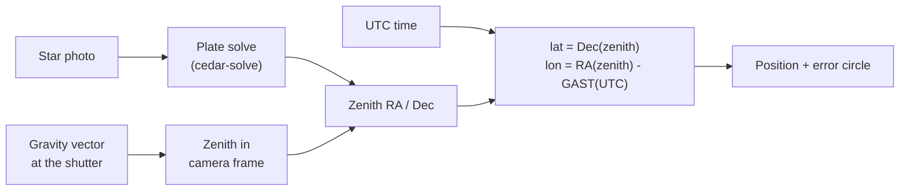
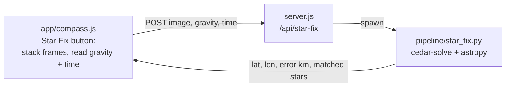

# Star Fix: find your position from a photo of the sky

Status: design evaluation, 2026-11-14. Nothing is built yet.

## 1. What a position fix needs

A sailor with a sextant needs three things. The app needs the same three things.

| Sailor had | App uses | Gives |
|---|---|---|
| Star almanac | Plate solver + Hipparcos catalogue | The sky direction (RA/Dec) of every pixel |
| Sextant (angle to the horizon) | Phone gravity sensor, or the horizon in the photo | Which direction is "up" (the zenith) |
| Chronometer | Phone clock (UTC) | How far the Earth turned |



If one of the three is missing, there is no fix.

## 2. Test on the four sample photos (`star_image/`)

I ran `cedar-solve` (an open-source fork of ESA tetra3) on the four photos. The default database covers a 10-30 deg field.
A phone frame is about 60-70 deg, so three photos solved only after a centre crop of 50 %.

| Photo | Input | Centre RA | Centre Dec | Field | Matched stars | False-match probability | Sky area |
|---|---|---|---|---|---|---|---|
| `1 (1).jpeg` | centre 50 % | 144.1 | -65.2 | 39 deg | 50 | 5e-75 | Carina |
| `1 (2).jpeg` | centre 50 % | 120.5 | -41.9 | 29 deg | 15 | 2e-7 | Puppis / Vela |
| `1 (3).jpeg` | full frame | 183.9 | -67.7 | 56 deg | 49 | 2e-72 | Crux / Musca |
| `1 (4).jpeg` | centre 50 % | 139.1 | -72.2 | 39 deg | 52 | 4e-80 | Carina |

Each solve took 0.1-6 s on a laptop. The fit error (RMSE) is 3-8 arcmin, which is good for a phone lens.

What these photos can tell about position:

- The files have no EXIF data: no time, no GPS, no camera model. A chat app probably removed it.
- Most photos show no horizon. `1 (2).jpeg` shows only some trees at one corner.
- So the photos give only one fact: a star at Dec -72 was above the horizon. Thus the camera was south of about 18 deg N.

Conclusion: plate solving works well on phone night photos. But a photo file alone is not enough for a fix.
The app must capture the time and the "up" direction at the moment of the photo.

## 3. Options

| Option | Time from | "Up" from | Expected error | Risk |
|---|---|---|---|---|
| A. Upload any photo | EXIF (often removed) | nothing | no fix, only a hemisphere band | Does not meet the goal |
| B. Upload photo, user marks the horizon line and types the time | user | horizon line in photo | 150-400 km | Horizon is often hidden. Lens distortion is largest at the edge, where the horizon is. |
| **C. Capture in Sky Compass** | phone clock | gravity sensor at the shutter | **50-150 km** | The browser camera stream shows fewer stars than night mode |

Recommendation: **build C, with B as the fallback** for photos that come from the native camera app.

Option C is a "bubble sextant": aircraft navigators used a bubble level instead of the sea horizon. The phone accelerometer is that bubble.
It does not use the magnetic compass, so the noise that `app/orient.js` describes does not affect it.

## 4. Error budget for option C

| Source | Typical size | Position error |
|---|---|---|
| Gravity tilt (phone held still, 1 s average) | 0.2-1 deg | 20-110 km |
| Camera axis vs. phone body | about 0.5 deg | about 55 km (calibrate once to remove) |
| Plate solve fit | 3-8 arcmin | 5-15 km |
| Phone clock | below 1 s | below 0.5 km |
| Precession, J2000 to date (if not corrected) | 0.36 deg | about 40 km. Correct it with astropy. |

So the honest claim is "within about 100 km". That is the accuracy of a good 18th-century navigator. GPS is 10 000 times better. Say this in the UI.

## 5. The main risk: enough stars in the browser camera

The native camera app uses night mode: many seconds of exposure and frame stacking. The sample photos come from night mode and show 170-660 stars.
A browser `getUserMedia` stream has short exposures and shows only bright stars.
The solver needs about 10 stars. At magnitude 3 a 60 deg field holds only about 10 stars.

Mitigation: stack 2-4 s of video frames in the page. `orient.js` already gives the gyro rotation, so the page can align the frames before it adds them.

Do a spike before any other work: one clear night, two phones (one iPhone, one Android).
Pass condition: the stacked frame solves 3 times out of 5. If it fails, ship option B only.

## 6. Where the code goes

Reuse the existing pattern of `/api/star-predict` and `/api/star-job/:id` in `server.js`.



- `app/compass.js`: add the button, the frame stack and the result map. Read "up" from `Orient` (beta and gamma only, no compass).
- `server.js`: add one route that spawns the Python job, the same way as `/api/star-predict`.
- `pipeline/star_fix.py`: solve with `return_rotation_matrix=True`, rotate the gravity vector into the sky frame, convert to latitude and longitude with astropy (`TETE` frame of date and GAST).
- `pipeline/requirements.txt`: add `cedar-solve`.
- Like the other live features, this needs `server.js`. A static host cannot run it.

Install notes from the test (Python 3.14, numpy 2):

- `pip install cedar-solve` fails on its Pillow pin. Install `numpy scipy pillow` first, then `pip install --no-deps cedar-solve`.
- `cedar-solve` still calls `np.math`. Add `import math; np.math = math` before you call the solver.
- Use the centre-crop retry (100 %, then 50 %) instead of building a wide-field database. Build a 30-70 deg database only if crops fail in the spike.

Do not use the astrometry.net web API. It needs an account, it is slow, and it sends a photo that reveals the user's location to a third party.

## 7. How to test

1. Math check (no camera): pick a known place and time. Compute the zenith, tilt a virtual camera, run the inverse, and assert that the result is within 1 km.
2. Solver check: the four sample photos must solve to the table in section 2.
3. Field check: take 5 fixes at a place with known GPS. Report the mean error in km.

## Appendix: the probe script

```python
import sys, glob, math
import numpy as np; np.math = math   # cedar-solve still calls np.math (removed in numpy 2)
from PIL import Image
import tetra3
t3 = tetra3.Tetra3()
for f in sorted(glob.glob(sys.argv[1] + '/*.jpeg')):
    full = Image.open(f).convert('L')
    for frac in (1.0, 0.5):   # whole frame, then centre crop so the field fits the 10-30 deg database
        w, h = full.size; cw, ch = int(w * frac), int(h * frac)
        img = full.crop(((w - cw) // 2, (h - ch) // 2, (w + cw) // 2, (h + ch) // 2))
        cents = tetra3.get_centroids_from_image(img, sigma=3, max_area=300, min_area=2)
        r = t3.solve_from_centroids(cents[:60], (img.height, img.width), solve_timeout=15000)
        print(f, frac, r.get('RA'), r.get('Dec'), r.get('FOV'), r.get('Matches'), r.get('Prob'))
        if r.get('RA') is not None:
            break
```
