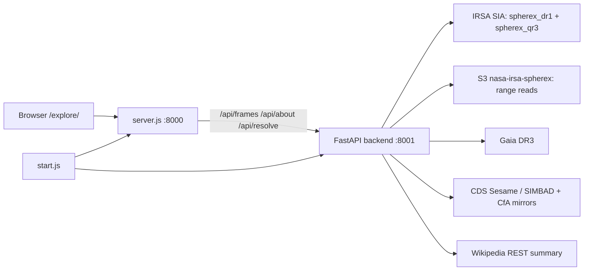

# Run record: live explorer, 2026-11-14

This run built the live "Explore any patch" mode of WANDERERS. A user types a name or RA/Dec. The tool fetches NASA SPHEREx images from IRSA, stacks one frame per survey, and shows a blink, a difference image, a motion ring and data panels. The run ended with all review seats at PASS and `main` pushed at `0df4049`.

## Goal

Build a public tool for the challenge: type RA/Dec, see SPHEREx images over time as a short video, and spot movers and blinkers. Then integrate it as a mode of the team's WANDERERS app.

## Shipped

- **Backend** (`backend/`): name and coordinate parsing; survey grouping; S3 section reads; SIP-WCS alignment north-up; stacks over the detectors that all frames share; difference image; proper-motion ring; FLAGS masking and saturation; centroids; photometry; Gaia DR3 ghosts; Lupton RGB; disk cache (7-day age, Windows-safe writes); `/api/about` and `/api/resolve`.
- **Frontend** (`web/`, served at `/explore/`): mission-control UI; URL state; one-press Back; motion, brightness, frames and quality panels; Aladin sky map; "Your sky now" sky dome; view looks (Raw, Smooth, Infrared colour, Realistic); candidate marking with "known?" checks; tutorial and field guide; "About this star" (3 sentences: catalog facts, our measurement, a dated history quote).
- **Boot:** `start.js` with `start.cmd` and `start.command`. It sets up both Python environments.
- **Docs:** `docs/blink/README.md`, `docs/blink/api.md`, `docs/demo-script.md`, and the worktree rule in `CLAUDE.md`.
- **Merge commits on main:** `1bcbc21` (feat/star-info), `1606bb4` (ops records), `0df4049` (origin/main before the push).

## Verify

| Command | Result |
|---|---|
| `backend/.venv/Scripts/python -m pytest backend -q` | 113 passed |
| `node --test test/*.test.js` | 173 pass, 1 skipped, 0 fail |
| `npm test` in `web/` | 62 passed |
| `npm run build` in `web/` | OK |
| Live through `server.js`: 4 aborted cold requests, then health and frames | 200 and 200, 0 `ERR_STREAM` lines |
| Stress walk through `server.js` | 9 PASS, 0 FAIL |
| Precompute on `main` | 7 entries, 0 failed images |

## Review

- Phase 1 + 2 of the first review: tech_lead PASS, project_manager PASS, user_advocate FAIL (stale panels while loading, #26).
- Fix round 2: tech_lead PASS, project_manager PASS, user_advocate FAIL (server crash on target switch, from the proxy fix `b18ce1d`).
- Fix round 3: tech_lead PASS, project_manager PASS, user_advocate PASS.
- Reports: `artifacts/review-*-explore-live.md`, `artifacts/review-*-star-info.md`, `artifacts/review-*-star-info-r3.md`.

## Architecture

The `finish-architecture` pass did not run in this run. It is a leftover. Top recommendation from the reviews: use one Python lookup for the whole app. There are four now (`pythonFor`, `pickPython`, `start.js`, `server.js`). See #27 and #18.

## Decisions

- Live data on request, plus a disk cache; no database (grilling, 2026-11-14).
- No LLM writes facts in the About card. History is quoted from Wikipedia with CC BY-SA credit.
- No flux estimate from the wings of saturated stars (#6).
- The early push at `fcc361d` (a reviewer agent pushed against its brief) is kept, with no revert (John).
- All work goes on branches in `.worktrees/`; agents never push (John).

## Leftovers

- Deferred lows: #47. Hosting and a named maintainer: #24. Scattered light: #5. Centroid pull and RGB channel gaps: #21.
- PR #19 was closed by its author without a merge. The Windows lookup in `fields.js` is not on `main`. `start.js` works around it (#18 comment).
- PR #20 waits for its author (2 high findings).
- `finish-architecture` pass: not run.

## Lessons

- Test the UI through `server.js`, not the Vite dev server. Vite bypasses the proxy, and that hid a server crash.
- Tell every agent "never git push", and check `main` against `origin` after each agent returns.
- In Git Bash, make and remove Windows junctions with a PowerShell script file. Inline `cmd` switches get mangled.

## Related

- [[index]]
