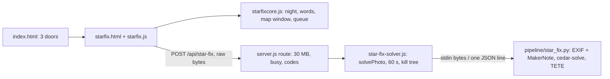

# Run record: Star Fix, 2026-11-15

This run built Star Fix. A person uploads original iPhone night-sky photos. The app finds where on Earth the photos were taken, from the stars, the phone's tilt and the photo time. It shows the place in words and on a map with an honest circle, and compares it with the phone's GPS. Branch `feature/star-fix`, pushed, last commit `94381d1`. It is not merged to `main`.

## Goal

Build the design in `docs/specs/star-fix-build.md` (written with a stronger model), with the owner's added asks: UX mechanics robustness (U1–U10) and a test of on-device compression with a quality check on the server.

## Shipped

- `pipeline/star_fix.py`: Pillow metadata (time, offset, Apple MakerNote gravity, the original orientation from pillow-heif), cedar-solve plate solve with centre crops, TAN refit at the picture centre, zenith → latitude and longitude in TETE. Solve gate: Matches ≥ 8, RMSE ≤ 300″, Prob ≤ 1e-8. `small_photo` warning below 1600 px. `bad_file` above 60 MP before decoding.
- `server.js` `POST /api/star-fix` (adapter: 30 MB limit, busy flag, status codes) and `star-fix-solver.js` `solvePhoto()` (spawn, stdin, 60 s limit, `taskkill /T` or process group, two kinds of 500). `PY = WANDERERS_PY || pickPython` closes #27.
- `app/starfixcore.js`: nights, median of unit vectors, radius, outliers, circle, nearest city, all user words, map window (16–40° from the radius and GPS distance), list default, photo queue.
- `app/starfix.html/.js/.css`: answer first, built-in Phillip Island example, no-server state, keyed in-place updates, Undo instead of confirm, drop state, aria-live progress.
- Home hero: three doors in one row from 1024 px (Observatory, Sky Compass, Star Fix). `start.js` installs `cedar-solve --no-deps`.

## Verify

- `.venv/Scripts/python.exe -m unittest discover -s tests -p "test_star_fix.py"` → OK (10 tests).
- `node --test test/*.test.js` → 325 tests, 324 pass, 0 fail, 1 skip (the same skip exists on the base commit).
- Browser (Playwright, 1280 and 390 px, both themes): the four `20260614_*` photos give "about 130 km south-east of Geelong, Australia", "Usually right to about 65 km", the GPS 61 km from the answer. CLS at 390 px is 0.003. Screenshots: `artifacts/star-fix/page-*.png`, `home-1280.png`.

## Findings

- **False solves exist.** A JPEG copy of `20260614_081100956` gave 15 matches and a 2800 km error: the right sky with the wrong scale and roll. The gate on Prob and RMSE removes it (test A17).
- **Compression is safe; browser HEIC decoding is not possible.** From 2048 px up, JPEG quality 0.4–0.92 moves the answer by only 1–2 km (`artifacts/star-fix/compress_test.py`). Chromium 156 on Windows cannot decode HEIC. Decision: keep the 30 MB limit; no on-device compression.

## Review

Two rounds, two-phase panel. Round 1: tech_lead, project_manager, user_advocate all PASS with mediums: map circle too small, doors stacked on laptops, U4 state reset, CLS 0.154. Fix round 1 plus a map span fix. Round 2: all three PASS, no high or medium. Reviews: `artifacts/review-*-star-fix.md`; UX evidence: `artifacts/star-fix/ux-review/`.

## Architecture

Report `artifacts/architecture/star-fix.html`. Implemented both candidates: (1, Top recommendation, Strong) deepen the night module, so the page only renders; (2, Worth exploring) the `solvePhoto()` seam, with a timeout test that checks the whole process tree is gone.

## Leftovers

- kneha07/WANDERERS#58: low findings ("0 photos used" for refused-only nights, silent refusal under a closed list, other install errors, the first-run time) and leftovers (orientation 3/8 photo tests, the 8 s Undo, the city choice for a large radius).
- kneha07/WANDERERS#57: the sample photos on public `main` hold exact GPS. This needs an owner decision.
- The circle is 2.5× the reticle at 608 px, not 3×. The test checks at least 2×.
- Merge `feature/star-fix` to `main` through a reviewed PR.
